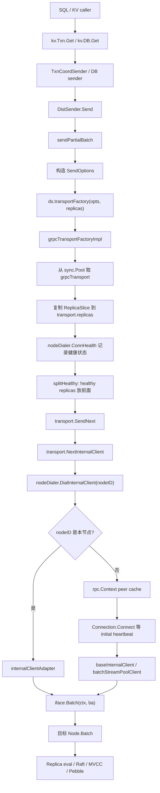
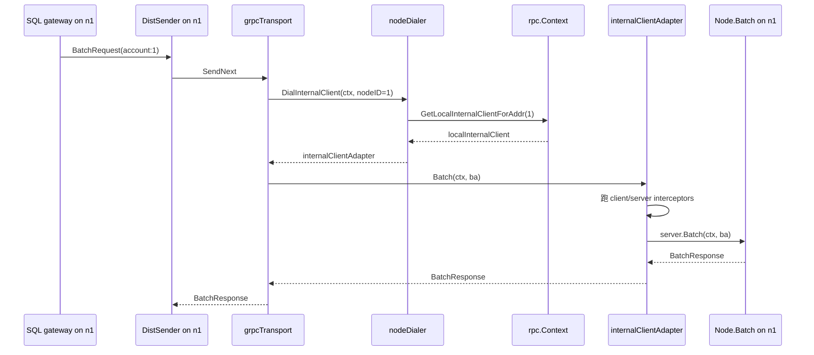
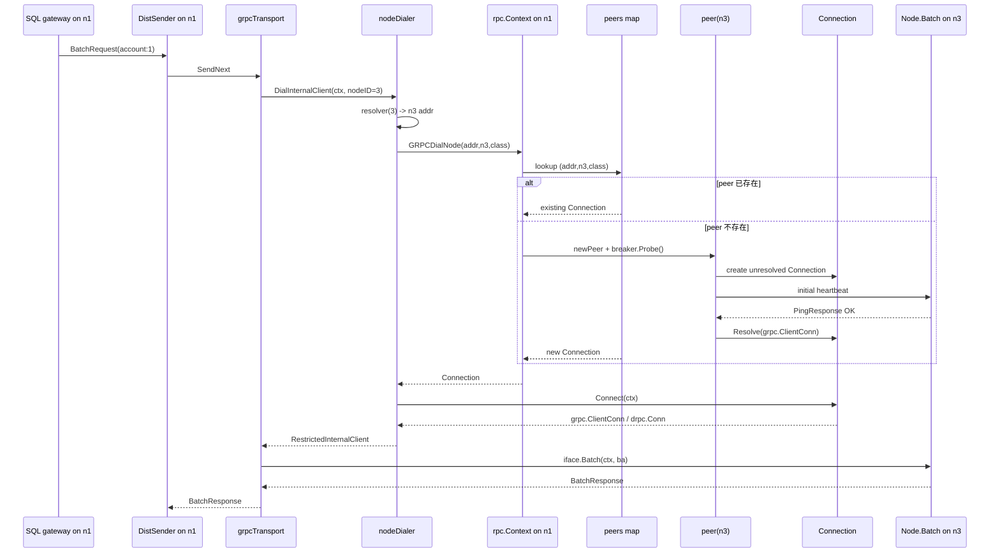

# DistSender客户端复用、连接健康与本地绕过网络机制深度剖析

## 一、第一轮 BFS：先建立职责边界（Why）

### 1.1 先回答核心问题：这里到底复用了什么

在 CockroachDB 的 KV 请求路径里，`DistSender` 最终要把一个 `BatchRequest` 发到某个 range replica，通常是 leaseholder。你前面问到的几个点：

```text
client 复用
连接健康
本地绕过网络
如果 gateway node 自己就是 leaseholder，会不会直接本地走
如果不是自己，怎么找连接、怎么判断健康
```

它们不是一个单点逻辑，而是分散在三层里：

```text
DistSender / grpcTransport
  负责“这次请求准备试哪些 replicas、按什么顺序试、怎么拿 client 发送”。

nodedialer.Dialer
  负责“给 nodeID 找到 RestrictedInternalClient”。

rpc.Context / peer / Connection
  负责“连接缓存、heartbeat、circuit breaker、loopback dial、本地 internal client”。
```

最重要的结论是：

```text
grpcTransport 不是长期持有网络连接的地方。
grpcTransport 是一次发送流程里的短生命周期 transport 对象。

真正长期复用的网络连接在 rpc.Context.peers / rpc.Context.drpcPeers 里。
key 是 (target address, nodeID, connection class)。

如果目标 nodeID 是本节点，KV Batch 热路径优先返回 internalClientAdapter，
这个路径不拿 grpc.ClientConn，也不走 TCP，也不做 protobuf 序列化。
```

可以把它理解成三种复用：

```text
1. transport 对象复用
   sync.Pool 复用 grpcTransport 结构体和 replicas slice backing array。

2. RPC connection 复用
   rpc.Context.peers 缓存 peer，peer 里有 Connection，Connection 包住 grpc.ClientConn / drpc.Conn。

3. Batch stream 复用
   在开启 rpc.batch_stream_pool.enabled 时，Batch RPC 不一定走普通 unary RPC，
   而是复用 BatchStream 上的 pooled stream。
```

### 1.2 请求在系统中的位置

一个 SQL 请求打到 node 1，假设它读写 `account:1`：

```text
SQL client
  -> node 1 SQL gateway
  -> kv.Txn / TxnCoordSender
  -> DistSender
  -> Transport
  -> nodeDialer
  -> rpc.Context
  -> 目标 range leaseholder
  -> Replica evaluation
  -> Raft / MVCC / Pebble
```

这里的“gateway”指的是接收 SQL / KV client 请求的 CockroachDB 节点，不一定是 range 的 leaseholder。

如果 `account:1` 所在 range 的 leaseholder 也在 node 1：

```text
node 1 gateway
  -> node 1 DistSender
  -> nodeDialer.DialInternalClient(nodeID=1)
  -> rpc.Context.GetLocalInternalClientForAddr(1)
  -> internalClientAdapter.Batch()
  -> 本进程里的 Node.Batch()
```

如果 leaseholder 在 node 3：

```text
node 1 gateway
  -> node 1 DistSender
  -> nodeDialer.DialInternalClient(nodeID=3)
  -> rpc.Context.GRPCDialNode / DRPCDialNode
  -> 复用或创建到 node 3 的 Connection
  -> RestrictedInternalClient.Batch()
  -> 网络 RPC 到 node 3
  -> node 3 Node.Batch()
```

所以你之前理解的这句话基本是对的，但要补一个关键区别：

```text
前置的 DistSender / transport 流程基本一致。
区别发生在 nodeDialer 拿 client 的时候：

目标是自己：
  直接返回 internalClientAdapter，热路径完全绕过网络和 grpc.ClientConn。

目标是别人：
  从 rpc.Context 的 peer map 里复用连接，或者创建 peer 并等 heartbeat 验证通过。
```

### 1.3 关键源码入口

| 模块 | 关键源码 | 作用 |
| --- | --- | --- |
| `DistSender` 创建 transport | `pkg/kv/kvclient/kvcoord/dist_sender.go:2799` | 普通 range 请求为一组 replicas 创建 transport |
| proxy 转发创建 transport | `pkg/kv/kvclient/kvcoord/dist_sender.go:1528` | proxy request 只为目标 leaseholder 创建单 replica transport |
| transport 抽象 | `pkg/kv/kvclient/kvcoord/transport.go:49` | 屏蔽底层 RPC/client 管理 |
| 默认 transport 工厂 | `pkg/kv/kvclient/kvcoord/transport_regular.go:12` | `GRPCTransportFactory` |
| transport 实现 | `pkg/kv/kvclient/kvcoord/transport.go:105` | `grpcTransportFactoryImpl` |
| 发送到下一个 replica | `pkg/kv/kvclient/kvcoord/transport.go:181` | `grpcTransport.SendNext` |
| 根据 nodeID 拿 client | `pkg/rpc/nodedialer/nodedialer.go:151` | `DialInternalClient` |
| 本地 internal client | `pkg/rpc/context.go:695` | `GetLocalInternalClientForAddr` |
| 设置本地 server | `pkg/rpc/context.go:1363` | `SetLocalInternalServer` |
| 连接缓存 | `pkg/rpc/context.go:2250` | `grpcDialNodeInternal` |
| peer / heartbeat | `pkg/rpc/peer.go:90` | `peer` 管连接健康 |
| Connection | `pkg/rpc/connection.go:59` | 包住真实 gRPC/DRPC connection |
| stream pool | `pkg/rpc/stream_pool.go:192` | 复用 `BatchStream` |

---

## 二、第二轮 BFS：完整控制流（How it flows）

### 2.1 普通请求的主路径

以一次 `Get(account:1)` 为例：



这里有两个容易混淆的地方：

```text
grpcTransportFactoryImpl 每次发送都会创建/复用一个 transport 对象。
但它不会每次都新建网络连接。

nodeDialer.DialInternalClient 每次发送都会被调用。
但远程路径里 rpc.Context.GRPCDialNode 会先查 peer map，
有缓存 peer 时直接复用 Connection。
```

### 2.2 本地 leaseholder 的路径

假设：

```text
node 1 是 SQL gateway
range r42 的 leaseholder 也在 node 1
```

路径是：



这个路径不经过：

```text
net.Dial
TCP
grpc.ClientConn
protobuf serialize/deserialize
远程 tracing span import
```

但它仍然保留：

```text
client interceptors
server interceptors
tenant identity
admission source 标记
tracing 语义
context cancel
```

### 2.3 远程 leaseholder 的路径

假设：

```text
node 1 是 SQL gateway
range r42 的 leaseholder 在 node 3
```

路径是：



这里“client 复用”的关键点是：

```text
第二次、第三次、第一万次发到 node 3：
  rpc.Context.GRPCDialNode(addr,n3,class)
  -> peer map 命中
  -> 返回已有 Connection
  -> Connection.Connect 直接拿已经 heartbeat 通过的 grpc.ClientConn
```

### 2.4 连接健康影响 replica 顺序

`grpcTransportFactoryImpl` 创建 transport 时，会对每个 replica 做一次健康查询：

```text
healthy := nodeDialer.ConnHealth(r.NodeID, opts.class) == nil
```

然后默认调用 `splitHealthy()`：

```text
已知健康的 replica 排前面
已知不健康 / 没连过 / breaker open 的 replica 排后面
原来的相对顺序保持稳定
```

假设某 range 有三个 replicas：

```text
replicas 原始顺序：
  n2, n3, n4

连接健康：
  n2 unhealthy
  n3 healthy
  n4 healthy

transport 内部顺序变成：
  n3, n4, n2
```

这不是强一致性语义，只是发送策略优化：

```text
健康排序不会决定谁是 leaseholder。
leaseholder 仍由 RangeDescriptor / Lease 信息和后续响应处理决定。

健康排序只是减少“明知连接不健康还先撞上去”的概率。
```

---

## 三、DFS 深入：关键对象与真实实现

### 3.1 `TransportFactory`：把 DistSender 和 RPC 子系统隔开

源码在 `pkg/kv/kvclient/kvcoord/transport.go:42`：

```go
type TransportFactory func(SendOptions, ReplicaSlice) Transport
```

它的职责是：

```text
输入：
  - SendOptions：connection class、metrics、是否考虑连接健康
  - ReplicaSlice：这次请求准备尝试的 replicas

输出：
  - Transport：可以按顺序给这些 replicas 发请求
```

为什么要抽象出 `TransportFactory`？

```text
1. DistSender 不直接依赖 gRPC / DRPC 细节。
2. 测试里可以替换成 fake transport。
3. 普通请求、proxy 请求、rangefeed、circuit breaker 探测都能复用同一套发送抽象。
```

生产默认实现是：

```text
GRPCTransportFactory(nodeDialer)
  -> grpcTransportFactoryImpl(opts, nodeDialer, replicas)
```

注意名字叫 `GRPCTransportFactory`，但当前实现里 `nodeDialer.DialInternalClient` 内部可能选择 gRPC 或 DRPC：

```text
rpcbase.DRPCEnabled == false:
  使用 gRPC

rpcbase.DRPCEnabled == true:
  使用 DRPC
```

所以从 DistSender 看，它拿到的只是 `RestrictedInternalClient`，不关心底层是 gRPC 还是 DRPC。

### 3.2 `grpcTransportFactoryImpl`：短生命周期 transport 复用

源码在 `pkg/kv/kvclient/kvcoord/transport.go:105`。

它做的事情可以拆成五步：

```text
1. 从 sync.Pool 里拿一个 *grpcTransport。
2. 复用旧 grpcTransport.replicas 的 backing array。
3. 把调用方给的 ReplicaSlice 复制成 []ReplicaDescriptor。
4. 对每个 replica 查询连接健康状态。
5. 默认把 healthy replica 稳定排序到前面。
```

伪代码：

```go
transport := grpcTransportPool.Get().(*grpcTransport)

replicas := transport.replicas
if cap(replicas) < len(rs) {
    replicas = make([]roachpb.ReplicaDescriptor, len(rs))
} else {
    replicas = replicas[:len(rs)]
}

for i := range rs {
    replicas[i] = rs[i].ReplicaDescriptor
    healthy := nodeDialer.ConnHealth(rs[i].NodeID, opts.class) == nil
    recordHealth(i, healthy)
}

transport.replicas = replicas

if !opts.dontConsiderConnHealth {
    transport.splitHealthy()
}
```

这里的复用很轻量：

```text
复用的是 grpcTransport 结构体。
复用的是 replicas slice 的底层数组。

不复用用户请求 BatchRequest。
不复用 BatchResponse。
不在这里复用 grpc.ClientConn。
```

`Release()` 在 `pkg/kv/kvclient/kvcoord/transport.go:166`：

```go
func (gt *grpcTransport) Release() {
    *gt = grpcTransport{
        replicas: gt.replicas[0:],
    }
    grpcTransportPool.Put(gt)
}
```

这里有个细节：

```text
Release 把大多数字段清空，但保留 replicas slice。
下一次 Get 出来时，如果新请求 replica 数量不超过 cap(replicas)，就不用重新分配数组。
```

这是一种对象池优化，不是连接池。

### 3.3 `splitHealthy`：健康连接优先，但不改变语义

健康状态来自：

```text
nodeDialer.ConnHealth(nodeID, class)
  -> resolver(nodeID) 得到 addr
  -> rpc.Context.ConnHealth(addr,nodeID,class)
  -> peer map 查 Connection
  -> Connection.Health()
```

`Connection.Health()` 的语义：

```text
nil:
  有连接，并且最近一次 heartbeat 成功。

ErrNotHeartbeated:
  peer 不存在，或者刚创建但 initial heartbeat 还没完成。

circuit breaker error:
  breaker 已经打开，最近 heartbeat 失败。

其它 error:
  resolver / 状态异常。
```

本地节点特殊处理：

```text
rpc.Context.ConnHealth:
  如果 GetLocalInternalClientForAddr(nodeID) != nil，直接认为 healthy。
```

所以本地 replica 在健康排序里天然是健康的。

真实例子：

```text
gateway = n1
range r42 replicas = [n1, n2, n3]
leaseholder hint = n2

连接健康：
  n1 本地 => healthy
  n2 breaker open => unhealthy
  n3 healthy

如果 DistSender 原始排序是 [n2, n1, n3]
splitHealthy 后可能是 [n1, n3, n2]
```

但这不表示 n1 就能成功执行写请求。因为如果 n1 不是 leaseholder，它可能返回 leaseholder 信息或者触发重路由。

健康排序解决的是：

```text
先不要撞向连接明显坏掉的节点。
```

它不解决：

```text
谁拥有 lease。
range descriptor 是否过期。
请求是否会遇到 WriteTooOld / retryable error。
```

### 3.4 `SendNext`：消费一个 replica，并拿 client 发 Batch

源码在 `pkg/kv/kvclient/kvcoord/transport.go:181`：

```go
func (gt *grpcTransport) SendNext(ctx context.Context, ba *kvpb.BatchRequest) (*kvpb.BatchResponse, error) {
    r := gt.replicas[gt.nextReplicaIdx]
    iface, err := gt.NextInternalClient(ctx)
    if err != nil {
        return nil, err
    }
    return gt.sendBatch(ctx, r.NodeID, iface, ba)
}
```

`NextInternalClient` 在 `pkg/kv/kvclient/kvcoord/transport.go:261`：

```go
r := gt.replicas[gt.nextReplicaIdx]
gt.nextReplicaIdx++
return gt.nodeDialer.DialInternalClient(ctx, r.NodeID, gt.class)
```

注意顺序：

```text
1. SendNext 先记住当前要发的 replica。
2. NextInternalClient 根据这个 replica 的 nodeID 拿 client。
3. nextReplicaIdx 自增，表示这个 replica 已经被尝试。
4. sendBatch 真正调用 iface.Batch。
```

这就是为什么 `Transport` 不要求线程安全：

```text
nextReplicaIdx 是普通 int。
DistSender 在一个发送流程里串行调用它。
```

`sendBatch` 在 `pkg/kv/kvclient/kvcoord/transport.go:193`，核心逻辑是：

```text
1. 如果 ctx 已经取消，提前返回。
2. 增加 SentCount。
3. 如果 rpc.IsLocal(iface)，增加 LocalSentCount。
4. 调用 iface.Batch(ctx, ba)。
5. 如果是远程响应并携带 CollectedSpans，把远程 trace import 到本地 span。
6. 包装 RPC error 返回。
```

所以真正的 RPC / 本地调用边界就在：

```go
reply, err := iface.Batch(ctx, ba)
```

`iface` 是什么，完全取决于 `nodeDialer.DialInternalClient`。

### 3.5 `nodeDialer.DialInternalClient`：本地优先，否则远程连接

源码在 `pkg/rpc/nodedialer/nodedialer.go:151`。

第一步就是本地 fast path：

```go
localClient := n.rpcContext.GetLocalInternalClientForAddr(nodeID)
if localClient != nil && !TestingNoLocalClientOptimization {
    return localClient, nil
}
```

`GetLocalInternalClientForAddr` 在 `pkg/rpc/context.go:695`：

```go
if nodeID == rpcCtx.NodeID.Get() {
    return rpcCtx.localInternalClient
}
return nil
```

也就是说：

```text
如果目标 nodeID == 当前节点 nodeID，并且本节点注册了 localInternalClient，
就直接返回 internalClientAdapter。
```

只有不是本地节点，才会继续走远程路径：

```text
if !DRPCEnabled:
  dial(ctx, resolver, rpcContext.GRPCDialNode, nodeID, class, checkBreaker=true)
  client = newBaseInternalClient(grpc.ClientConn)
  如果开启 batch stream pool，client = newBatchStreamPoolClient(conn.BatchStreamPool())

else:
  dial(ctx, resolver, rpcContext.DRPCDialNode, nodeID, class, checkBreaker=true)
  client = unaryDRPCBatchServiceToInternalAdapter
```

最后可能包一层 tracing client：

```text
maybeWrapInTracingClient(ctx, client)
```

但源码明确说：

```text
tracingInternalClient 不包 internalClientAdapter。
本地 RPC 不需要这层远程 trace 注入。
```

### 3.6 `baseInternalClient`：每次 New adapter 不是每次新连接

`baseInternalClient` 在 `pkg/rpc/nodedialer/nodedialer.go:341`：

```go
type baseInternalClient grpc.ClientConn

func (c *baseInternalClient) Batch(ctx context.Context, ba *kvpb.BatchRequest) (*kvpb.BatchResponse, error) {
    return kvpb.NewGRPCInternalClientAdapter(c.asConn()).Batch(ctx, ba)
}
```

这里容易误解：

```text
每次 Batch 都调用 NewGRPCInternalClientAdapter，
是不是每次都新建 client / 新建连接？
```

不是。

`NewGRPCInternalClientAdapter(c.asConn())` 只是把已有的 `*grpc.ClientConn` 包成生成代码里的 typed client。这个 wrapper 很轻，源码注释也说这样可以 inline，避免 wrapper 分配到堆上。

真正重的连接是：

```text
*grpc.ClientConn
```

它来自 `rpc.Context` 缓存的 `Connection`，不是这里新建。

### 3.7 `rpc.Context` 的 peer map：真正的连接缓存

`rpc.Context` 有两个 map：

```go
peers     peerMap[*grpc.ClientConn]
drpcPeers peerMap[drpc.Conn]
```

key 是 `peerKey`，源码在 `pkg/rpc/peer_map.go:18`：

```go
type peerKey struct {
    TargetAddr string
    NodeID     roachpb.NodeID
    Class      rpcbase.ConnectionClass
}
```

这说明连接缓存不是简单按 nodeID，也不是简单按地址，而是按三元组：

```text
(目标地址, 目标 nodeID, connection class)
```

为什么要带 `NodeID`？

```text
地址可能复用。
例如 k8s 里一个地址后来指向了另一个节点，或者节点重启换地址。
带 nodeID 可以在 heartbeat 里校验“我连到的真是我要的 node”。
```

为什么要带 `ConnectionClass`？

```text
不同请求类别可能需要不同连接：
  - DefaultClass
  - SystemClass
  - rangefeed / admission 相关 class

它们可能有不同优先级、监控、限流和隔离语义。
```

`grpcDialNodeInternal` 在 `pkg/rpc/context.go:2250`：

```go
k := peerKey{TargetAddr: target, NodeID: remoteNodeID, Class: class}
if p, ok := rpcCtx.peers.get(k); ok {
    return p.c
}

return rpcDialNodeInternal(rpcCtx, k, newGRPCPeerOptions(...))
```

如果 map 命中，就直接返回已有 `Connection`。

如果没命中，走 `rpcDialNodeInternal`：

```text
1. 对 peer map 加锁。
2. 再查一次，避免并发创建重复 peer。
3. newPeer。
4. p.b.Probe() 启动 heartbeat probe。
5. 放入 map。
6. 返回 peer 当前的 Connection。
```

这就是连接复用的核心。

### 3.8 `Connection`：连接必须先 heartbeat 验证通过

`Connection` 在 `pkg/rpc/connection.go:59`：

```text
Connection 包住 grpc.ClientConn / drpc.Conn。
它不允许调用方直接使用一个“还没验证过”的连接。
```

关键字段：

```text
connFuture:
  initial heartbeat 成功后才 Resolve(conn,nil)。
  如果 initial heartbeat 失败，则 Resolve(nil,err)。

batchStreamPool:
  绑定在已经验证过的 connection 上，用来复用 BatchStream。
```

`Connect(ctx)`：

```text
等 connFuture ready。
同时监听 circuit breaker signal。
如果 breaker 已经打开，快速返回错误。
```

`Health()`：

```text
返回最近一次 heartbeat 的健康状态。
如果还没有 heartbeat 完成，返回 ErrNotHeartbeated。
```

所以远程请求第一次连 node 3 时，可能发生：

```text
DistSender 请求需要发到 n3
  -> nodeDialer 调 GRPCDialNode
  -> rpc.Context 创建 peer
  -> peer probe 建立 grpc.ClientConn
  -> peer 发送 initial heartbeat
  -> heartbeat 校验成功
  -> connFuture Resolve
  -> Connect 返回 grpc.ClientConn
  -> Batch RPC 才能发出去
```

### 3.9 `peer`：heartbeat loop + circuit breaker

`peer` 在 `pkg/rpc/peer.go:90`。它代表：

```text
当前节点到某个远端节点、某个 connection class 的一条逻辑连接状态。
```

它维护：

```text
1. Connection
2. breaker
3. peer status metrics
4. heartbeat loop
5. connected / disconnected 时间
6. 是否可以删除 stale peer
```

高层流程在源码注释里也写得很清楚：

```text
run
  -> runOnce
     -> 创建新的 grpc.ClientConn / drpc.Conn
     -> runSingleHeartbeat 初始 heartbeat
     -> onInitialHeartbeatSucceeded
     -> runHeartbeatUntilFailure
  -> onHeartbeatFailed
  -> 重新创建新的 Connection
  -> 下一轮 runOnce
```

initial heartbeat 成功时，`onInitialHeartbeatSucceeded` 做三件关键事：

```text
1. report(nil)，让 circuit breaker 进入健康状态。
2. batchStreamPool.Bind(ctx, cc)，把 stream pool 绑定到真实连接。
3. connFuture.Resolve(cc, nil)，唤醒正在 Connect() 等待的请求。
```

heartbeat 失败时，`onHeartbeatFailed` 做几件关键事：

```text
1. 如果 connFuture 还没 resolve，resolve 成错误，避免调用方永远阻塞。
2. 关闭 batchStreamPool。
3. report(err)，让 circuit breaker 打开。
4. 更新 disconnected / unhealthy metrics。
5. 之后 run() 会创建新的 Connection，准备重新拨号。
```

所以连接健康不是“发请求时临时 ping 一下”。

它是一个后台状态机持续维护：

```text
健康：
  Batch 请求可以复用连接。

不健康：
  Connection.Health 返回错误。
  TransportFactory 会把该 replica 排后。
  Connection.Connect 会被 breaker 快速拒绝，避免大量请求堆到坏连接上。
```

### 3.10 `onlyOnceDialer`：不让 gRPC 偷偷重连

源码在 `pkg/rpc/context.go:1854`。

普通 gRPC `ClientConn` 有自己的 reconnect 机制。但 CockroachDB 不希望 gRPC 悄悄重连，因为重连后需要重新做：

```text
nodeID 校验
cluster/version 校验
clock offset 更新
dialback 检查
metrics 状态更新
```

源码注释里的真实风险是：

```text
n2 连到 n1@ip1
n1 停掉
这个地址后来变成另一个节点或另一个老版本 binary
gRPC 如果透明重连，n2 可能一段时间内还以为自己在跟原来的 n1 通信
```

所以 CockroachDB 用 `onlyOnceDialer`：

```text
一个底层连接只允许一次真正 dial。
连接断了以后，让 peer heartbeat loop 感知失败。
由 peer 创建新的 Connection，并重新跑 initial heartbeat。
```

这让连接生命周期掌握在 CockroachDB 自己的 peer/breaker 状态机里，而不是交给 gRPC 黑盒重连。

### 3.11 BatchStream pool：复用 stream，降低 unary RPC 成本

`nodeDialer` 里有一个开关：

```text
rpc.batch_stream_pool.enabled
```

源码在 `pkg/rpc/nodedialer/nodedialer.go:370`。

开启时，远程 Batch 请求可能不使用普通 unary RPC：

```text
baseInternalClient.Batch
  -> unary Batch RPC

batchStreamPoolClient.Batch
  -> streamPool.Send
  -> 复用 BatchStream
```

`streamPool` 在 `pkg/rpc/stream_pool.go:192`，它的思想是：

```text
普通 unary RPC：
  每次请求创建一个 stream，用完丢掉。

BatchStream pool：
  创建一批长一点生命周期的 BatchStream。
  每次请求从 pool 里拿一个 pooledStream。
  Send 一个 BatchRequest。
  Recv 一个 BatchResponse。
  用完后放回 pool。
```

伪代码：

```go
func (p *streamPool) Send(ctx, req) (resp, err) {
    s := p.get()
    if s == nil {
        s = p.newPooledStream()
    }
    defer p.putIfNotClosed(s)
    return s.Send(ctx, req)
}
```

注意这里又是一层复用：

```text
Connection 复用：
  复用 grpc.ClientConn / drpc.Conn。

Stream pool 复用：
  在同一个 connection 上复用 BatchStream。
```

如果连接坏了：

```text
peer.onHeartbeatFailed
  -> batchStreamPool.Close()
```

旧 stream pool 被关闭，下一次健康连接建立后重新绑定新的 pool。

### 3.12 `internalClientAdapter`：本地 KV Batch 热路径完全绕过网络

`rpc.Context.SetLocalInternalServer` 在 `pkg/rpc/context.go:1363`。

它把本进程里的 `kvpb.InternalServer` 注册进 `rpc.Context`：

```text
rpcCtx.localInternalClient = makeInternalClientAdapter(internalServer, ...)
```

`internalClientAdapter` 在 `pkg/rpc/context.go:704`。它实现了：

```text
RestrictedInternalClient
  - Batch
  - MuxRangeFeed
```

它的核心目标：

```text
让本节点对自己的 Internal RPC 看起来像正常 RPC，
但实际用本地函数调用执行。
```

`Batch` 路径大概是：

```text
internalClientAdapter.Batch(ctx, ba)
  -> ba.ShallowCopy()
  -> ba.AdmissionHeader.SourceLocation = LOCAL
  -> grpcutil.NewLocalRequestContext(ctx, tenantID)
  -> grpcutil.ClearIncomingContext(ctx)
  -> client unary interceptors
  -> server unary interceptors
  -> server.Batch(ctx, ba)
```

这里绕过的是：

```text
网络 socket
TCP
grpc.ClientConn
protobuf encode/decode
远程 transport
```

但没有绕过：

```text
interceptors
tenant identity
tracing 语义
admission source 标记
server.Batch 的真实执行逻辑
```

为什么不能直接 `server.Batch(ctx, ba)`？

因为这样会跳过很多 RPC 层语义：

```text
认证 / 租户上下文
tracing
metrics / interceptors
本地请求标记
incoming metadata 清理
```

CockroachDB 想要的是：

```text
性能像本地函数调用。
行为像一次正常内部 RPC。
```

`internalClientAdapter` 就是这个折中。

### 3.13 loopback dialer：另一种“本地绕过 TCP”，不要和 internalClientAdapter 混淆

`rpc.Context` 里还有 `loopbackDialFn`，源码注释在 `pkg/rpc/context.go:261`。

它解决的是另一个问题：

```text
当目标 address == 自己的 AdvertiseAddr 时，
普通 gRPC/DRPC dial 可以用内存 pipe 绕过 OS TCP stack。
```

这和 `internalClientAdapter` 是两套机制。

对比：

| 机制 | 用在哪里 | 是否走 gRPC/DRPC 协议 | 是否走 TCP | 是否走 protobuf 序列化 | 主要目的 |
| --- | --- | --- | --- | --- | --- |
| `internalClientAdapter` | KV Batch 热路径的 `RestrictedInternalClient` | 不完整走，模拟 interceptors | 不走 | 不走远程序列化 | 高性能本地函数调用 |
| `loopbackDialFn` | 普通 gRPC/DRPC self-dial | 走 | 不走 OS TCP | 走 | 保证 self-dial 可靠，绕过 DNS/firewall/TCP 端口问题 |

源码注释明确说：

```text
loopbackDialFn 和 RestrictedInternalClient 的本地优化是独立机制。
RestrictedInternalClient 是 KV Batch hot path 的更激进优化。
loopbackDialFn 是普通 gRPC 协议跑在内存 pipe 上。
```

真实例子：

```text
某个组件不是通过 nodeDialer.DialInternalClient 拿 RestrictedInternalClient，
而是正常 GRPCDialNode 拨自己的 AdvertiseAddr。

这时不会用 internalClientAdapter。
但 grpcDialRaw 发现 target == AdvertiseAddr，
会选择 loopbackTransport，
底层 net.Conn 来自 loopbackDialFn，而不是 TCP dial。
```

---

## 四、运行时例子：把抽象落到具体场景

### 4.1 场景一：gateway 就是 leaseholder

假设：

```text
node 1 收到 SQL：
  SELECT * FROM accounts WHERE id = 1;

accounts:1 所在 range:
  r42 replicas = [n1, n2, n3]
  leaseholder = n1
```

执行路径：

```text
DistSender 创建 transport:
  replicas 里包含 n1/n2/n3

transport.SendNext:
  当前目标 n1

nodeDialer.DialInternalClient(n1):
  nodeID == rpcCtx.NodeID.Get()
  返回 localInternalClient

sendBatch:
  rpc.IsLocal(iface) == true
  LocalSentCount +1
  iface.Batch(ctx, ba)

internalClientAdapter.Batch:
  本地调用 Node.Batch
```

这时不需要问：

```text
“n1 怎么知道自己连得上 n1？”
```

因为它根本不是远程连接问题。它直接拿本进程注册好的 `localInternalClient`。

### 4.2 场景二：gateway 不是 leaseholder，但已有健康连接

假设：

```text
node 1 是 gateway
range r42 leaseholder = node 3
node 1 之前已经和 node 3 通过 heartbeat
```

执行路径：

```text
nodeDialer.DialInternalClient(n3)
  -> resolver(n3) = 10.0.0.3:26257
  -> rpc.Context.GRPCDialNode("10.0.0.3:26257", n3, class)
  -> peers.get(peerKey{10.0.0.3:26257,n3,class}) 命中
  -> Connection.Connect(ctx)
  -> connFuture 已经 resolved
  -> 直接返回 grpc.ClientConn
  -> Batch RPC 发出
```

这里没有重新建 TCP 连接。

每次请求都会重新走 `DialInternalClient`，但它是“拿 client”的入口，不等于“每次重新拨号”。

### 4.3 场景三：第一次连远程节点

假设 node 1 第一次需要发到 node 4：

```text
peers map 里没有 (n4 addr,n4,class)
```

路径：

```text
GRPCDialNode
  -> peer map miss
  -> newPeer
  -> breaker.Probe()
  -> peer.runOnce
  -> grpcDialRaw
  -> runSingleHeartbeat(PingRequest_BLOCKING)
  -> heartbeat OK
  -> onInitialHeartbeatSucceeded
  -> connFuture.Resolve(grpc.ClientConn,nil)
  -> Connect 返回
```

如果 initial heartbeat 失败：

```text
connFuture.Resolve(nil, err)
Connection.Connect 返回 err
DistSender 这次发送失败，后续按错误类型决定是否尝试其它 replica / 刷新 range cache。
```

### 4.4 场景四：一个 replica 连接不健康

假设：

```text
range r42 replicas = [n2, n3, n4]

node 1 到各节点连接状态：
  n2: breaker open
  n3: healthy
  n4: ErrNotHeartbeated
```

`grpcTransportFactoryImpl` 会记录：

```text
n2 unhealthy
n3 healthy
n4 unhealthy
```

排序后：

```text
[n3, n2, n4]
```

因为排序是 stable 的，所以同为 unhealthy 的 n2 和 n4 会保持原始相对顺序；它只保证 healthy replica 被移动到前面。

这样做的收益：

```text
如果 n3 可以服务请求，就避免先撞 n2 的 breaker。
如果 n3 不是 leaseholder，它可能返回正确 leaseholder 信息，DistSender 再移动目标。
```

### 4.5 场景五：连接中途断了

假设：

```text
n1 到 n3 的连接一开始 healthy。
后来 n3 重启或网络断开。
```

后台 heartbeat loop 会发现：

```text
runHeartbeatUntilFailure
  -> runSingleHeartbeat 失败
  -> onHeartbeatFailed
  -> breaker report(err)
  -> ConnectionHealth 变 unhealthy
  -> batchStreamPool.Close()
  -> 下一轮 runOnce 尝试重连
```

这时新的请求到来：

```text
ConnHealth(n3) 返回 breaker error
transportFactory 把 n3 排后

如果仍然必须发到 n3：
  Connection.Connect 可能直接被 breaker 拒绝
```

这可以避免高并发请求把大量 goroutine 堆在坏连接上。

### 4.6 场景六：proxy request 只是转发一次

你前面问过 proxy request。

假设：

```text
n1 是原始 gateway
n1 想发到 n3 leaseholder
但 n1 -> n3 网络不通
n1 -> n2 通
n2 -> n3 通
```

普通请求可以尝试通过 n2 proxy：

```text
n1 构造带 ProxyRangeInfo 的 BatchRequest
n1 发给 n2
n2 的 DistSender.sendProxyRequest
  -> 只构造一个包含 n3 leaseholder 的 transport
  -> requestToSend.ProxyRangeInfo = nil
  -> transport.SendNext 发到 n3
```

这里 n2 怎么知道自己连得上 n3？

```text
它不是提前保证。
它用自己的 nodeDialer / rpc.Context 去拿到 n3 的连接。
如果 n2 到 n3 的 peer healthy，就能发。
如果不 healthy，sendProxyRequest 返回错误给 n1。
```

proxy 节点不会再做多跳代理：

```text
requestToSend.ProxyRangeInfo = nil
```

这避免：

```text
n1 -> n2 -> n4 -> n5 -> ...
```

这种无限转发链。

---

## 五、设计模式分析

### 5.1 Factory Pattern：TransportFactory

`DistSender` 不直接 new gRPC client，而是通过：

```text
TransportFactory(SendOptions, ReplicaSlice) Transport
```

这样有几个好处：

```text
1. 生产环境用 grpcTransport。
2. 测试可以注入 fake transport，模拟 RPC error / ambiguous result / 延迟。
3. DistSender 的路由逻辑和 RPC 连接逻辑解耦。
```

### 5.2 Object Pool Pattern：grpcTransportPool

`grpcTransport` 是短生命周期对象。高并发 KV 请求下，如果每次都分配：

```text
grpcTransport
[]ReplicaDescriptor
health map 相关状态
```

会给 GC 制造压力。

所以使用：

```go
var grpcTransportPool = sync.Pool{
    New: func() interface{} { return &grpcTransport{} },
}
```

设计要点：

```text
只缓存可安全复用的临时对象。
Release 时清掉大多数字段，避免保留不该保留的引用。
保留 replicas backing array，减少下一次分配。
```

### 5.3 Health-aware Ordering Pattern：健康优先排序

健康排序不是强制策略，而是 hint：

```text
能健康连接的 replica 优先试。
不健康的 replica 不删除，只排后。
```

这很适合分布式系统，因为健康信息可能滞后：

```text
刚刚 unhealthy 的节点可能恢复了。
刚刚 healthy 的节点也可能马上坏了。
```

所以 CockroachDB 不用健康状态做绝对判断，而是做排序优化。

### 5.4 Circuit Breaker Pattern：坏连接快速失败

`peer` 里的 breaker 由 heartbeat probe 驱动：

```text
heartbeat 成功：
  breaker healthy

heartbeat 失败：
  breaker open
```

请求侧 `Connection.Connect` 查询 breaker：

```text
breaker open:
  快速返回错误

breaker closed:
  等 connFuture / 返回连接
```

这解决高并发下的一个典型问题：

```text
如果 n3 已经不可达，
不能让所有请求都阻塞在 Dial / TCP timeout 上。
```

### 5.5 Adapter Pattern：internalClientAdapter

`internalClientAdapter` 把一个本地 server 包成：

```text
RestrictedInternalClient
```

调用方看到的是：

```go
iface.Batch(ctx, ba)
```

但底层不是网络 RPC，而是：

```text
client interceptors
server interceptors
server.Batch()
```

这是典型 Adapter：

```text
对上提供同一个 client 接口。
对下可以选择本地函数调用或远程 RPC。
```

### 5.6 Pooling Pattern：BatchStream pool

`BatchStreamPool` 是另一层池化：

```text
不是池化 connection。
而是在 connection 上池化 stream。
```

它优化的是普通 unary RPC 每次创建 stream 的成本。

---

## 六、常见误区澄清

### 6.1 “每次 DialInternalClient 是不是每次拨 TCP？”

不是。

`DialInternalClient` 是“拿一个 client”的入口。远程路径里：

```text
rpc.Context.GRPCDialNode
  -> 先查 peer map
  -> 命中则复用已有 Connection
```

只有 peer map miss，或者旧 peer 被删除 / 连接重建，才会真正 dial。

### 6.2 “transport.Release 会不会关闭连接？”

不会。

`transport.Release` 只是把 `grpcTransport` 放回 `sync.Pool`。

真正连接由：

```text
rpc.Context peer heartbeat loop
stopper quiesce
connection failure
peer deletion
```

这些机制管理。

### 6.3 “NewGRPCInternalClientAdapter 是不是新 client？”

它只是 typed wrapper，不是新 TCP 连接。

真正连接是：

```text
*grpc.ClientConn
```

已经在 `Connection` 里复用。

### 6.4 “ConnHealth 会不会主动拨号？”

`ConnHealth` 不主动拨号。

它只看已有状态：

```text
有 peer 且 heartbeat 成功 => nil
没有 peer => ErrNotHeartbeated
breaker open => breaker error
```

另有 `ConnHealthTryDial` 会尝试触发 dial，但 DistSender transport 里用的是普通 `ConnHealth`。

### 6.5 “本地请求是不是完全不走 RPC 逻辑？”

不是完全不走。

它不走网络，不走 gRPC `ClientConn`，但仍然走一部分 RPC 语义：

```text
client/server interceptors
local request context
tenant identity
metadata 清理
admission source 标记
```

所以更准确地说：

```text
本地 Batch hot path 绕过网络传输层，
但保留 RPC 层必要语义。
```

### 6.6 “loopback dialer 和 localInternalClient 是一个东西吗？”

不是。

```text
localInternalClient:
  KV Batch 热路径，直接本地函数调用。

loopbackDialer:
  普通 gRPC/DRPC self-dial，协议还在，只是底层 net.Conn 是内存 pipe。
```

### 6.7 “健康排序是不是保证请求一定打到 leaseholder？”

不是。

健康排序只知道：

```text
当前节点到某个 node 的连接是不是健康。
```

它不知道：

```text
这个 replica 当前是不是 leaseholder。
lease 是否刚刚转移。
range descriptor 是否 stale。
```

leaseholder 路由是 DistSender 另一套逻辑处理的。

---

## 七、完整心智模型：一段伪代码看懂

### 7.1 DistSender 侧

```go
func sendPartialBatch(ba BatchRequest, desc RangeDescriptor, replicas []Replica) {
    opts := SendOptions{
        class:   ConnectionClassForKey(desc.StartKey, ba.ConnectionClass),
        metrics: metrics,
    }

    transport := transportFactory(opts, replicas)
    defer transport.Release()

    for !transport.IsExhausted() {
        replica := transport.NextReplica()

        sendCtx, cbToken, cbErr := circuitBreakers.ForReplica(desc, replica).Track(...)
        if cbErr != nil {
            transport.SkipReplica()
            continue
        }

        ba.Replica = replica
        br, err := transport.SendNext(sendCtx, ba)
        err = cbToken.Done(br, err)

        if success(br, err) {
            return br
        }

        if learnedNewLeaseholder(err) {
            transport.MoveToFront(newLeaseholder)
            continue
        }

        // 根据错误类型决定刷新 range cache、重试、换 replica、返回错误。
    }
}
```

### 7.2 transport 侧

```go
func grpcTransportFactoryImpl(opts, nodeDialer, replicas) Transport {
    t := pool.Get()
    t.replicas = reuseOrAllocateReplicaSlice(replicas)

    for each replica {
        t.replicaHealth[i] = nodeDialer.ConnHealth(replica.NodeID, opts.class)
    }

    if considerHealth {
        stableSortHealthyFirst(t.replicas)
    }

    return t
}

func (t *grpcTransport) SendNext(ctx, ba) {
    replica := t.replicas[t.nextReplicaIdx]
    client := t.nodeDialer.DialInternalClient(ctx, replica.NodeID, t.class)
    t.nextReplicaIdx++
    return client.Batch(ctx, ba)
}
```

### 7.3 nodeDialer 侧

```go
func DialInternalClient(ctx, nodeID, class) RestrictedInternalClient {
    if local := rpcCtx.GetLocalInternalClientForAddr(nodeID); local != nil {
        return local
    }

    addr := resolver(nodeID)

    if grpcEnabled {
        conn := rpcCtx.GRPCDialNode(addr, nodeID, class).Connect(ctx)
        if batchStreamPoolEnabled {
            return newBatchStreamPoolClient(conn.BatchStreamPool())
        }
        return newBaseInternalClient(conn)
    }

    conn := rpcCtx.DRPCDialNode(addr, nodeID, class).Connect(ctx)
    return newDRPCInternalClient(conn)
}
```

### 7.4 rpc.Context 侧

```go
func GRPCDialNode(addr, nodeID, class) *Connection {
    key := peerKey{addr, nodeID, class}

    if peer := peers[key]; peer exists {
        return peer.Connection
    }

    lock(peers)
    if peer := peers[key]; peer exists {
        return peer.Connection
    }

    peer := newPeer(key)
    peer.breaker.Probe()  // 启动 heartbeat loop
    peers[key] = peer
    return peer.Connection
}
```

### 7.5 peer heartbeat 侧

```go
func peer.run() {
    for {
        conn := dial()

        if initialHeartbeat(conn) fails {
            connection.Resolve(nil, err)
            breaker.Report(err)
            sleepAndRetry()
            continue
        }

        streamPool.Bind(conn)
        connection.Resolve(conn, nil)
        breaker.Report(nil)

        err := heartbeatUntilFailure(conn)

        streamPool.Close()
        breaker.Report(err)
        connection = newUnresolvedConnection()
    }
}
```

---

## 八、最终总结：一句话模型

### 8.1 最短路径总结

```text
DistSender 负责选 replica。
grpcTransport 负责按顺序尝试 replica。
nodeDialer 负责按 nodeID 拿 RestrictedInternalClient。
rpc.Context 负责复用和维护远程连接。
peer heartbeat 负责连接健康。
internalClientAdapter 负责本地 KV Batch 绕过网络。
loopbackDialer 负责普通 self-dial 绕过 OS TCP。
```

### 8.2 你可以这样记

```text
如果目标是本节点：
  nodeDialer 直接返回 localInternalClient。
  这是最快路径。

如果目标是远端节点：
  nodeDialer 通过 rpc.Context 拿 peer cache 里的 Connection。
  Connection 必须 heartbeat 验证过。

如果远端连接坏了：
  peer heartbeat 打开 breaker。
  transport 下次创建时会把它排后。
  Connect 也会快速失败。

如果是普通 self-dial 而不是 KV Batch hot path：
  可能走 loopbackDialFn，用内存 pipe 跑 gRPC/DRPC。
```

### 8.3 最终 Mermaid 总览

```mermaid
flowchart LR
    A["DistSender"] --> B["TransportFactory"]
    B --> C["grpcTransport<br/>sync.Pool 短生命周期复用"]
    C --> D["nodeDialer.DialInternalClient"]

    D --> E{"target nodeID == local nodeID?"}

    E -- "yes" --> F["rpc.Context.localInternalClient"]
    F --> G["internalClientAdapter<br/>本地函数调用"]
    G --> H["Node.Batch 本进程执行"]

    E -- "no" --> I["resolver(nodeID) -> addr"]
    I --> J["rpc.Context.GRPCDialNode / DRPCDialNode"]
    J --> K["peerMap[(addr,nodeID,class)]"]
    K --> L{"peer exists?"}
    L -- "yes" --> M["复用 Connection"]
    L -- "no" --> N["newPeer + breaker.Probe"]
    N --> O["initial heartbeat"]
    O --> M
    M --> P["Connection.Connect"]
    P --> Q["baseInternalClient 或 BatchStreamPoolClient"]
    Q --> R["远程 Batch RPC"]
    R --> S["remote Node.Batch"]

    K -. "ConnHealth" .-> T["transport splitHealthy<br/>healthy replicas first"]
```



### 8.4 最后用一句工程话收束

CockroachDB 这里的设计不是一个简单的“连接池”，而是：

```text
请求级 transport 池化
节点级 connection 缓存
heartbeat 驱动的健康状态
circuit breaker 快速失败
BatchStream 复用降低 unary 成本
本地 KV hot path 绕过网络
普通 self-dial 通过 loopback 绕过 TCP
```

这些机制叠在一起，目标是：

```text
高并发下少分配、少建连、少阻塞；
网络异常时尽快绕开坏节点；
本地请求尽量不付网络成本；
但仍保留 RPC 语义、tracing、认证、租户隔离和健康验证。
```
