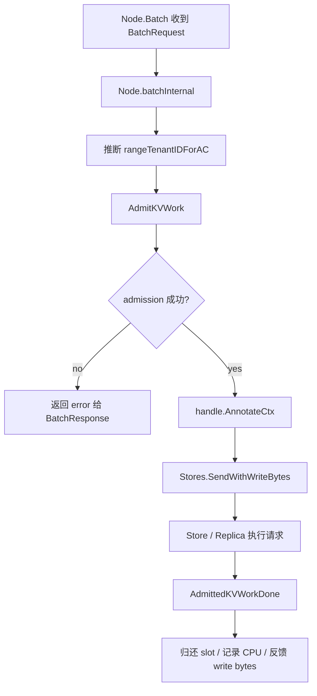
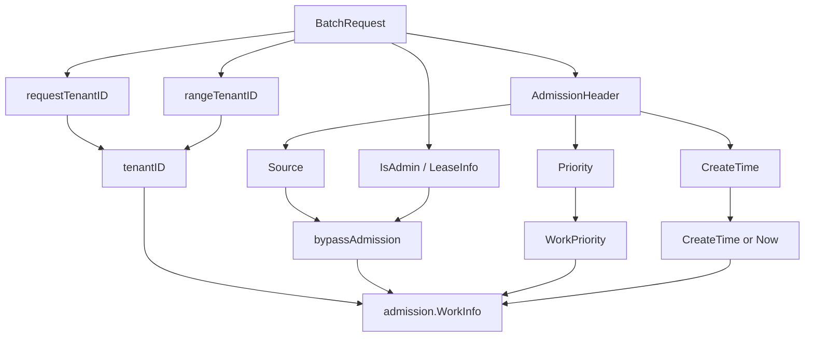
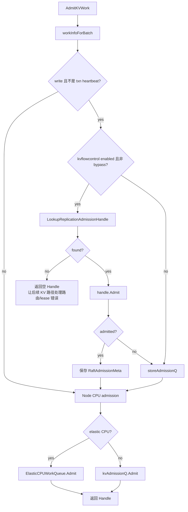
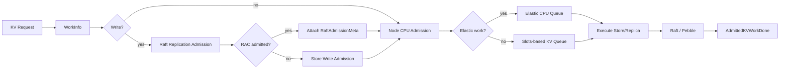

# KV 准入控制与 Raft 复制流控深度剖析——从 AdmitKVWork 到 WaitForEval

## 一、第一轮 BFS：职责边界与设计动机（Why）

### 1.1 系统性问题背景

CockroachDB 的一次 KV 请求不是简单地“打到 Pebble 写一下”。尤其是写请求，它通常要经过：

- SQL / KV client 构造请求
- DistSender 根据 range cache 路由
- Gateway node 通过 RPC 把请求发到目标 node
- 目标 node 进入 `Node.Batch`
- server 端 admission control 判断是否允许继续
- Store / Replica 执行读写逻辑
- 写请求进入 Raft proposal
- Raft log 复制到 followers
- followers 对 log entry 做 below-raft admission
- apply 到状态机 / Pebble

如果没有 admission control，请求会出现几个典型问题。

**问题 1：写入进入 Raft 太快，followers 跟不上**

```text
Range r100 有 3 个副本：
  n1: leader / leaseholder
  n2: follower
  n3: follower

客户端持续写入 r100。

如果 n3 磁盘慢、网络慢，leader 还继续无限接收写请求：
  - leader 上的 Raft log 待复制数据越来越多
  - send queue 变大
  - 内存压力变大
  - follower 恢复越来越困难
```

这里需要一种机制：

```text
在写请求进入 Raft 之前，先问一句：
  “这个 range 当前还能继续往 followers 推复制流吗？”
```

这就是 `kvflowcontrol` / RACv2 的核心职责。

**问题 2：单个 tenant 或低优先级任务吃光节点 CPU**

```text
tenant A 在跑大规模 TTL / BACKUP / EXPORT。
tenant B 正在执行普通业务查询。

如果 tenant A 的低优先级 bulk work 可以无限消耗 CPU：
  - tenant B 的延迟会被拖高
  - 节点调度延迟变差
  - 普通业务请求被低优先级任务干扰
```

这里需要节点级 CPU admission：

```text
普通请求走 slots-based admission。
低优先级 bulk/export work 走 elastic CPU admission。
```

**问题 3：store 本地写入压力需要被保护**

即使没有启用 Raft replication admission，或者某些请求 bypass 了 RAC，leaseholder 本地 store 仍然可能被写入压力打爆。

所以还有一层 store 级 admission：

```text
如果不能通过 raft flow control 控制写入，
就通过 storeAdmissionQ 保护 leaseholder 本地 store。
```

**问题 4：admission control 不能变成正确性判断**

Admission control 不是 range 路由系统，也不是 lease 判断系统。

例如：

```text
Gateway 的 range cache 过期了，把 r100 请求打到 n2。
但 r100 已经 split 或 lease 转走，n2 上没有这个 replica。
```

这时 admission control 不应该自己制造一个“准入失败”的错误。

它应该：

```text
不在 admission 层阻塞。
让后面的 Store / Replica 执行路径返回标准 KV 错误。
DistSender 再根据错误刷新 cache 并重试。
```

### 1.2 KV Admission 解决的核心问题

这套代码解决的是一个问题：

> 一个 KV request 到达 server 端后，在真正执行前，要不要先等资源？

它按资源维度拆成三层：

1. **Raft replication admission**
   - 控制写请求进入 Raft 的速度。
   - 避免 followers 慢时 leader 端持续堆积。
   - 核心路径：`ReplicationAdmissionHandle.Admit -> RangeController.WaitForEval`。

2. **Store write admission**
   - 控制 leaseholder 本地 store 的写入压力。
   - 主要用于 flow control 不启用或没有实际 admit 的场景。
   - 核心路径：`StoreWorkQueue.Admit`。

3. **Node CPU admission**
   - 控制节点 CPU 使用和 tenant 之间的公平性。
   - 普通 work 走 slots-based queue。
   - bulk/export/低优先级 work 走 elastic CPU queue。
   - 核心路径：`kvAdmissionQ.Admit` / `ElasticCPUWorkQueue.Admit`。

这三层不是互相替代的同一种东西，而是保护不同资源：

| 层级 | 保护对象 | 典型请求 | 主要代码 |
|---|---|---|---|
| Raft replication admission | range 的 Raft 复制流 | 写请求 | `kvflowcontrol` / `RangeController` |
| Store write admission | leaseholder 本地 store | 写请求 | `StoreWorkQueue` |
| Node CPU admission | node CPU 和 tenant 公平性 | 读写请求、bulk work | `WorkQueue` / `ElasticCPUWorkQueue` |

### 1.3 在系统中的位置

整体路径可以先看成这样：

```text
SQL / KV client
    |
    v
DistSender
    |
    v
RPC: Node.Batch
    |
    v
Node.batchInternal
    |
    v
KVAdmissionController.AdmitKVWork
    |
    +--> workInfoForBatch
    |
    +--> Raft replication admission
    |       LookupReplicationAdmissionHandle
    |       admissionHandle.Admit
    |       Replica.flowControlV2.AdmitForEval
    |       RangeController.WaitForEval
    |
    +--> Store write admission
    |       StoreWorkQueue.Admit
    |
    +--> Node CPU admission
            kvAdmissionQ.Admit
            ElasticCPUWorkQueue.Admit
    |
    v
handle.AnnotateCtx
    |
    v
Stores.SendWithWriteBytes
    |
    v
Store / Replica / Raft / Pebble
    |
    v
KVAdmissionController.AdmittedKVWorkDone
```

对应入口在：

- `pkg/server/node.go`
  - `Node.Batch`
  - `Node.batchInternal`
- `pkg/kv/kvserver/kvadmission/kvadmission.go`
  - `AdmitKVWork`
  - `workInfoForBatch`
  - `AdmittedKVWorkDone`
- `pkg/kv/kvserver/flow_control_stores.go`
  - `LookupReplicationAdmissionHandle`
  - `admissionHandle.Admit`
- `pkg/kv/kvserver/kvflowcontrol/rac2/range_controller.go`
  - `rangeController.WaitForEval`
- `pkg/kv/kvserver/kvflowcontrol/rac2/token_counter.go`
  - `WaitForEval`

### 1.4 核心抽象与生命周期

#### 核心对象 1：Controller

`kvadmission.Controller` 是 KV 层 admission 的统一入口。

```go
type Controller interface {
    AdmitKVWork(ctx, requestTenantID, rangeTenantID, ba) (Handle, error)
    AdmittedKVWorkDone(Handle, *StoreWriteBytes)
}
```

调用约定非常重要：

```text
AdmitKVWork 成功返回后，
调用方必须在 KV work 完成后调用 AdmittedKVWorkDone。
```

也就是说，admission 分成两段：

```text
开始前：
  AdmitKVWork
  申请 slot / token / CPU grant

完成后：
  AdmittedKVWorkDone
  归还 slot / 记录 CPU / 反馈写入字节数
```

#### 核心对象 2：Handle

`Handle` 是 admission 返回给调用方的“小票”。

```go
type Handle struct {
    tenantID             roachpb.TenantID
    storeAdmissionQ      *admission.StoreWorkQueue
    storeWorkHandle      admission.StoreWorkHandle
    elasticCPUWorkHandle *admission.ElasticCPUWorkHandle
    raftAdmissionMeta    *kvflowcontrolpb.RaftAdmissionMeta

    callAdmittedWorkDoneOnKVAdmissionQ bool
    cpuStart                           time.Duration
}
```

它记录了后续收尾需要的信息：

- 这个请求该计到哪个 tenant。
- 有没有 store admission handle。
- 有没有 elastic CPU handle。
- 有没有需要塞进 Raft command 的 `RaftAdmissionMeta`。
- 是否需要对 `kvAdmissionQ` 调用 `AdmittedWorkDone`。
- CPU 计费的起点。

可以把它理解成：

```text
Handle = 准入票据 + 后续结算凭证 + ctx 元数据载体
```

#### 核心对象 3：WorkInfo

`admission.WorkInfo` 是 admission 系统理解请求的统一输入。

```go
admission.WorkInfo{
    TenantID:        tenantID,
    Priority:        priority,
    CreateTime:      createTime,
    BypassAdmission: bypassAdmission,
}
```

它回答四个问题：

```text
这是谁的请求？
优先级是什么？
什么时候创建的？
是否可以绕过排队等待？
```

#### 核心对象 4：ReplicationAdmissionHandle

`ReplicationAdmissionHandle` 是 range 级 Raft flow control 的入口。

```go
type ReplicationAdmissionHandle interface {
    Admit(context.Context, admissionpb.WorkPriority, time.Time) (bool, error)
}
```

它不是全局对象，也不是 SQL lock。

真实实现是：

```go
type admissionHandle struct {
    r *Replica
}

func (h admissionHandle) Admit(ctx context.Context, pri admissionpb.WorkPriority, ct time.Time) (bool, error) {
    return h.r.flowControlV2.AdmitForEval(ctx, pri, ct)
}
```

也就是说：

```text
ReplicationAdmissionHandle = 指向某个本地 Replica 的轻量包装。
```

#### 核心对象 5：RangeController

`RangeController` 是 RACv2 的 range 级控制器。

它知道：

- 当前 range 的 voters / non-voters。
- 哪些 replica 处于 `StateReplicate`。
- 每条 replication stream 还有多少 eval tokens / send tokens。
- 普通 work 和 elastic work 是否需要等待。
- 等待 quorum 还是等待所有 replicate handles。

本篇最核心函数就是：

```go
func (rc *rangeController) WaitForEval(
    ctx context.Context,
    pri admissionpb.WorkPriority,
) (waited bool, err error)
```

## 二、第二轮 BFS：控制流与组件协作（How it flows）

### 2.1 主路径：一次 KV 请求的 admission 生命周期

以一次普通写请求为例：

```text
客户端写 key = /Table/100/account/1
```

经过 DistSender 路由后，请求到达某个 node 的 `Node.Batch`。

`Node.batchInternal` 会先做 admission：

```go
handle, err := n.storeCfg.KVAdmissionController.AdmitKVWork(
    ctx, tenID, rangeTenantIDForAC, args,
)
```

成功后：

```go
ctx = handle.AnnotateCtx(ctx)
```

这一步会把两类信息塞进 ctx：

```text
1. elastic CPU handle
2. raft admission meta
```

然后才真正执行：

```go
br, writeBytes, pErr = n.stores.SendWithWriteBytes(ctx, args)
```

最后，无论成功失败，都要：

```go
n.storeCfg.KVAdmissionController.AdmittedKVWorkDone(handle, writeBytes)
```

整体生命周期：



### 2.2 workInfoForBatch：把 BatchRequest 映射成 admission 语言

`workInfoForBatch` 是信息归一化层。

它不做等待，也不做限流，只做一件事：

```text
把 BatchRequest 里的 tenant/source/priority/create-time/bypass 规则
统一整理成 admission.WorkInfo。
```

它的核心决策：

1. 默认按 `requestTenantID` 计费。
2. 如果请求来自 system tenant，并且是非 admin 请求，可能改用 `rangeTenantID`。
3. 如果请求来自普通 SQL tenant，强制 `source = FROM_SQL`，不允许假装 admin bypass。
4. 如果 source 是 `OTHER`，直接 bypass。
5. 如果开启旧的 bulk-only 模式，Normal 及以上优先级 bypass。
6. LeaseInfo 请求是健康探测，bypass。
7. 非 bypass 且 create time 为空时，补当前时间。

可以画成：



### 2.3 AdmitKVWork：三层准入控制

`AdmitKVWork` 的主干可以简化成：

```go
admissionInfo := workInfoForBatch(...)

if write request and not heartbeat {
    if kvflowcontrol enabled and not bypass {
        admitted := wait for raft replication admission
        if admitted {
            attach RaftAdmissionMeta
        }
    }

    if flow-control not used or not admitted {
        wait for store write admission
    }
}

if admission still enabled {
    if export or low-priority bulk work {
        wait for elastic CPU admission
    } else {
        wait for slots-based CPU admission
    }
}

return Handle
```

图上看：



### 2.4 为什么 HeartbeatTxnRequest 特殊处理

代码里有一个容易忽略的分支：

```go
if ba.IsWrite() && !ba.IsSingleHeartbeatTxnRequest() {
    ...
}
```

事务 heartbeat 也是写类请求，但它不走 storeAdmissionQ。

原因是：

```text
当写请求被限流时，事务可能执行得更慢。
事务执行得更慢，就更需要 heartbeat 保活。
如果 heartbeat 也占 storeAdmissionQ slot，
它们可能把真正能推进事务的写请求挤掉。
```

一个具体例子：

```text
storeAdmissionQ 一共 100 个 slot。

写入压力过大时：
  100 个 slot 被 heartbeat 占满。

结果：
  真正的 Put / EndTxn 请求进不来。
  事务无法推进。
  heartbeat 继续增加。

系统进入“只保活不干活”的坏状态。
```

所以 heartbeat 在这层被排除。

### 2.5 Handle 的收尾路径

`AdmittedKVWorkDone` 做的是 admission 的“结算”。

```go
func (n *controllerImpl) AdmittedKVWorkDone(ah Handle, writeBytes *StoreWriteBytes)
```

它按 Handle 里保存的信息做三类收尾：

1. **elastic CPU**

```text
ElasticCPUWorkQueue.AdmittedWorkDone
```

表示这个弹性 CPU work 完成了。

2. **node-level kvAdmissionQ**

```text
cpuTime := grunning.Time() - ah.cpuStart
kvAdmissionQ.AdmittedWorkDone(tenantID, cpuTime)
```

把本次请求消耗的 CPU 记到 tenant admission accounting。

3. **storeAdmissionQ**

```text
storeAdmissionQ.AdmittedWorkDone(storeWorkHandle, writeBytes)
```

把实际写入字节数反馈给 store admission。

核心心智模型：

```text
AdmitKVWork 是拿票。
Handle 是票据。
AdmittedKVWorkDone 是结账。
```

## 三、DFS 深入：关键函数与核心逻辑（How it works）

### 3.1 DFS：LookupReplicationAdmissionHandle

入口：

```go
kvflowHandle, found := n.kvflowHandles.LookupReplicationAdmissionHandle(ba.RangeID)
```

实现不是查一个全局 `map[RangeID]Handle`，而是：

```go
func (sh *storesForFlowControl) LookupReplicationAdmissionHandle(
    rangeID roachpb.RangeID,
) (handle kvflowcontrol.ReplicationAdmissionHandle, found bool) {
    ls := (*Stores)(sh)
    ls.VisitStores(func(s *Store) error {
        if h, ok := (*storeForFlowControl)(s).LookupReplicationAdmissionHandle(rangeID); ok {
            handle = h
            found = true
        }
        return nil
    })
    return handle, found
}
```

再下一层：

```go
func (sh *storeForFlowControl) LookupReplicationAdmissionHandle(
    rangeID roachpb.RangeID,
) (kvflowcontrol.ReplicationAdmissionHandle, bool) {
    repl := sh.lookupReplica(rangeID)
    if repl == nil {
        return nil, false
    }
    return admissionHandle{r: repl}, true
}
```

也就是：

```text
遍历当前 node 的 stores
  -> 看哪个 store 上有这个 range 的 Replica
     -> 找到 Replica 后包装成 admissionHandle
```

#### found=false 是什么含义

`found=false` 表示：

```text
当前 node 上找不到这个 RangeID 对应的本地 replica admission handle。
```

常见原因：

- DistSender range cache 过期，请求发错节点。
- range split / merge 后，旧 range 不在这个节点了。
- replica relocation 后，本节点已经没有这个 replica。
- replica 正在销毁。
- 测试 knob 限制了 flow control 范围。

注意：这不等于 key 不存在，也不等于请求成功。

`AdmitKVWork` 在这里返回空 Handle：

```go
if !found {
    return Handle{}, nil
}
```

意思是：

```text
admission 层不处理这个请求。
不要在这里阻塞。
让后续 Store / Replica 路径返回标准 KV 错误。
```

### 3.2 DFS：admissionHandle.Admit

`ReplicationAdmissionHandle.Admit` 的真实实现很薄：

```go
type admissionHandle struct {
    r *Replica
}

func (h admissionHandle) Admit(
    ctx context.Context, pri admissionpb.WorkPriority, ct time.Time,
) (admitted bool, err error) {
    return h.r.flowControlV2.AdmitForEval(ctx, pri, ct)
}
```

它真正委托给：

```text
Replica.flowControlV2.AdmitForEval
```

### 3.3 DFS：processorImpl.AdmitForEval

`AdmitForEval` 先取 range 的 `RangeController`：

```go
rc := p.leader.rc
if rc == nil {
    return false, nil
}
return rc.WaitForEval(ctx, pri)
```

这里有一个关键点：

```text
found=true 只是说明本地有 Replica。
但 Replica 上不一定有可用的 RangeController。
```

如果 `rc == nil`，返回：

```text
admitted=false
err=nil
```

这不是错误。

上层看到 `admitted=false` 后，会 fallback 到 `storeAdmissionQ`：

```go
if !attemptFlowControl || !admitted {
    storeAdmissionQ.Admit(...)
}
```

所以要区分：

```text
found=false:
  本地没有 handle，AdmitKVWork 直接返回空 Handle。

found=true, admitted=false:
  本地有 replica，但 RACv2 不处理这次等待。
  上层 fallback 到 storeAdmissionQ。
```

### 3.4 DFS：rangeController.WaitForEval 的核心逻辑

`rangeController.WaitForEval` 是这套逻辑最复杂的部分。

它回答的问题是：

```text
这个写请求在 evaluation / proposal 之前，
是否需要等 Raft replication tokens？
如果要等，等哪些 replicas 的 tokens？
```

#### 第一步：priority 转 work class

```go
wc := admissionpb.WorkClassFromPri(pri)
```

大致分成：

```text
RegularWorkClass:
  普通业务请求。

ElasticWorkClass:
  BACKUP / EXPORT / TTL / bulk low priority 这类低优先级弹性 work。
```

#### 第二步：根据配置判断是否 bypass

配置由 `WaitForEvalConfig` 给出：

```go
waitCategory, waitCategoryChangeCh := rc.opts.WaitForEvalConfig.Current()
bypass := waitCategory.Bypass(wc)
```

`WaitForEvalCategory` 有三种：

```go
NoWorkWaitsForEval
OnlyElasticWorkWaitsForEval
AllWorkWaitsForEval
```

含义：

| Category | Regular work | Elastic work |
|---|---|---|
| `NoWorkWaitsForEval` | bypass | bypass |
| `OnlyElasticWorkWaitsForEval` | bypass | wait |
| `AllWorkWaitsForEval` | wait | wait |

如果 bypass：

```go
return waited, nil
```

这里返回的 `waited` 通常是 false，测试 knob 可能覆盖。

#### 第三步：普通 work 和 elastic work 的等待策略不同

```go
waitForAllReplicateHandles := false
if wc == admissionpb.ElasticWorkClass {
    waitForAllReplicateHandles = true
}
```

普通 work：

```text
主要确保 quorum 和关键 replica 不被压垮。
```

Elastic work：

```text
更保守，要求所有 StateReplicate 的 replicate handles 都要能继续。
```

为什么 elastic work 更保守？

```text
普通业务请求对延迟敏感，不能为了所有 follower 都健康而过度等待。

Elastic work 是低优先级工作，目标是尽量不影响系统健康。
所以 follower 慢时，它应该更主动让路。
```

### 3.5 DFS：voterSets / nonVoterSet / quorum

`WaitForEval` 会拿一份等待集合快照：

```go
vss := rc.mu.voterSets
nvs := rc.mu.nonVoterSet
refreshCh := rc.mu.waiterSetRefreshCh
```

`voterSets` 是参与 Raft quorum 的 voters。

`nonVoterSet` 是 non-voters，不参与 quorum，但也可能承载复制流。

对每个 voter set：

```go
quorumCount := (len(vs) + 2) / 2
```

几个例子：

```text
3 voters:
  quorumCount = (3 + 2) / 2 = 2

5 voters:
  quorumCount = (5 + 2) / 2 = 3
```

它会统计：

```go
votersHaveEvalTokensCount
```

即：

```text
已经有 eval tokens，并且没有 send queue backlog 的 voter 数量。
```

然后计算：

```go
remainingForQuorum := quorumCount - votersHaveEvalTokensCount
```

例子：

```text
3 voters，quorum=2。

n1 有 token
n2 没 token
n3 没 token

votersHaveEvalTokensCount = 1
remainingForQuorum = 2 - 1 = 1

含义：
  至少还要等一个 voter token 可用，才能满足 quorum。
```

### 3.6 DFS：requiredWait 是什么

`remainingForQuorum` 只管 quorum。

但有些 replica 即使不影响 quorum，也必须特别关注。

代码里：

```go
requiredWait: v.isLeader || v.isLeaseHolder ||
    (waitForAllReplicateHandles && v.isStateReplicate)
```

含义：

```text
leader:
  Raft 复制核心角色。

leaseholder:
  KV 请求评价和事务协调关键位置。

elastic work 下的 StateReplicate replica:
  低优先级 work 不能继续压垮任何正在正常复制的 follower。
```

所以等待条件是两层：

```text
1. quorum 条件：
   至少有足够多 voters 可以继续。

2. requiredWait 条件：
   所有关键 replica 都不能缺 token。
```

伪代码：

```go
for signaledQuorumCount < requiredQuorum || requiredWaitCount > 0 {
    wait for token signal / config change / replica refresh / ctx cancel
}
```

### 3.7 DFS：token_counter.go 里的 WaitForEval helper

注意这里有两个同名函数：

```text
rangeController.WaitForEval:
  高层逻辑，负责构造等待集合。

rac2.WaitForEval:
  底层 helper，负责真正 select 等待 channel。
```

底层 helper 签名：

```go
func WaitForEval(
    ctx context.Context,
    configRefreshWaitCh <-chan struct{},
    replicaRefreshWaitCh <-chan struct{},
    handles []tokenWaitingHandleInfo,
    requiredQuorum int,
    traceIndividualWaits bool,
    scratch []reflect.SelectCase,
) (state WaitEndState, scratch2 []reflect.SelectCase)
```

它等待四类事件：

| 事件 | 返回值 | 含义 |
|---|---|---|
| token handle signaled | 继续检查 | 某条复制流可能有 token 了 |
| `ctx.Done()` | `ContextCanceled` | 请求取消或超时 |
| config refresh | `ConfigRefreshWaitSignaled` | 配置变了，重算是否还要等 |
| replica refresh | `ReplicaRefreshWaitSignaled` | replica 状态变了，重算等待集合 |

它使用 `reflect.Select` 的原因是：

```text
要同时等不固定数量的 token handles。
```

如果一个 range 有 3 个 voters 和 2 个 non-voters，等待 channel 数量可能不同。

普通 `select` 不能动态构造 case，所以用 `reflect.Select`。

### 3.8 DFS：token signal 不是直接“锁住请求”

`tokenCounterPerWorkClass` 里有一个 `signalCh`：

```go
signalCh chan struct{}
```

它的作用是：

```text
当 tokens 从 <= 0 变成 > 0 时，signal 一个 waiter。
```

但是 signal 只表示：

```text
你可以醒来重新检查。
```

不表示：

```text
你一定已经拿到了 token。
```

所以底层 helper 里还要确认：

```go
available := handleInfo.handle.confirmHaveTokensAndUnblockNextWaiter()
if !available {
    continue
}
```

这是典型的 condition variable 思维：

```text
signal 只是提示条件可能满足。
醒来后必须重新检查条件。
```

### 3.9 DFS：RaftAdmissionMeta 如何进入 Raft

当 `kvflowHandle.Admit` 返回 `admitted=true` 时，`AdmitKVWork` 会设置：

```go
ah.raftAdmissionMeta = &kvflowcontrolpb.RaftAdmissionMeta{
    AdmissionPriority:   int32(admissionInfo.Priority),
    AdmissionCreateTime: admissionInfo.CreateTime,
    AdmissionOriginNode: n.nodeID.Get(),
}
```

然后：

```go
ctx = handle.AnnotateCtx(ctx)
```

会把 meta 写入 ctx：

```go
ctx = kvflowcontrol.ContextWithMeta(ctx, h.raftAdmissionMeta)
```

后续 Raft command 编码时，会使用这个 meta：

```text
raftlog.EncodeCommand(..., EncodeOptions{
    RaftAdmissionMeta: meta,
})
```

这让 below-raft admission 能知道：

```text
这个 Raft entry 的 priority 是什么？
create time 是什么时候？
origin node 是谁？
```

followers 处理 Raft log entry 时，会 decode 这些 meta，并提交给 below-raft admission queue。

## 四、运行时行为与具体例子（Runtime Behavior）

### 4.1 场景一：普通写请求，tokens 充足

```text
Range r100:
  n1: leader + leaseholder
  n2: follower
  n3: follower

客户端写 account:1。
请求到达 n1。
```

执行过程：

```text
1. AdmitKVWork 构造 WorkInfo。
2. 写请求，且不是 heartbeat。
3. kvflowcontrol enabled。
4. LookupReplicationAdmissionHandle(r100) 找到本地 Replica。
5. admissionHandle.Admit 调用 r100.flowControlV2.AdmitForEval。
6. RangeController.WaitForEval 检查 voter tokens。
7. quorum 已满足，requiredWait 也满足。
8. 返回 admitted=true。
9. AdmitKVWork 设置 RaftAdmissionMeta。
10. 请求继续进入 Store / Replica / Raft。
11. 请求完成后 AdmittedKVWorkDone 结算 CPU/store 信息。
```

这个场景下，admission 几乎不阻塞。

### 4.2 场景二：follower 很慢，普通 work 被等待

```text
Range r100:
  n1: leader + leaseholder
  n2: follower 正常
  n3: follower 很慢

复制流状态：
  n1 -> n2 tokens 充足
  n1 -> n3 tokens 用光
```

对于普通 work：

```text
3 voters quorum=2。

n1 和 n2 健康，quorum 可能已经够。
但如果 n3 是 requiredWait 之外的普通 follower，
普通 work 不一定等 n3。
```

这体现了一个设计取舍：

```text
普通业务请求不能为了所有 follower 都慢慢追上而无限等待。
它主要保证 quorum 和关键 replica。
```

### 4.3 场景三：elastic work 遇到慢 follower

同样的复制状态：

```text
n1 -> n2 tokens 充足
n1 -> n3 tokens 用光
```

如果请求是 BACKUP / EXPORT / TTL 这类 elastic work：

```text
waitForAllReplicateHandles = true
```

此时：

```text
即使 quorum 够了，
只要 n3 处于 StateReplicate 且缺 token，
elastic work 也要等。
```

原因：

```text
elastic work 是低优先级任务。
系统宁愿让它慢一点，也不要继续加重慢 follower 的复制压力。
```

### 4.4 场景四：请求打到错误节点

```text
Gateway range cache 过期。
它以为 r100 在 n2。
但 r100 已经迁移到 n3。

请求到达 n2。
```

`AdmitKVWork`：

```text
LookupReplicationAdmissionHandle(r100)
  -> 遍历 n2 本地 stores
  -> 找不到 r100 replica
  -> found=false
```

于是：

```go
return Handle{}, nil
```

这不是说请求成功。

真实含义是：

```text
admission control 不处理这个请求。
不要在这里把它排队。
后面的 Stores.SendWithWriteBytes 会返回标准 KV 错误。
DistSender 收到后刷新 range cache 并重试。
```

### 4.5 场景五：配置变化唤醒等待者

假设当前配置：

```text
kvflowcontrol.enabled = true
mode = ApplyToAll
```

普通请求正在 `WaitForEval` 里等待 token。

管理员把配置改成：

```text
mode = ApplyToElastic
```

这意味着：

```text
RegularWorkClass 不再需要等。
```

`WaitForEvalConfig` 会 close `waitCategoryChangeCh`。

底层 helper 返回：

```text
ConfigRefreshWaitSignaled
```

高层重新读取配置：

```go
waitCategory, waitCategoryChangeCh = rc.opts.WaitForEvalConfig.Current()
bypass = waitCategory.Bypass(wc)
```

如果现在可以 bypass：

```go
return false, nil
```

### 4.6 场景六：replica 状态变化唤醒等待者

等待过程中，range 可能发生：

- lease transfer
- raft leadership change
- replica 从 `StateProbe` 变成 `StateReplicate`
- replica 被移除
- split / merge

这些变化会影响：

```text
voterSets
nonVoterSet
requiredWait
remainingForQuorum
```

所以底层 helper 返回：

```text
ReplicaRefreshWaitSignaled
```

高层直接：

```go
goto retry
```

重新拿快照，重新判断。

## 五、设计模式分析

### 5.1 模式一：Admission Control Pattern

定义：

```text
在真正执行 work 前，先经过一个资源门禁。
资源不足时，work 等待、降级、绕过或失败。
```

在代码中的体现：

```go
handle, err := AdmitKVWork(...)
...
AdmittedKVWorkDone(handle, writeBytes)
```

这是一种典型的“两阶段 admission”：

```text
进入时申请资源。
结束时反馈消耗。
```

### 5.2 模式二：Token-Based Flow Control

定义：

```text
用 token 表示下游还能承受多少 work。
上游必须有 token 才继续发送。
下游处理完后归还 token。
```

在这里：

```text
Raft leader 是上游。
followers / replication streams 是下游。
eval tokens 表示写请求能否继续进入 evaluation / proposal。
send tokens 表示复制发送侧是否还能继续推数据。
```

慢 follower 会让 token 变少。

token 少到不足时，新的写请求会被挡在 `WaitForEval`。

### 5.3 模式三：Quorum-Aware Waiting

普通分布式流控常见做法是：

```text
所有下游都 ready 才继续。
```

但 Raft 的关键性质是 quorum。

所以普通 work 的等待逻辑更细：

```text
不一定等所有 replica。
至少要满足 quorum。
同时必须照顾 leader / leaseholder 这些关键 replica。
```

这就是：

```go
remainingForQuorum > 0 || requiredWait
```

### 5.4 模式四：Fail-Open for Stale Routing

`LookupReplicationAdmissionHandle` 找不到 handle 时：

```go
return Handle{}, nil
```

这是一种 fail-open。

原因：

```text
admission control 不是正确性层。
如果它无法确认本地 range 状态，不要制造 admission 错误。
让真正的 KV routing / lease / replica 执行层给出权威错误。
```

### 5.5 模式五：Context Metadata Propagation

`RaftAdmissionMeta` 不直接作为函数参数一路传到底，而是通过 ctx 传播：

```go
ctx = handle.AnnotateCtx(ctx)
```

后续 Raft encoding 再从 ctx 拿 meta。

这种做法的好处：

```text
不需要把 admission 参数加到每一层函数签名里。
```

代价：

```text
数据流不如显式参数直观，需要知道 ctx 里藏了什么。
```

### 5.6 模式六：Signal-and-Recheck

token available 的通知不是直接授予资源。

它只是：

```text
告诉 waiter：你可以醒来重新检查条件了。
```

代码体现：

```go
available := handleInfo.handle.confirmHaveTokensAndUnblockNextWaiter()
if !available {
    continue
}
```

这是并发控制里很常见的模式：

```text
signal 可能过时。
条件必须重查。
```

## 六、设计取舍与替代方案（Trade-offs）

### 6.1 当前方案 vs 完全不做 admission

不做 admission：

```text
优点：
  请求路径简单。
  没有等待开销。

缺点：
  follower 慢时 leader 可以无限堆积。
  bulk work 可以影响普通请求。
  tenant 之间缺少公平性保护。
```

当前方案：

```text
优点：
  能把压力挡在执行前。
  能按 priority / tenant 做区分。
  能根据 Raft 复制健康状况控制写入。

缺点：
  代码路径复杂。
  有更多状态需要维护。
  诊断时要看 admission、flow-control、Raft 多层指标。
```

### 6.2 当前方案 vs 所有 replica 都等

所有 replica 都等：

```text
优点：
  follower 压力最安全。

缺点：
  一个慢 follower 就能拖慢所有普通业务写入。
```

当前方案：

```text
普通 work:
  quorum + required replicas。

elastic work:
  更接近所有 StateReplicate replicas。
```

这是在延迟和保护性之间做区分：

```text
普通业务重延迟。
elastic work 重让路。
```

### 6.3 当前方案 vs admission 层直接返回路由错误

当找不到 local replica handle 时，admission 层没有直接返回路由错误。

原因：

```text
admission control 不掌握完整 KV 正确性上下文。
它不知道这是 stale route、split、merge、lease transfer，还是合法的短暂状态。
```

所以它选择：

```text
fail open，让 Store / Replica 执行层返回标准错误。
```

这避免了 admission 层和 routing 层职责混乱。

### 6.4 当前方案 vs 所有请求都走同一个队列

如果所有请求都只走一个全局队列：

```text
实现简单。
但无法表达不同资源瓶颈。
```

比如：

```text
Raft follower 慢:
  应该按 range replication streams 限制。

节点 CPU 高:
  应该按 tenant / priority 限制。

store 写入压力高:
  应该按 store 写入字节数反馈。
```

所以当前方案拆成多层：

```text
range-level replication
store-level write
node-level CPU
```

## 七、完整流程示例

### 7.1 例子：普通写请求成功通过 RACv2

```text
请求：
  tenant=t10
  priority=NormalPri
  key 属于 range r100

拓扑：
  r100 voters: n1, n2, n3
  n1 是 leaseholder + raft leader
  n2/n3 是 followers

token 状态：
  n1->n2 有 token
  n1->n3 有 token
```

执行：

```text
1. Node.batchInternal 进入 AdmitKVWork。
2. workInfoForBatch 得到：
     TenantID=t10
     Priority=NormalPri
     BypassAdmission=false
3. 请求是 write 且不是 heartbeat。
4. kvflowcontrol enabled。
5. LookupReplicationAdmissionHandle(r100) 找到 n1 本地 replica。
6. AdmitForEval 找到 RangeController。
7. WaitForEval 计算：
     wc=RegularWorkClass
     quorum=2
     votersHaveEvalTokensCount=3
     remainingForQuorum=0
     requiredWait=false
8. 返回 admitted=true。
9. AdmitKVWork 设置 RaftAdmissionMeta。
10. 普通 CPU admission 拿 slot。
11. Store / Replica 执行写请求。
12. Raft command 编码携带 admission meta。
13. 请求完成，AdmittedKVWorkDone 做 CPU / write bytes 结算。
```

### 7.2 例子：普通写请求被 follower 慢拖住

```text
token 状态：
  n1->n2 有 token
  n1->n3 没 token

quorum=2。
```

如果 n1 和 n2 足够满足 quorum，普通 work 可能不等 n3。

但如果 leader/leaseholder 或 quorum 所需 token 不足：

```text
WaitForEval 进入等待。
```

等待结束条件之一：

```text
n3 或其它 required handle token 恢复。
```

或者：

```text
配置变化，普通 work 不再需要等待。
```

或者：

```text
ctx 超时，返回 ctx.Err()。
```

### 7.3 例子：ExportRequest 走 elastic CPU

```text
请求：
  Backup 生成单个 ExportRequest。

AdmitKVWork：
  shouldUseElasticCPU = true
```

它不走普通 slots-based CPU queue，而是：

```go
ElasticCPUWorkQueue.Admit(ctx, admitDuration, admissionInfo)
```

这意味着：

```text
给这次 export 发一段 CPU 配额。
底层执行 export 时可以协作式检查配额。
配额用完后，低优先级 work 应该让路。
```

### 7.4 例子：bypassAdmission 不等于完全不记账

在 store admission 这里有一个细节：

```go
storeAdmissionQ.Admit(ctx, admission.StoreWriteWorkInfo{WorkInfo: admissionInfo})
```

即使 `BypassAdmission=true`，也可能仍然调用 `Admit`。

原因：

```text
bypass 表示不排队等待。
不表示不做 accounting。
```

否则 admission 系统看到的负载会偏低。

## 八、总结与心智模型（Mental Model）

### 8.1 一句话总结

KV admission control 是 CockroachDB 在 KV work 真正执行前设置的一组资源门禁：

```text
写请求先看 Raft 复制能不能承受；
再看 store 本地写入能不能承受；
最后看节点 CPU 和 tenant 公平性能不能承受。
```

### 8.2 最重要的三个不要混

**不要把 admission control 当成锁**

```text
它不保护数据并发正确性。
并发正确性靠事务、MVCC、锁表、timestamp、Raft。
```

**不要把 admission control 当成路由**

```text
找不到 range handle 时，它不负责返回 NotLeaseHolder 或 RangeKeyMismatch。
这些由 Store / Replica / DistSender 路径处理。
```

**不要把 admission control 当成 Pebble 写入**

```text
Admit / WaitForEval 不会直接打到 Pebble。
它是在进入 KV execution / Raft proposal 前等待 token 或 slot。
```

### 8.3 最小心智模型

可以把它记成：

```go
func AdmitKVWork(batch) Handle {
    info := workInfoForBatch(batch)

    if batch.IsWrite() {
        if raftFlowControlEnabled {
            admitted := waitForRaftReplicationTokens(rangeID, info.Priority)
            if admitted {
                handle.raftAdmissionMeta = meta(info)
            } else {
                waitForStoreWriteAdmission(storeID, info)
            }
        } else {
            waitForStoreWriteAdmission(storeID, info)
        }
    }

    if isElasticCPUWork(batch, info) {
        handle.elasticCPU = waitForElasticCPU(info)
    } else {
        handle.cpuStart = waitForNodeCPUSlot(info)
    }

    return handle
}
```

### 8.4 WaitForEval 的最小心智模型

```go
func RangeControllerWaitForEval(priority) {
    workClass := WorkClassFromPriority(priority)

    if config says this work class bypasses {
        return admitted=false
    }

    snapshot voters and nonVoters

    for each voter set {
        count voters that already have eval tokens
        compute remaining quorum needed
        collect required handles

        if quorum missing or required handles missing {
            wait for:
              - token signal
              - config refresh
              - replica refresh
              - ctx cancellation
        }
    }

    return admitted=true
}
```

### 8.5 从调试角度应该看什么

如果一个请求卡在这里，优先看：

```text
1. 请求 priority 是 Regular 还是 Elastic？
2. kvflowcontrol.enabled 和 mode 是什么？
3. 目标 range 的 RangeController 是否存在？
4. 哪些 replicas 的 eval tokens 用光？
5. 是否有 send queue backlog？
6. 是否发生 lease transfer / raft leadership change / split / merge？
7. ctx 是不是超时取消？
```

对应代码路径：

```text
AdmitKVWork
  -> LookupReplicationAdmissionHandle
  -> admissionHandle.Admit
  -> AdmitForEval
  -> rangeController.WaitForEval
  -> rac2.WaitForEval
```

### 8.6 最终图像



最后用一句话收束：

```text
KV admission control 不是为了让请求“正确”，而是为了让正确的请求以系统能承受的速度前进。
```
