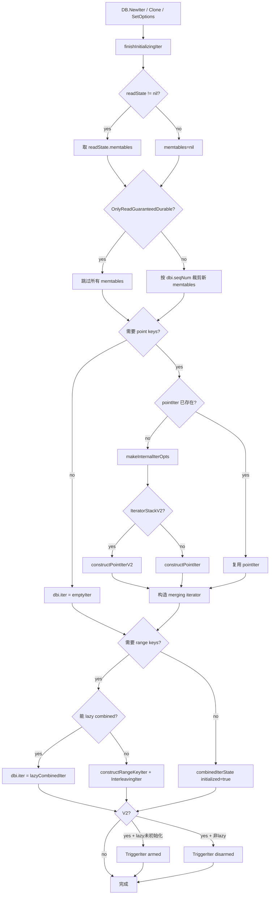

# Pebble finishInitializingIter 深度剖析——LSM 读路径与 Iterator 树构建

## 一、先给结论

`Iterator.finishInitializingIter()` 是 Pebble 创建读迭代器时最关键的一步。

它不是简单地初始化几个字段，而是在做这件事：

```text
把当前读请求应该看到的所有数据来源

  indexed batch
  mutable / immutable memtable
  L0 sublevels
  L1-L6 SSTables
  range deletions
  range keys

组装成一棵统一的 iterator 树，对外表现成一个有序的 Iterator。
```

源码位置：

```go
func (dbi *Iterator) finishInitializingIter(ctx context.Context) {
    var memtables flushableList
    if dbi.readState != nil {
        memtables = dbi.readState.memtables
    }
    ...
}
```

它被这些路径调用：

```text
DB.NewIter
  -> DB.newIter
     -> Iterator.finishInitializingIter

Iterator.Clone
  -> Iterator.finishInitializingIter

Iterator.SetOptions
  -> Iterator.finishInitializingIter
```

一句话：

```text
DB.newIter 负责准备 Iterator 的基本字段；
finishInitializingIter 负责真正搭建底层读取结构。
```

## 二、为什么需要这个函数

Pebble 是 LSM Tree。

一次读并不是只读一个地方。

假设你执行：

```go
iter, _ := db.NewIter(nil)
defer iter.Close()

iter.SeekGE([]byte("user:10"))
```

底层可能要同时看：

```text
1. 当前 mutable memtable
2. 旧的 immutable memtables
3. L0.3
4. L0.2
5. L0.1
6. L0.0
7. L1
8. L2
9. ...
10. L6
```

如果这个 iterator 是从 indexed batch 创建的，还要看：

```text
0. batch 里的未提交写入
```

这些来源都有自己的迭代器。

`finishInitializingIter()` 的任务就是把它们变成：

```text
batch iter
memtable iter
L0 sublevel iter
L1 iter
L2 iter
...
L6 iter
      ↓
merging iterator
      ↓
外部 Iterator
```

对调用方来说，它只看到：

```go
iter.SeekGE(key)
iter.Next()
iter.Value()
```

但对 Pebble 来说，它背后是多路归并。

## 三、涉及的核心知识点

这个函数涉及的知识点不少，按重要性分为几组。

### 3.1 LSM Tree 的读路径

Pebble 的数据大致分布在：

```text
内存:
  mutable memtable
  immutable memtables

磁盘:
  L0 SSTables
  L1 SSTables
  ...
  L6 SSTables
```

写入先进入 memtable。

```text
Set(user:10, v2)
  -> WAL
  -> memtable
```

memtable 满了后 flush 成 SST：

```text
memtable
  -> flush
  -> L0 SSTable
```

然后 compaction 把 L0/L1 等文件继续整理到更低层。

所以一次读必须把这些层一起考虑。

### 3.2 readState：一次读的稳定视图

`readState` 定义在 `pebble/read_state.go`：

```go
type readState struct {
    db        *DB
    refcnt    atomic.Int32
    current   *manifest.Version
    memtables flushableList
}
```

它包含两块东西：

```text
current:
  当前 LSM 磁盘版本，也就是 L0-L6 有哪些 SST 文件。

memtables:
  当前读需要看到的 memtable 列表。
```

Iterator 创建时会引用 `readState`，防止它读到一半，底层 SST 或 memtable 被释放。

心智模型：

```text
readState = 这个 Iterator 的读视图锚点
```

### 3.3 flushableList：memtable 队列

`flushableList` 定义在 `pebble/flushable.go`：

```go
type flushableList []*flushableEntry
```

`flushableEntry` 包的是 `flushable` 接口：

```go
type flushable interface {
    newIter(o *IterOptions) internalIterator
    newFlushIter(o *IterOptions) internalIterator
    newRangeDelIter(o *IterOptions) keyspan.FragmentIterator
    newRangeKeyIter(o *IterOptions) keyspan.FragmentIterator
    containsRangeKeys() bool
    ...
}
```

它不只表示普通 memtable，也可能表示：

```text
1. memTable
2. flushableBatch
3. ingestedFlushable
```

所以这里叫 `flushable`，不是单纯叫 `memtable`。

因为它们都能像 memtable 一样：

```text
参与读取
等待 flush
提供 iterator
```

### 3.4 Version：磁盘 SST 文件布局

`manifest.Version` 里保存当前 LSM 文件布局：

```go
type Version struct {
    L0SublevelFiles []LevelSlice
    Levels [NumLevels]LevelMetadata
    ...
}
```

其中：

```text
L0SublevelFiles:
  L0 被拆成的多个 sublevel。

Levels[1] ~ Levels[6]:
  L1-L6 的文件元数据。
```

L0 很特殊，因为 L0 文件之间可能 key range 重叠，所以 Pebble 会拆成多个 sublevel。

例如：

```text
L0.2: F5 [b,c]    F6 [m,o]   新
L0.1: F3 [a,z]              中
L0.0: F1 [a,z]              老
L1:   G1 [a,f] G2 [g,z]
```

读的时候要从新到旧：

```text
L0.2 -> L0.1 -> L0.0 -> L1 -> L2 ...
```

## 四、finishInitializingIter 的主流程

函数整体可以拆成四段：

```text
1. 选出这次读应该看到的 memtables。
2. 构造 point-key iterator 树。
3. 如果需要 range keys，构造 range-key 或 lazy combined iterator。
4. 如果使用 IteratorStackV2，配置 TriggerIter。
```

对应代码：

```go
func (dbi *Iterator) finishInitializingIter(ctx context.Context) {
    var memtables flushableList
    if dbi.readState != nil {
        memtables = dbi.readState.memtables
    }

    if dbi.opts.OnlyReadGuaranteedDurable {
        memtables = nil
    } else {
        for i := len(memtables) - 1; i >= 0; i-- {
            if logSeqNum := memtables[i].logSeqNum; logSeqNum < dbi.seqNum {
                break
            }
            memtables = memtables[:i]
        }
    }

    if dbi.opts.pointKeys() {
        ...
    }

    if dbi.opts.rangeKeys() {
        ...
    }

    if dbi.allocV2 != nil {
        ...
    }
}
```

## 五、第一段：选出应该读哪些 memtables

### 5.1 从 readState 取 memtables

```go
var memtables flushableList
if dbi.readState != nil {
    memtables = dbi.readState.memtables
}
```

普通 `DB.NewIter()` 会有 `readState`。

所以这里拿到：

```text
当前 mutable memtable
当前 immutable memtables
可能还有 ingested flushable
```

注意：这里不是复制全部数据，只是拿到这些结构的引用。

### 5.2 OnlyReadGuaranteedDurable：只读已保证持久的数据

```go
if dbi.opts.OnlyReadGuaranteedDurable {
    memtables = nil
}
```

这个选项的意思是：

```text
不要读 memtable。
只读已经 flush 到 SST 的状态。
```

因为 memtable 虽然可能已经写了 WAL，但 Pebble 当前实现选择了一个保守语义：

```text
跳过所有 memtables = 只看最近一次 flush 后形成的稳定磁盘视图
```

举例：

```text
磁盘 SST:
  user:10 = v1

memtable:
  user:10 = v2
```

普通 iterator 读到：

```text
user:10 = v2
```

`OnlyReadGuaranteedDurable=true` 读到：

```text
user:10 = v1
```

这不是说 `v2` 一定没持久化，而是当前实现为了保守，直接不读 memtable。

### 5.3 按 seqNum 裁剪 memtables

如果不是 `OnlyReadGuaranteedDurable`，就执行：

```go
for i := len(memtables) - 1; i >= 0; i-- {
    if logSeqNum := memtables[i].logSeqNum; logSeqNum < dbi.seqNum {
        break
    }
    memtables = memtables[:i]
}
```

这个逻辑是 snapshot 可见性控制。

`dbi.seqNum` 表示：

```text
这个 iterator 最多能看到哪个 sequence number 之前的数据。
```

如果某个 memtable 的 `logSeqNum >= dbi.seqNum`，说明这个 memtable 是这个 iterator 的可见时间点之后产生的，它不能被读。

假设：

```text
dbi.seqNum = 100

memtables:
  M1 logSeqNum=20
  M2 logSeqNum=70
  M3 logSeqNum=120
```

那么 iterator 只能看：

```text
M1
M2
```

不能看：

```text
M3
```

因为 M3 代表的写入晚于 seqNum=100 的快照视图。

这段从后往前裁剪，是因为 memtable 列表通常按时间从老到新排列：

```text
老 -> 新
M1, M2, M3
```

从队尾开始砍掉新 memtable 很快。

## 六、第二段：构造 point-key iterator

Point key 就是普通的单点 key-value：

```text
Set("a", "1")
Delete("b")
Merge("c", ...)
```

对应不是 range key。

代码：

```go
if dbi.opts.pointKeys() {
    if dbi.pointIter == nil {
        internalOpts := dbi.makeInternalIterOpts(memtables)
        if dbi.allocV2 != nil {
            dbi.constructPointIterV2(ctx, memtables, internalOpts)
        } else {
            dbi.constructPointIter(ctx, memtables, internalOpts)
        }
    }
    dbi.iter = dbi.pointIter
} else {
    dbi.iter = emptyIter
}
```

### 6.1 如果不读 point key，就用 emptyIter

如果用户只想读 range keys：

```go
IterOptions{
    KeyTypes: IterKeyTypeRangesOnly,
}
```

那 point iterator 没必要建。

于是：

```go
dbi.iter = emptyIter
```

### 6.2 makeInternalIterOpts 做什么

```go
internalOpts := dbi.makeInternalIterOpts(memtables)
```

它主要准备 SST iterator 需要的环境：

```text
1. block read stats
2. SST stats collector
3. value retrieval profile
4. blob value fetcher
5. range key masking filter
```

这里一个重点是 blob value。

如果 value 被分离到 blob file 里，普通 SST 里存的可能只是引用。

所以 iterator 需要：

```text
blobValueFetcher
```

来按需读取外部 value。

这部分与 LSM 主结构不是一个概念，但在读路径上必须接上。

### 6.3 constructPointIter vs constructPointIterV2

Pebble 有两套 iterator stack：

```text
IteratorStackV1:
  constructPointIter
  mergingIter
  levelIter

IteratorStackV2:
  constructPointIterV2
  mergingIterV2
  levelIterV2
  InterleavingIter
```

你现在看到的 `newIterV2Alloc` 文档讲的是 V2 的对象池。

这里 `finishInitializingIter` 会根据：

```go
if dbi.allocV2 != nil
```

选择 V2 或 V1。

核心区别先不用纠结。

它们都在做同一件事：

```text
把 batch、memtables、L0、L1-L6 加到一个 merging iterator 里。
```

## 七、constructPointIterV2 如何体现 Pebble 的 LSM

V2 路径更清楚，重点看它加 level 的顺序。

### 7.1 先计算需要几个 iterator 层

```go
numMergingLevels := 0

hasTriggerIter := !i.batchOnlyIter
if hasTriggerIter {
    numMergingLevels++
}
if i.batch != nil {
    numMergingLevels++
}
if !i.batchOnlyIter {
    numMergingLevels += len(memtables)
    current = i.version
    if current == nil {
        current = i.readState.current
    }
    maxReadAmp := current.MaxReadAmp()
    numMergingLevels += maxReadAmp
}
```

这一步是性能优化：

```text
先数清楚要多少层，再一次性准备 slice 容量。
```

`MaxReadAmp()` 的定义是：

```go
func (v *Version) MaxReadAmp() int {
    readAmp := len(v.L0SublevelFiles)
    for i := 1; i < len(v.Levels); i++ {
        if !v.Levels[i].Empty() {
            readAmp++
        }
    }
    return readAmp
}
```

也就是：

```text
L0 sublevel 数量 + 非空的 L1-L6 层数
```

为什么叫 read amplification？

因为一个点读最坏可能需要查：

```text
每个 L0 sublevel 查一次
每个非空 L1-L6 查一次
```

例如：

```text
L0 有 4 个 sublevel
L1 非空
L3 非空
L6 非空
```

则：

```text
MaxReadAmp = 4 + 3 = 7
```

### 7.2 TriggerIter：给 lazy range key 用的触发器

```go
if hasTriggerIter {
    i.triggerIter.Init(
        i.comparer.Compare,
        &current.RangeKeySetRegions,
        nil,
        i.opts.LowerBound, i.opts.UpperBound,
    )
    bld.AddLevel(&i.triggerIter)
}
```

这个不是普通数据层。

它是一个触发器，用于 lazy combined iteration。

简单理解：

```text
range key 通常很少。
没必要一开始就构造完整 range-key iterator。
先让 point iterator 扫。
如果扫到可能有 range key 的区域，再触发构造 range-key stack。
```

V2 把 `TriggerIter` 放在第一个 level，是为了让 merging iterator 能在合适位置触发切换。

### 7.3 Batch 层：未提交写入排在最上面

```go
if i.batch != nil {
    i.batch.batch.initInternalIter(&i.opts, &i.batch.pointIter)
    i.batch.batch.initRangeDelIter(&i.opts, &i.batch.rangeDelIter, i.batch.batchSeqNum)
    ...
    bld.AddLevel(&i.batch.pointInterleavingIter)
}
```

如果是 indexed batch iterator，batch 必须排在 DB 层之上。

例子：

```text
DB:
  user:10 = old

indexed batch:
  Set user:10 = new
```

iterator 应该看到：

```text
user:10 = new
```

所以层级是：

```text
batch
memtables
L0
L1
...
```

Batch 里的写入还没 commit，但对这个 batch iterator 来说，它是最新视图。

### 7.4 Memtable 层：从新到老加入

```go
for _, mem := range slices.Backward(memtables) {
    pointIter := mem.newIter(&i.opts)
    rangeDelIter := mem.newRangeDelIter(&i.opts)
    iiter := bld.InterleavingIter()
    iiter.Init(i.comparer, pointIter, rangeDelIter, ...)
    bld.AddLevel(iiter)
}
```

注意这里是 `slices.Backward(memtables)`。

意思是：

```text
从最新 memtable 到最老 memtable。
```

为什么？

因为新写入要覆盖旧写入。

例子：

```text
M1 老:
  user:10 = v1

M2 新:
  user:10 = v2
```

读 `user:10` 应该返回：

```text
v2
```

所以 merging iterator 必须知道：

```text
M2 比 M1 新
```

### 7.5 L0 sublevels：从新到老加入

```go
for idx := len(current.L0SublevelFiles) - 1; idx >= 0; idx-- {
    addLevelIterV2(current.L0SublevelFiles[idx].Iter(), manifest.L0Sublevel(idx))
}
```

L0 特殊，因为 L0 文件可能重叠。

Pebble 把 L0 拆成多个 sublevel：

```text
L0.2  新: F5 [b,c]   F6 [m,o]
L0.1  中: F3 [a,z]
L0.0  老: F1 [a,z]
```

读的时候必须从高 sublevel 到低 sublevel：

```text
L0.2 -> L0.1 -> L0.0
```

否则会读到旧值。

例子：

```text
L0.0 F1:
  user:10 = v1

L0.2 F5:
  user:10 = v3
```

正确结果：

```text
v3
```

所以 `finishInitializingIter` 间接决定了 LSM 新旧覆盖关系。

### 7.6 L1-L6：按层从上到下加入

```go
for level := 1; level < len(current.Levels); level++ {
    if current.Levels[level].Empty() {
        continue
    }
    addLevelIterV2(current.Levels[level].Iter(), manifest.Level(level))
}
```

L1-L6 每层内部文件 key range 不重叠，所以每层只需要一个 `levelIterV2`。

顺序是：

```text
L1 -> L2 -> L3 -> L4 -> L5 -> L6
```

越上层越新，越下层越老。

完整顺序是：

```text
TriggerIter
batch
newest memtable
older memtables
L0 newest sublevel
L0 older sublevels
L1
L2
...
L6
```

这就是 Pebble 一次读的 LSM 层顺序。

## 八、mergingIterV2：把多层合并成一个有序流

最后：

```go
m := &buf.merging
m.Init(
    i.comparer, i.opts.getLogger(),
    i.opts.LowerBound, i.opts.UpperBound,
    &i.stats.InternalStats,
    i.seqNum,
    batchSnapshot, batchLevelIdx,
    bld.Levels(),
)
i.mergingV2 = m
i.pointIter = m
```

这一步把所有 level 交给 `mergingIterV2`。

`mergingIterV2` 对外表现为一个 iterator：

```text
SeekGE
Next
Prev
Valid
```

但内部会在多个 child iterator 之间做归并。

假设底层有：

```text
M2:      a=3, d=3
M1:      a=2, c=2
L0.0:    a=1, b=1, e=1
L1:      a=0, f=0
```

外部迭代结果应该是：

```text
a=3
b=1
c=2
d=3
e=1
f=0
```

对于同一个 user key，最新层覆盖旧层。

也就是：

```text
M2.a 覆盖 M1.a
M1.a 覆盖 L0.a
L0.a 覆盖 L1.a
```

## 九、第三段：range key 的处理

Point key 是：

```text
Set("a", "1")
Delete("b")
```

Range key 是作用在一段范围上的 key：

```text
RangeKeySet(["a", "z"), suffix, value)
```

Pebble 的 iterator 可以只读 point keys，也可以只读 range keys，也可以两者一起读。

### 9.1 如果需要 range keys

```go
if dbi.opts.rangeKeys() {
    dbi.rangeKeyMasking.init(dbi, dbi.comparer)
    ...
}
```

这里先初始化 range key masking。

Range key masking 的作用是：

```text
某些 range key 可以遮住 point key。
```

这对 CockroachDB 的 MVCC range key / range tombstone 语义很重要。

### 9.2 lazy combined iteration

核心判断：

```go
useLazyCombinedIteration := dbi.rangeKey == nil &&
    dbi.opts.KeyTypes == IterKeyTypePointsAndRanges &&
    (dbi.batch == nil || dbi.batch.batch.countRangeKeys == 0) &&
    !dbi.batchOnlyIter &&
    !dbi.opts.disableLazyCombinedIteration
```

它的想法是：

```text
如果用户要同时读 point key 和 range key，
但 range key 很可能很少，
那就先不要构造完整 range-key iterator。
```

继续检查 memtable：

```go
for i := range memtables {
    if memtables[i].containsRangeKeys() {
        useLazyCombinedIteration = false
        break
    }
}
```

如果 batch 或 memtable 里已经有 range key，就不能 lazy。

因为这些内存结构可能马上影响当前扫描结果，必须完整构造。

### 9.3 lazy 模式下做什么

```go
dbi.lazyCombinedIter = lazyCombinedIter{
    parent:    dbi,
    pointIter: dbi.pointIter,
    combinedIterState: combinedIterState{
        initialized: false,
    },
}
dbi.iter = &dbi.lazyCombinedIter
```

意思是：

```text
现在先用 point iterator。
等扫到可能有 range key 的文件区域，再切换成 point+range combined iterator。
```

这是一种延迟初始化优化。

好处：

```text
如果这次 scan 根本没碰到 range key 区域，就省掉构造 range-key stack 的成本。
```

### 9.4 非 lazy 模式下做什么

```go
if dbi.rangeKey == nil {
    dbi.rangeKey = iterRangeKeyStateAllocPool.Get().(*iteratorRangeKeyState)
    dbi.constructRangeKeyIter()
} else {
    dbi.rangeKey.iterConfig.SetBounds(dbi.opts.LowerBound, dbi.opts.UpperBound)
}

dbi.rangeKey.iiter.Init(
    dbi.comparer,
    dbi.iter,
    dbi.rangeKey.rangeKeyIter,
    keyspan.InterleavingIterOpts{...},
)
dbi.iter = &dbi.rangeKey.iiter
```

这里会真正构造 range key iterator，并用 `InterleavingIter` 把 point key 和 range key 交织起来。

心智模型：

```text
point iterator:
  a, b, c, d

range key iterator:
  [b, e)

interleaving iterator:
  a
  range-key [b,e)
  b
  c
  d
```

具体谁先返回，取决于 keyspan interleaving 的内部规则。

重点是：

```text
finishInitializingIter 决定最终 dbi.iter 指向 point-only、range-only、lazy combined，还是 eager combined。
```

## 十、第四段：V2 TriggerIter 的开关

函数末尾：

```go
if dbi.allocV2 != nil {
    if !dbi.lazyCombinedIter.combinedIterState.initialized {
        dbi.triggerIter.Reset(&dbi.lazyCombinedIter.combinedIterState)
    } else {
        dbi.triggerIter.Reset(nil)
    }
}
```

如果 lazy combined iterator 还没初始化：

```text
armed trigger
```

也就是让 `TriggerIter` 处于可触发状态。

如果不需要 lazy：

```text
disarm trigger
```

也就是：

```text
TriggerIter 不做事。
```

这就是为什么 `constructPointIterV2` 一开始总是可能加 `TriggerIter`，但它是否工作由 `finishInitializingIter` 最后决定。

## 十一、完整例子：读 user:10 时发生了什么

假设当前 Pebble 结构是：

```text
indexed batch:
  user:10 = batch-new

memtables:
  M2 logSeqNum=180:
    user:20 = m2

  M1 logSeqNum=120:
    user:10 = mem-new

SST:
  L0.1:
    F4 [user:01, user:50]
      user:10 = l0-new

  L0.0:
    F1 [user:01, user:99]
      user:10 = l0-old

  L1:
    G1 [user:01, user:99]
      user:10 = l1-old
```

创建 iterator：

```go
iter, _ := batch.NewIter(nil)
```

如果是 indexed batch 读 DB 视图，那么层级会变成：

```text
batch
M2
M1
L0.1
L0.0
L1
```

读 `user:10`：

```text
batch 命中 user:10 = batch-new
下面的 mem-new / l0-new / l0-old / l1-old 都被遮住
```

返回：

```text
batch-new
```

如果没有 batch：

```text
M2 不命中 user:10
M1 命中 user:10 = mem-new
L0/L1 被遮住
```

返回：

```text
mem-new
```

如果设置：

```go
IterOptions{OnlyReadGuaranteedDurable: true}
```

则 memtables 被清空：

```text
L0.1
L0.0
L1
```

返回：

```text
l0-new
```

如果 iterator 的 `seqNum=150`，而：

```text
M2 logSeqNum=180
M1 logSeqNum=120
```

则裁剪掉 M2，只保留 M1：

```text
M1
L0.1
L0.0
L1
```

读 `user:20` 时：

```text
M2 里有 user:20=m2，但 M2 对 seqNum=150 不可见
```

所以不会返回 M2 的值。

## 十二、这个函数如何体现 Pebble 的 LSM 实现

### 12.1 LSM 不是抽象概念，在这里变成了 iterator 顺序

LSM 的层级关系：

```text
memtable -> L0 -> L1 -> ... -> L6
```

在 `finishInitializingIter` 相关代码里变成：

```text
AddLevel(batch)
AddLevel(newest memtable)
AddLevel(older memtable)
AddLevel(L0 newest sublevel)
AddLevel(L0 older sublevel)
AddLevel(L1)
AddLevel(L2)
...
```

读语义不是靠一句注释保证的，而是靠 iterator 树的顺序实现的。

### 12.2 新值覆盖旧值

Pebble 的覆盖关系：

```text
batch > memtable > L0 high sublevel > L0 low sublevel > L1 > ... > L6
```

`finishInitializingIter` 通过构造顺序把这个关系交给 `mergingIter`。

### 12.3 L0 sublevel 降低读放大

如果没有 sublevel，L0 文件互相重叠，点读可能要查很多 L0 文件。

有 sublevel 后：

```text
同一个 sublevel 内文件不重叠
每个 sublevel 最多定位一个相关文件
```

所以 `MaxReadAmp()` 可以用：

```text
L0 sublevel 数量 + 非空 L1-L6 数量
```

这也是为什么 `constructPointIterV2` 用 `current.MaxReadAmp()` 预估 iterator 数量。

### 12.4 memtable 也是 LSM 的一层

在读路径中，memtable 和 SST 都被抽象成 iterator。

```text
memtable.newIter()
levelIterV2.init(...)
```

它们最终都进入：

```text
mergingIterV2
```

这就是 LSM 的工程实现味道：

```text
不同存储介质，不同内部结构；
统一成相同 iterator 接口；
最后做多路归并。
```

## 十三、涉及的数据结构总结

### 13.1 readState

```text
作用:
  固定一次读看到的 memtable + Version。

关键点:
  ref/unref 防止底层对象被释放。
```

### 13.2 flushableList

```text
作用:
  表示当前读要看的内存层。

可能包含:
  memTable
  flushableBatch
  ingestedFlushable
```

### 13.3 Version

```text
作用:
  表示当前磁盘 LSM 文件布局。

核心字段:
  L0SublevelFiles
  Levels[1..6]
```

### 13.4 LevelSlice / LevelMetadata

```text
作用:
  表示某一层里的一组 SST 文件元数据。

L0 sublevel:
  同一 sublevel 内文件不重叠。

L1-L6:
  同一 level 内文件不重叠。
```

### 13.5 levelIterV2

```text
作用:
  在一个 level 或 sublevel 里按 key 找对应 SST，再进入 SST iterator。
```

### 13.6 mergingIterV2

```text
作用:
  把多个 child iterator 归并成一个全局有序 iterator。

它处理:
  多层顺序
  相同 user key 的版本可见性
  snapshot seqNum
  batch snapshot
```

### 13.7 InterleavingIter

```text
作用:
  把 point key iterator 和 range deletion / range key iterator 交织起来。
```

### 13.8 lazyCombinedIter

```text
作用:
  延迟构造 range-key stack。

适用:
  用户请求 point+range，但当前扫描路径可能根本碰不到 range key。
```

## 十四、容易误解的点

### 14.1 不是 NewIter 时就打开所有 SST 文件

`finishInitializingIter` 会构造 `levelIterV2`，但不等于把所有 SST 文件都读进内存。

更准确地说：

```text
它构造了访问各层的 iterator 框架。
真正 Seek 到某个 key 时，levelIter 才定位具体 SST。
SST 内部 block 也通常是按需读取。
```

### 14.2 memtable 裁剪不是删除 memtable

这段：

```go
memtables = memtables[:i]
```

只是当前 iterator 的局部 slice 视图变短。

它不会删掉真实 memtable。

只是说：

```text
本次读不看后面的新 memtable。
```

### 14.3 batchOnlyIter 不读 DB

如果是 batch-only：

```text
只读 batch
不读 memtables
不读 L0-L6
```

所以 `constructPointIterV2` 里很多逻辑都被：

```go
if !i.batchOnlyIter
```

挡住了。

### 14.4 L0 sublevel 不是磁盘上的真实目录层级

L0.0、L0.1、L0.2 是内存元数据组织方式。

SST 文件还是 L0 文件。

sublevel 是为了：

```text
读路径更高效
compaction picker 更好选择输入
维护 L0 内部的新旧覆盖关系
```

## 十五、流程图



## 十六、最终心智模型

可以把 `finishInitializingIter` 理解成这个伪代码：

```go
func finishInitializingIter() {
    memtables := readState.memtables

    if onlyDurable {
        memtables = nil
    } else {
        memtables = removeMemtablesNewerThanSnapshot(memtables, seqNum)
    }

    if needPointKeys {
        levels := []Iter{}

        if hasBatch {
            levels = append(levels, batchIter)
        }

        levels = append(levels, newestToOldestMemtableIters(memtables)...)
        levels = append(levels, newestToOldestL0SublevelIters(version)...)
        levels = append(levels, L1ToL6Iters(version)...)

        pointIter = newMergingIter(levels)
        iter = pointIter
    } else {
        iter = emptyIter
    }

    if needRangeKeys {
        if canUseLazyCombinedIteration {
            iter = lazyWrap(pointIter)
            armTriggerIter()
        } else {
            rangeIter = constructRangeKeyIter()
            iter = interleave(pointIter, rangeIter)
            disarmTriggerIter()
        }
    }
}
```

最核心的一句话：

```text
finishInitializingIter 是 Pebble 把 LSM 物理结构转换成一个逻辑有序读视图的地方。
```

如果你想理解 Pebble 的读路径，这个函数是入口之一。

它上接：

```text
DB.newIter / Snapshot / indexed batch
```

它下接：

```text
memtable iterator
levelIterV2
mergingIterV2
range-key interleaving
SST block 读取
```

所以看懂它之后，Pebble 的读链路就能串起来：

```text
用户 NewIter
  -> 固定 readState
  -> 选择可见 memtables
  -> 加入 batch/memtable/L0/L1-L6
  -> merging iterator 做多路归并
  -> range key 按需交织
  -> 对外提供一个普通 Iterator
```
