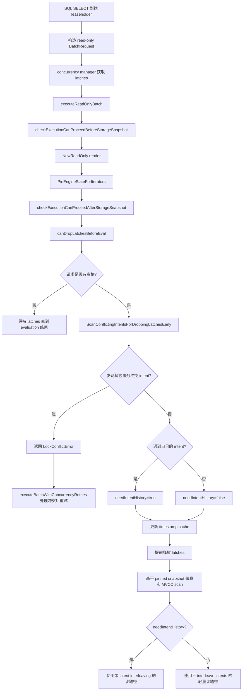

# ScanConflictingIntentsForDroppingLatchesEarly 深度剖析——读路径提前释放 Latches 策略

## 一、第一轮 BFS：这个函数到底解决什么问题

`ScanConflictingIntentsForDroppingLatchesEarly` 位于：

```text
pkg/storage/engine.go
```

它不是 SQL 层函数，也不是普通 MVCC Scan 的主读取函数。它是一个**读路径优化策略中的验证函数**：

```text
read-only batch 想在真正 evaluation 之前提前释放 latches
      |
      v
先扫 separated lock table
      |
      v
判断这次读会不会遇到其它事务的 intent
```

如果没有冲突 intent，读请求可以：

```text
pin Pebble snapshot
更新 timestamp cache
提前释放 latches
继续基于已经 pin 住的 snapshot 做真实 MVCC 读取
```

这样一个很慢的读请求不会一直拿着 latches 阻塞后面的写请求。

### 1.1 先给结论

这个函数的核心策略是：

```text
用一次便宜的 lock table scan，换取 read-only 请求提前释放 latches 的资格。
```

它只负责回答两个问题：

```go
func ScanConflictingIntentsForDroppingLatchesEarly(...) (needIntentHistory bool, err error)
```

第一，当前读范围内有没有其它事务的冲突 intent？

```text
有  -> append 到 intents，调用方返回 LockConflictError，不允许提前释放 latches
没有 -> 当前读可以继续尝试提前释放 latches
```

第二，后续真正读 MVCC 数据时是否还需要 intent history？

```text
遇到自己的 intent -> needIntentHistory = true
```

因为事务需要 read-your-own-write，且可能需要按 sequence number、epoch、savepoint rollback 等规则从 intent history 中取正确的 provisional value。

## 二、真实 SQL 场景：为什么读请求会卡住写请求

假设有表：

```sql
CREATE TABLE accounts (
  id INT PRIMARY KEY,
  balance INT
);
```

底层大致会变成 KV：

```text
/Table/accounts/1 -> balance=100
/Table/accounts/2 -> balance=200
```

现在有一个长范围读：

```sql
SELECT * FROM accounts WHERE id BETWEEN 1 AND 100000;
```

这个 SQL 到 KV 层可能变成一个或多个 `ScanRequest`。假设其中一个 scan 覆盖当前 replica 上的 key range：

```text
[accounts/1, accounts/100001)
```

正常悲观 read-only 执行路径大致是：

```text
1. concurrency manager 为读请求获取 latches
2. 读请求 pin Pebble snapshot
3. 读请求真正扫描 MVCC 数据
4. 读请求更新 timestamp cache
5. 读请求释放 latches
```

问题在第 3 步。如果这个 scan 很大，真实扫描可能很慢：

```text
Scan 读 10 万行
耗时 300ms
```

在这 300ms 内，一个写请求来了：

```sql
UPDATE accounts SET balance = balance + 10 WHERE id = 10;
```

它也要访问：

```text
accounts/10
```

如果读请求还拿着覆盖 `[accounts/1, accounts/100001)` 的 latch，写请求会被挡住：

```text
读请求大范围 latch 未释放
      |
      v
写请求 accounts/10 overlap
      |
      v
写请求等待
```

这个等待不是因为 SQL 锁，也不是因为 Pebble 不能并发读写，而是因为 CockroachDB 的 replica 级并发控制需要保护：

```text
1. timestamp cache 的更新顺序
2. intent / lock 检查顺序
3. overlapping read/write evaluation 的可串行化关系
```

### 2.1 优化目标

如果读请求已经 pin 住了 Pebble snapshot：

```text
读请求后续看到的 storage 视图固定了
```

那么后来的写请求即使写入 Pebble，也不会影响这个读请求的 snapshot。

于是可以考虑：

```text
读请求不要一直拿着 latches 做完整 scan
```

优化后的目标路径：

```text
1. 获取 latches
2. pin Pebble snapshot
3. 先扫 lock table，确认没有冲突 intent
4. 更新 timestamp cache
5. 提前释放 latches
6. 基于 snapshot 继续真正 scan
```

这样写请求可以在第 5 步之后进入，不用等第 6 步的大 scan 完成。

## 三、第二轮 BFS：它在读路径中的位置

调用链从 `Replica.executeReadOnlyBatch` 开始：

```text
Replica.executeReadOnlyBatch
  |
  |-- checkExecutionCanProceedBeforeStorageSnapshot
  |
  |-- StateEngine().NewReadOnly()
  |
  |-- rw.PinEngineStateForIterators(...)
  |
  |-- checkExecutionCanProceedAfterStorageSnapshot
  |
  |-- canDropLatchesBeforeEval
        |
        |-- canReadOnlyRequestDropLatchesBeforeEval
        |
        |-- ScanConflictingIntentsForDroppingLatchesEarly
        |
        |-- if no conflict:
              updateTimestampCacheAndDropLatches
              g = nil
  |
  |-- executeReadOnlyBatchWithServersideRefreshes
```

关键点是顺序：

```text
必须先 pin engine state
再扫 lock table
再更新 timestamp cache
再释放 latches
最后才做真正 MVCC scan
```

不能随便换顺序。

### 3.1 为什么先 pin Pebble snapshot

`PinEngineStateForIterators` 的意义是：

```text
从这一刻开始，这个 reader 创建出来的 iterator 看到同一个稳定 storage snapshot
```

例子：

```text
t=100: 读请求 pin snapshot
t=101: 写请求写 accounts/10 = 999
t=102: 读请求继续扫描 accounts/10
```

读请求看到的是 `t=100` 时的版本，不会看到 `t=101` 的新写。

所以：

```text
后来的写不会污染已经 pin 住的读视图
```

### 3.2 为什么还要扫 lock table

因为 pin snapshot 只能固定 committed MVCC 数据视图，不能自动证明：

```text
这个 snapshot 中没有别的事务的未提交 intent
```

如果 snapshot 里已经存在一个别的事务 intent，读请求不能无视它。

例子：

```sql
-- T1
BEGIN;
UPDATE accounts SET balance = 500 WHERE id = 10;
-- 不提交
```

底层大致是：

```text
MVCC key accounts/10 上有 T1 的 provisional value
separated lock table 里也有 intent(accounts/10, T1)
```

然后：

```sql
-- T2
SELECT * FROM accounts WHERE id BETWEEN 1 AND 100;
```

如果 T2 在读之前直接释放 latches，然后慢慢 scan，读到 `accounts/10` 时才发现 T1 intent，问题就复杂了：

```text
它已经释放了 latches
timestamp cache 也可能已经更新
其它写也可能已经进来
```

所以优化策略要求：

```text
在释放 latches 之前，先扫 lock table，把会冲突的 intent 找出来。
```

## 四、DFS 深入：函数逐段拆解

函数签名：

```go
func ScanConflictingIntentsForDroppingLatchesEarly(
    ctx context.Context,
    reader Reader,
    txnID uuid.UUID,
    ts hlc.Timestamp,
    start, end roachpb.Key,
    intents *[]roachpb.Intent,
    maxLockConflicts int64,
    targetLockConflictBytes int64,
) (needIntentHistory bool, err error)
```

参数含义：

```text
reader
  已经 pin 住 engine state 的 reader。
  它不是普通随时变动的读视图。

txnID
  当前请求所属事务 ID。
  非事务读时可以是 uuid.Nil。
  用来判断 lock table 里的 intent 是否属于自己。

ts
  当前读请求的 read timestamp。
  其它事务 intent 是否冲突，要和这个 timestamp 比较。

start, end
  用户 key 范围。
  Get 没有 end。
  Scan 使用 [start, end)。

intents
  输出参数。
  如果发现其它事务的冲突 intent，append 到这里。

maxLockConflicts
  最多收集多少个冲突 intent。

targetLockConflictBytes
  最多收集大约多少字节的冲突 intent 信息。

needIntentHistory
  返回值。
  true 表示后续真正 MVCC scan 不能跳过 intent interleaving。
```

### 4.1 把用户 key 范围映射到 lock table key 范围

用户 key：

```text
accounts/1
accounts/2
accounts/10
```

lock table 有自己的本地 key 编码。代码使用：

```go
ltStart, _ := keys.LockTableSingleKey(start, nil)
ltEnd, _ := keys.LockTableSingleKey(end, nil)
```

对应关系：

```text
用户 scan:       [accounts/1, accounts/101)
lock table scan: [LTSK(accounts/1), LTSK(accounts/101))
```

其中 `LTSK` 可以理解成：

```text
LockTableSingleKey(user_key)
```

单点 Get 没有 EndKey：

```sql
SELECT * FROM accounts WHERE id = 10;
```

底层是：

```text
start = accounts/10
end   = nil
```

这时使用 prefix iterator：

```text
只扫描 accounts/10 这个用户 key 对应的 lock table 前缀
```

### 4.2 为什么只匹配 lock.Intent

代码构造 iterator 时：

```go
opts := LockTableIteratorOptions{
    LowerBound: ltStart,
    MatchMinStr: lock.Intent,
    ReadCategory: fs.BatchEvalReadCategory,
}
```

lock table 中可能有三类 replicated lock：

```text
Shared
Exclusive
Intent
```

这个函数只关心：

```text
Intent
```

因为它只服务于：

```text
non-locking read
```

普通非锁定读不和 replicated Shared / Exclusive lock 冲突。真正会影响一致性读返回的，是其它事务未提交写入形成的 intent。

SQL 对照：

```sql
SELECT * FROM accounts WHERE id = 10;
```

这是 non-locking read。

它不应该因为别人持有某种 replicated shared/exclusive lock 就一定阻塞。但如果别人有未提交写：

```sql
BEGIN;
UPDATE accounts SET balance = 500 WHERE id = 10;
```

那这个未提交写就是 intent，普通一致性读必须处理它。

### 4.3 发现自己的 intent：不是冲突，但要保守打开 intent history

代码：

```go
ownIntent := txnID != uuid.Nil && txnID == meta.Txn.ID
if ownIntent {
    needIntentHistory = true
    continue
}
```

真实 SQL：

```sql
BEGIN;
UPDATE accounts SET balance = 500 WHERE id = 10;
SELECT balance FROM accounts WHERE id = 10;
COMMIT;
```

第二条 `SELECT` 必须读到：

```text
balance = 500
```

这叫 read-your-own-write。

自己的 intent 不应该变成 `LockConflictError`，否则事务会被自己挡住。

但为什么 `needIntentHistory=true`？

因为事务内部不是只有一个“当前值”这么简单。CockroachDB 的事务里还有：

```text
sequence number
epoch
ignored sequence numbers
savepoint rollback
timestamp push
```

看一个更真实的例子：

```sql
BEGIN;

UPDATE accounts SET balance = 500 WHERE id = 10; -- seq=1

SAVEPOINT cockroach_restart;

UPDATE accounts SET balance = 700 WHERE id = 10; -- seq=2

ROLLBACK TO SAVEPOINT cockroach_restart;

SELECT balance FROM accounts WHERE id = 10;
```

这个 `SELECT` 不一定应该看到最新 intent 里的 `700`。如果 seq=2 被 rollback，它应该看到之前合法的版本，比如 `500` 或更老版本。

这就是 intent history 的价值：

```text
同一个 intent metadata 下面可能有历史 provisional values
scanner 需要按 txn seq / ignored seq / epoch 规则挑正确值
```

当前函数在遇到自己的 intent 时选择保守策略：

```text
只要遇到 own intent，就让后续 MVCC scan 继续使用 intent interleaving。
```

它没有在这里精确判断：

```text
这个 own intent 是否真的需要 intent history
```

因为那样要重复实现 `pebbleMVCCScanner.getOne` 里的复杂规则。测试里也明确说明：

```text
当前实现对所有 read-your-own-write 场景都 fallback 到 intent interleaving iterator。
```

这是用性能换简单和正确性。

### 4.4 发现其它事务 intent：按 timestamp 判断是否冲突

代码：

```go
if intentConflicts := meta.Timestamp.ToTimestamp().LessEq(ts); !intentConflicts {
    continue
}
```

意思是：

```text
其它事务 intent timestamp <= 本次读 timestamp
  -> 冲突

其它事务 intent timestamp > 本次读 timestamp
  -> 当前读看不到它，可以忽略
```

真实 SQL 场景 1：冲突

```sql
-- T1, ts=10
BEGIN;
UPDATE accounts SET balance = 500 WHERE id = 10;
-- 不提交

-- T2, read ts=20
SELECT balance FROM accounts WHERE id = 10;
```

底层判断：

```text
T1 intent ts = 10
T2 read ts   = 20

10 <= 20
```

T2 的读时间戳已经在 T1 intent 之后。T2 不能直接读取旧 committed value，因为 T1 可能提交。

所以函数会 append：

```text
Intent(accounts/10, T1)
```

调用方返回：

```text
LockConflictError
```

外层会进入并发重试逻辑，等待或推动 T1。

真实 SQL 场景 2：不冲突

```sql
-- T2, read ts=20，已经选好了历史读时间戳
SELECT balance FROM accounts AS OF SYSTEM TIME ...

-- T1, intent ts=30
BEGIN;
UPDATE accounts SET balance = 500 WHERE id = 10;
```

底层判断：

```text
T1 intent ts = 30
T2 read ts   = 20

30 <= 20 false
```

T2 是历史读，看不到未来的 intent，忽略。

### 4.5 收集冲突 intent，而不是立刻返回

这个函数不是发现第一个冲突就返回，而是把冲突 append 到 `intents`：

```go
conflictingIntent := roachpb.MakeIntent(meta.Txn, ltKey.Key)
*intents = append(*intents, conflictingIntent)
```

为什么？

因为一次 `LockConflictError` 可以携带多个 locks：

```text
Scan [accounts/1, accounts/100)
  accounts/10 有 T1 intent
  accounts/20 有 T2 intent
  accounts/30 有 T3 intent
```

一次性返回多个冲突，可以让上层 lock wait / intent resolution 有更多信息。

但是不能无限收集，所以有两个限制：

```text
maxLockConflicts
targetLockConflictBytes
```

达到限制后：

```go
return true /* needsIntentHistory */, nil
```

这里返回 `true` 是保守策略。因为扫描提前停止了，函数无法证明后面没有 own intent，所以不能允许后续 MVCC scan 使用“不 interleave intents”的快速路径。

## 五、第三轮 BFS：提前释放 latches 的完整策略

`ScanConflictingIntentsForDroppingLatchesEarly` 不是孤立策略，它和下面几个机制一起构成完整正确性闭环：

```text
latches
Pebble snapshot pinning
separated lock table scan
timestamp cache
MVCC scan / intent interleaving
server-side concurrency retry
```

### 5.1 资格检查：不是所有读都能提前释放

调用方先执行：

```go
canReadOnlyRequestDropLatchesBeforeEval(ba, g)
```

只有这些请求有资格：

```text
1. g != nil
   当前请求确实持有 concurrency guard / latches

2. ReadConsistency == CONSISTENT
   当前只支持一致性读

3. EvalKind 是 PessimisticEval 或 PessimisticAfterFailedOptimisticEval
   不能是 OptimisticEval

4. ba.IsLocking() == false
   不能是 SELECT FOR UPDATE / FOR SHARE 这种锁定读

5. WaitPolicy 不能是 SkipLocked

6. 请求类型必须是：
   Get
   Scan
   ReverseScan
   Export
```

SQL 对照：

可以尝试：

```sql
SELECT * FROM accounts WHERE id = 10;
SELECT * FROM accounts WHERE id BETWEEN 1 AND 100;
```

不可以：

```sql
SELECT * FROM accounts WHERE id = 10 FOR UPDATE;
SELECT * FROM queue FOR UPDATE SKIP LOCKED;
```

为什么 `FOR UPDATE` 不可以？

```text
锁定读本身要获取锁。
它不能在真正 evaluation 前释放 latches，否则锁获取和读结果之间的并发关系不安全。
```

为什么 `SKIP LOCKED` 不可以？

```text
SKIP LOCKED 只应该把真正读到的 key 写入 timestamp cache。
如果提前按照整个 request span 更新 timestamp cache，会把跳过的 locked keys 也算成已读，语义不对。
```

为什么 `OptimisticEval` 不可以？

```text
OptimisticEval 一开始并不完整等待 latches。
而且 limited scan 最后到底读了多少 key，要看 response 的 ResumeSpan。
提前释放前无法准确知道 timestamp cache 应该覆盖哪个实际读范围。
```

### 5.2 执行顺序：为什么 timestamp cache 必须先于释放 latches

优化路径中有一行很关键：

```go
r.updateTimestampCacheAndDropLatches(ctx, g, ba, nil, nil, st)
```

注意它不是：

```text
先释放 latches，再更新 timestamp cache
```

而是一个 end-cmd 过程：

```text
更新 timestamp cache
释放 latches
```

为什么？

假设读请求 R：

```sql
SELECT balance FROM accounts WHERE id = 10;
```

读时间戳：

```text
R read ts = 100
```

如果 R 先释放 latch，但还没更新 timestamp cache，写请求 W 进来了：

```sql
UPDATE accounts SET balance = 999 WHERE id = 10;
```

W 可能选择：

```text
write ts = 90
```

这会破坏：

```text
R 在 ts=100 读过 accounts/10
后来的写不能悄悄写到 <=100 的时间戳
```

timestamp cache 的作用就是记录：

```text
accounts/10 在 ts=100 被读过
```

于是 W 必须写到：

```text
write ts > 100
```

所以正确顺序是：

```text
先记录“我读过”
再放别人进来写
```

### 5.3 为什么 pin snapshot + timestamp cache 就够了

读请求 R 在 t=0：

```text
pin Pebble snapshot S0
```

然后确认 lock table 没有冲突 intent。

然后：

```text
更新 timestamp cache
释放 latches
```

之后写请求 W 在 t=1 进入：

```text
写 accounts/10
```

W 会看到 timestamp cache：

```text
accounts/10 read at ts=100
```

于是 W 的写时间戳会被推到：

```text
> 100
```

同时 R 的真实读取还在 snapshot S0 上进行：

```text
R 不会看到 W 的新写
```

所以读写关系变成：

```text
R 逻辑上发生在 W 之前
W 的 timestamp 被推到 R 之后
```

这就是提前释放 latches 仍然安全的关键。

## 六、Mermaid：完整执行流程图



## 七、真实 SQL 场景 1：没有冲突，读提前释放 latches

初始数据：

```sql
INSERT INTO accounts VALUES (1, 100), (2, 200), (10, 1000);
```

事务：

```sql
-- T2
SELECT * FROM accounts WHERE id BETWEEN 1 AND 100;
```

此时没有其它事务未提交写。

底层过程：

```text
T2 Scan [accounts/1, accounts/101)
  |
  |-- 获取 latches
  |-- pin Pebble snapshot
  |-- 扫 lock table [LTSK(accounts/1), LTSK(accounts/101))
  |-- 没有 intent
  |-- update timestamp cache: [accounts/1, accounts/101) read at ts=T2
  |-- release latches
  |-- 继续 MVCC scan
```

此时另一个事务进来：

```sql
-- T3
UPDATE accounts SET balance = balance + 10 WHERE id = 10;
```

T3 不用等 T2 完整 scan 结束。它可以进入 evaluation，但会被 timestamp cache 约束：

```text
T3 write timestamp > T2 read timestamp
```

结果：

```text
T2 仍然读 snapshot 里的旧值
T3 写在 T2 之后
```

并发性提高，正确性保持。

## 八、真实 SQL 场景 2：其它事务有低时间戳 intent，不能提前释放

```sql
-- T1
BEGIN;
UPDATE accounts SET balance = 500 WHERE id = 10;
-- 不提交
```

底层：

```text
accounts/10 上有 T1 intent
intent timestamp = 10
```

另一个事务：

```sql
-- T2
SELECT * FROM accounts WHERE id BETWEEN 1 AND 100;
```

假设：

```text
T2 read timestamp = 20
```

判断：

```text
intent timestamp 10 <= read timestamp 20
```

函数会收集：

```text
Intent(accounts/10, T1)
```

调用方返回：

```text
LockConflictError{Locks: [accounts/10/T1]}
```

外层 `executeBatchWithConcurrencyRetries` 看到 `LockConflictError` 后，会走锁冲突处理逻辑：

```text
释放 latches
进入 lock wait / push / intent resolution 相关流程
等冲突解决后重试读请求
```

这里不能提前释放 latches 后继续读，因为 T2 的读结果取决于 T1：

```text
T1 commit -> T2 应该看到或被 timestamp/retry 影响
T1 abort  -> T2 可以读旧 committed value
```

## 九、真实 SQL 场景 3：其它事务有未来 intent，可以忽略

```sql
-- T2 是历史读
SELECT * FROM accounts AS OF SYSTEM TIME '-10s' WHERE id = 10;
```

假设：

```text
T2 read timestamp = 20
```

另一个事务：

```sql
-- T1
BEGIN;
UPDATE accounts SET balance = 500 WHERE id = 10;
```

T1 的 intent timestamp：

```text
30
```

判断：

```text
30 <= 20 false
```

所以这个 intent 对 T2 不冲突。T2 是历史读，它本来就不应该看到未来写。

函数会继续扫描，不把这个 intent 加入冲突列表。

## 十、真实 SQL 场景 4：事务读自己的写，为什么要 intent history

```sql
BEGIN;
UPDATE accounts SET balance = 500 WHERE id = 10;
SELECT balance FROM accounts WHERE id = 10;
COMMIT;
```

底层：

```text
accounts/10 上有当前事务自己的 intent
```

这个 intent：

```text
不冲突
但后续 scan 必须能读到它
```

所以函数返回：

```text
needIntentHistory = true
intents 为空
```

调用方结果：

```text
没有 LockConflictError
可以提前释放 latches
但 evaluation 使用 readOnlyDefault
也就是不要设置 DontInterleaveIntents
```

这样 `pebbleMVCCScanner.getOne` 在真正读到这个 key 时，会进入自己的 intent 处理逻辑：

```text
同 epoch 且 read seq >= intent seq
  -> 读自己的 intent

read seq < intent seq
  -> 可能从 intent history 里找旧 provisional value

intent seq 被 savepoint rollback 忽略
  -> 跳过这个 intent 或读更老版本

epoch 不同
  -> 按事务重启语义处理
```

这个路径不是 `ScanConflictingIntentsForDroppingLatchesEarly` 自己实现的。它只是提前告诉上层：

```text
后面别走 DontInterleaveIntents 的快速路径
```

## 十一、DontInterleaveIntents：这个返回值如何影响真正读取

`evaluateCommand` 里会把 eval path 转成：

```go
DontInterleaveIntents: evalPath == readOnlyWithoutInterleavedIntents
```

如果 `needIntentHistory=false`，且扫描 lock table 没发现冲突：

```text
evalPath = readOnlyWithoutInterleavedIntents
```

这会让 MVCC scan 不使用 `intentInterleavingIter`。

它的意义是：

```text
既然提前确认了 lock table 没有需要关心的 intent，
真正 scan MVCC 数据时就不必把 intent metadata interleave 进扫描结果。
```

这减少 iterator 复杂度和开销。

但如果遇到了自己的 intent：

```text
needIntentHistory=true
```

那么：

```text
evalPath 保持 readOnlyDefault
```

后续 scanner 仍然能看到 intent metadata，并按 `pebbleMVCCScanner.getOne` 的规则处理 own intent。

## 十二、为什么这个函数只扫 separated lock table，不直接扫 MVCC keyspace

直接 MVCC scan 能不能发现 intent？

能。

但直接 MVCC scan 的成本就是：

```text
你已经开始真正 evaluation 了
```

这不满足优化目标。优化目标是：

```text
在真正 evaluation 前，快速判断能不能释放 latches
```

separated lock table 的好处：

```text
1. lock / intent 有单独 keyspace
2. 可以只扫描锁记录，不扫所有 MVCC value
3. 可以按用户 key 范围映射成 lock table 范围
4. 可以用 LockTableIterator 过滤掉 Shared/Exclusive，只看 Intent
```

例如：

```text
accounts/1..accounts/100000 里有 100000 行数据
但只有 accounts/10 上有一个 intent
```

如果直接扫 MVCC 数据，需要走大量数据 key。

扫 lock table 时，关注的是：

```text
这个范围里有没有锁记录
```

这通常更接近优化目标。

## 十三、为什么达到 limit 后 conservatively 返回 true

代码中有两个提前返回：

```go
if maxLockConflicts != 0 && int64(len(*intents)) >= maxLockConflicts {
    return true /* needsIntentHistory */, nil
}

if targetLockConflictBytes != 0 && intentSize >= targetLockConflictBytes {
    return true /* needsIntentHistory */, nil
}
```

这看起来奇怪：

```text
已经发现很多冲突了，为什么返回 needsIntentHistory=true？
```

原因是这两个返回表示：

```text
扫描没完成
```

扫描没完成时，函数不能证明后面没有当前事务自己的 intent。

所以必须保守：

```text
needsIntentHistory = true
```

这不会改变是否有冲突的结论，因为 `intents` 已经有内容。调用方看到：

```text
len(intents) > 0
```

仍然会返回 `LockConflictError`。

但是这个保守返回保证了：

```text
如果未来某些路径继续使用返回值，也不会错误地关闭 intent interleaving。
```

## 十四、策略正确性的核心不变量

这个优化成立依赖几个不变量。

### 14.1 读请求已经被 concurrency manager 排序

在调用这个函数之前，请求已经通过 `SequenceReq`：

```text
获取 latches
检查内存 lock table
拿到 concurrency guard
```

所以它不是裸奔读。

### 14.2 Pebble snapshot 已经 pin 住

这保证：

```text
释放 latches 之后的新写，不会改变当前读接下来看到的 storage view。
```

### 14.3 释放 latches 前必须更新 timestamp cache

这保证：

```text
后来的写不会写到当前读 timestamp 之前或等于当前读 timestamp 的危险位置。
```

### 14.4 释放前必须确认没有冲突 intent

这保证：

```text
读请求不会在释放 latches 后才发现自己必须等待另一个未提交事务。
```

### 14.5 遇到 own intent 时不能关闭 intent interleaving

这保证：

```text
read-your-own-write、savepoint rollback、epoch、sequence number 语义仍由 MVCC scanner 正确处理。
```

## 十五、和普通 MVCC scan 处理 intent 的区别

普通 MVCC scan 在 `pebbleMVCCScanner.getOne` 里处理 intent：

```text
读到 intent metadata
  |
  |-- 不是自己的 intent
  |     |
  |     |-- intent ts <= read ts
  |     |      -> 记录 intent，最终 LockConflictError
  |     |
  |     |-- intent ts > read ts
  |            -> seek 到 read ts 可见版本
  |
  |-- 是自己的 intent
        |
        |-- seq/epoch/savepoint 判断
        |-- 可能读 intent 本身
        |-- 可能读 intent history
        |-- 可能跳过 intent 读旧版本
```

`ScanConflictingIntentsForDroppingLatchesEarly` 不想复制完整 MVCC scan 逻辑。

它只做提前验证：

```text
其它事务冲突 intent -> 返回给上层处理
自己的 intent -> 标记 needIntentHistory
未来 intent -> 忽略
Shared/Exclusive replicated locks -> 忽略
```

所以它是一个：

```text
preflight lock-table-only validation
```

不是完整 MVCC reader。

## 十六、为什么不是所有 read 都这么做

这个策略有额外成本：

```text
先扫一次 lock table
后面还要扫一次 MVCC keyspace
```

所以它不是“所有读都一定赚”。

它适合：

```text
读范围比较大
读 evaluation 可能比较慢
释放 latches 后能显著减少写请求等待
```

但对非常小的点读：

```sql
SELECT * FROM accounts WHERE id = 1;
```

额外扫 lock table 的收益可能很小。

CockroachDB 这里仍然允许 Get 走这个路径，因为：

```text
1. Get 的 lock table prefix scan 很小
2. 统一路径减少特殊分支
3. 有没有收益由运行时冲突和 workload 决定
```

## 十七、设计取舍

### 17.1 当前方案：先扫 lock table，再提前释放

优点：

```text
1. read-only 大 scan 不长时间阻塞写
2. 正确性边界清晰
3. 不需要完整 MVCC scan 就能发现关键 intent
4. 没有冲突时可以关闭 intent interleaving，降低后续 scan 成本
```

缺点：

```text
1. 多了一次 lock table scan
2. own intent 场景采取保守策略，可能没有最优性能
3. 只支持部分 read-only 请求
```

### 17.2 替代方案：读请求一直持有 latches

优点：

```text
逻辑简单
不需要提前扫 lock table
```

缺点：

```text
大 scan 会长时间阻塞写
高并发读写混合 workload 下延迟会变差
```

### 17.3 替代方案：直接释放 latches，不扫 lock table

这个不安全。

因为 snapshot 里可能已经有冲突 intent：

```text
释放 latches 后才发现需要等待 intent
```

这会让 timestamp cache、lock wait、intent resolution 的顺序变得复杂，容易破坏正确性。

### 17.4 替代方案：精确判断 own intent 是否需要 history

理论上可以优化：

```text
如果 own intent 的 seq/epoch/timestamp 一定能直接读取
就不必 needIntentHistory=true
```

但这要求在 lock table scan 阶段复制 MVCC scanner 的复杂判断：

```text
sequence number
epoch
ignored seq nums
savepoint rollback
timestamp push
```

当前实现选择：

```text
遇到 own intent 一律保守地 needIntentHistory=true
```

这牺牲一些性能，换取更低复杂度和更稳的正确性。

## 十八、最终心智模型

把整个策略浓缩成一句话：

```text
读请求先拿 latches 建立正确的并发顺序；
pin 住 Pebble snapshot 后，用 lock table scan 确认没有必须等待的 intent；
然后先更新 timestamp cache，再释放 latches；
最后基于稳定 snapshot 慢慢读。
```

伪代码：

```go
func readOnlyRequest() {
    guard := concurrencyManager.SequenceReq()
    defer maybeRelease(guard)

    reader := engine.NewReadOnly()
    reader.PinEngineStateForIterators()

    if eligibleToDropLatchesEarly(request, guard) {
        intents := scanSeparatedLockTable(request.span, request.txnID, request.readTS)
        if len(intents) > 0 {
            return LockConflictError(intents)
        }

        updateTimestampCache(request.span, request.readTS)
        releaseLatches(guard)
        guard = nil
    }

    return mvccScan(readerPinnedSnapshot)
}
```

核心不是“读不用锁了”，而是：

```text
读已经通过 latches 排序过；
读已经固定 storage snapshot；
读已经检查过 intent；
读已经写入 timestamp cache；
所以 latches 可以不覆盖整个慢 scan。
```

这就是 `ScanConflictingIntentsForDroppingLatchesEarly` 的策略价值。
