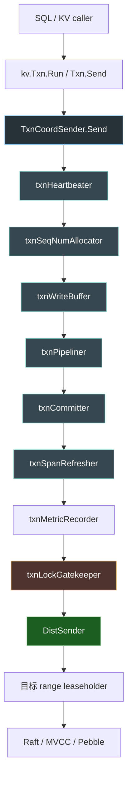
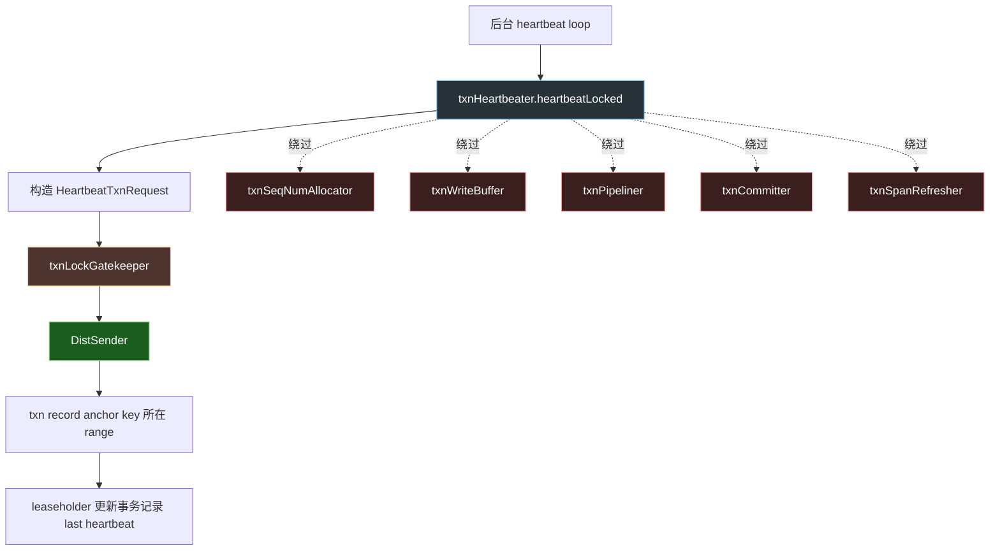
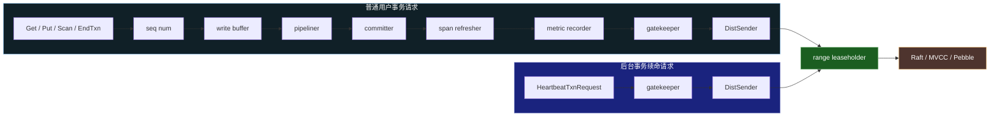

# TxnInterceptor栈深度剖析——CockroachDB事务请求的客户端侧流水线

## 一、第一轮 BFS：职责边界与设计动机（Why）

### 1.1 先回答你问的那句话

你看到的这句话：

```text
不会走 seq num
不会走 write buffer
不会走 pipeliner
不会走 committer
不会走 span refresher
```

说的是 `txnHeartbeater` 发送后台 `HeartbeatTxnRequest` 的特殊路径。

正常事务请求会走完整的事务 interceptor 栈：

```text
TxnCoordSender.Send
  -> txnHeartbeater
  -> txnSeqNumAllocator
  -> txnWriteBuffer
  -> txnPipeliner
  -> txnCommitter
  -> txnSpanRefresher
  -> txnMetricRecorder
  -> txnLockGatekeeper
  -> DistSender
  -> range leaseholder
```

但是 heartbeat 请求不是用户的 Get/Put/Scan/EndTxn。它只是后台去事务记录所在的 range 上续命：

```text
txnHeartbeater.heartbeatLocked
  -> txnLockGatekeeper
  -> DistSender
  -> txn record 所在 range 的 leaseholder
```

关键源码位置：

- Root transaction interceptor 栈构造在 `pkg/kv/kvclient/kvcoord/txn_coord_sender.go:289`。
- `TxnCoordSender.Send` 调用栈顶 `interceptorStack[0].SendLocked` 在 `pkg/kv/kvclient/kvcoord/txn_coord_sender.go:622`。
- Heartbeat 直接调用 `h.gatekeeper.SendLocked` 在 `pkg/kv/kvclient/kvcoord/txn_interceptor_heartbeater.go:521`。
- `txnHeartbeater` 字段注释明确说 gatekeeper 会绕过其它 interceptors，见 `pkg/kv/kvclient/kvcoord/txn_interceptor_heartbeater.go:101`。

所以这句话不是说所有事务都不走这些层，而是说：

```text
后台 heartbeat 不走这些层。
普通用户事务请求会走这些层。
```

### 1.2 为什么 CockroachDB 要有 interceptor 栈

`TxnCoordSender` 是 KV 事务在客户端侧的协调器。这里的“客户端侧”不是浏览器客户端，而是相对于 KV range leaseholder 来说的请求发起侧，也就是 gateway node / gateway pod 上的 KV client 层。

如果一个 SQL 请求打到 node 1：

```text
SQL client
  -> node 1 SQL gateway
  -> node 1 上的 kv.Txn
  -> node 1 上的 TxnCoordSender
  -> DistSender 路由到目标 range leaseholder
```

事务不能只是简单把 `BatchRequest` 发出去。因为 CockroachDB 的事务需要在客户端侧维护很多跨请求状态：

- 每个写请求的 sequence number。
- 客户端本地暂存的 writes。
- 已经发出去但还没证明成功的 in-flight writes。
- 事务已经读过哪些 span，方便被 push timestamp 后做 refresh。
- commit 时是否能 1PC、parallel commit、read-only elide。
- 事务 record 是否需要 heartbeat，是否被其它事务 abort。
- 请求发送期间如何释放 `TxnCoordSender` 锁，避免网络 RPC 阻塞整个 coordinator。

如果把这些逻辑全写在 `TxnCoordSender.Send` 一个函数里，它会变成一个巨大状态机。CockroachDB 选择把这些职责拆成多个 interceptor：

```text
每一层只处理一个维度的问题。
处理完以后，把请求交给下一层。
响应回来以后，再从下往上回传。
```

这就是典型的 Chain of Responsibility / Pipeline 思路。

### 1.3 核心对象：TxnCoordSender

`TxnCoordSender` 是 `kv.TxnSender` 的生产实现。它不是全局单例，而是每个事务一个。源码注释在 `pkg/kv/kvclient/kvcoord/txn_coord_sender.go:77` 附近说明了它的职责：

```text
TxnCoordSender
  - 代表客户端维护事务状态
  - 给事务 record 发 heartbeat
  - 维护 lock spans / intents
  - 处理 retryable error
  - commit/rollback 后清理本地状态
```

它内部预分配了一组 interceptor 对象：

```go
interceptorAlloc struct {
    arr [7]txnInterceptor
    txnHeartbeater
    txnSeqNumAllocator
    txnWriteBuffer
    txnPipeliner
    txnCommitter
    txnSpanRefresher
    txnMetricRecorder
    txnLockGatekeeper // not in interceptorStack array.
}
```

注意 `txnLockGatekeeper` 不在 `interceptorStack` 数组里，它在栈底负责把 interceptor 栈接到底层 `DistSender`。

### 1.4 RootTxn 和 LeafTxn 的栈不一样

Root transaction 的完整栈是：

```text
txnHeartbeater
txnSeqNumAllocator
txnWriteBuffer
txnPipeliner
txnCommitter
txnSpanRefresher
txnMetricRecorder
txnLockGatekeeper
DistSender
```

Leaf transaction 的栈更短：

```text
txnSeqNumAllocator
txnWriteBuffer
txnPipeliner
txnSpanRefresher  // 条件性存在
txnLockGatekeeper
DistSender
```

原因是 leaf txn 是分布式 SQL 执行里派生出来的局部事务视图。它通常只负责读，不负责真正 commit，不负责 heartbeat root transaction record。因此 leaf 上没有 `txnHeartbeater`、`txnCommitter`、`txnMetricRecorder` 这些 root-only 逻辑。源码见 `pkg/kv/kvclient/kvcoord/txn_coord_sender.go:403`。

---

## 二、第二轮 BFS：控制流与组件协作（How it flows）

### 2.1 正常事务请求的完整调用链

下面是普通事务请求的路径，例如：

```sql
BEGIN;
UPDATE accounts SET balance = balance - 100 WHERE id = 1;
UPDATE accounts SET balance = balance + 100 WHERE id = 2;
COMMIT;
```

在 KV 层可以粗略理解成：

```text
Get(account:1)
Put(account:1)
Get(account:2)
Put(account:2)
EndTxn(commit=true)
```

Mermaid 图：



### 2.2 Heartbeat 请求的特殊路径

Heartbeat 是后台 goroutine 周期性发的，不是用户显式发的请求。

当一个事务开始留下锁或 intent 后，`txnHeartbeater.SendLocked` 会确保事务有一个 txn record anchor key，并启动 heartbeat loop。后续 `heartbeatLocked` 构造 `HeartbeatTxnRequest`，直接走 gatekeeper：

```text
heartbeatLocked
  -> h.gatekeeper.SendLocked
  -> DistSender
  -> txn record range leaseholder
```

Mermaid 图：



### 2.3 一句话心智模型

正常事务请求：

```text
我要读写用户数据，所以要经过事务语义增强层。
```

Heartbeat 请求：

```text
我只是在更新事务记录的活跃时间，不是用户读写，不要给我加事务读写语义。
```

---

## 三、DFS 深入：五个核心 interceptor 分别是什么

### 3.1 txnSeqNumAllocator：给事务内部请求编号

#### 3.1.1 它解决什么问题

一个事务里面可能有很多请求：

```text
Put(k, v1)
Get(k)
Put(k, v2)
Get(k)
EndTxn(commit=true)
```

这些请求都属于同一个 `txn_id`，但它们在事务内部也有顺序。CockroachDB 需要知道：

```text
第一个 Put 是第几步？
第二个 Put 是第几步？
Get 应该看到哪个 Put？
请求重放时，怎么判断这是同一个写，还是新的写？
```

所以每个事务内部写请求会拿到一个递增的 `Sequence`。源码入口是 `pkg/kv/kvclient/kvcoord/txn_interceptor_seq_num_allocator.go:79`。

核心字段：

```go
type txnSeqNumAllocator struct {
    writeSeq enginepb.TxnSeq
    readSeq  enginepb.TxnSeq
    steppingMode kv.SteppingMode
}
```

含义：

```text
writeSeq = 最近一次写请求拿到的 sequence number
readSeq  = 读请求应该按哪个 sequence number 读
```

#### 3.1.2 它怎么给请求编号

`SendLocked` 里遍历当前 batch 的每个 request：

```text
如果是 intent write 或 EndTxn:
  writeSeq++
  req.Header.Sequence = writeSeq

否则:
  req.Header.Sequence = readSeq
```

源码逻辑在 `pkg/kv/kvclient/kvcoord/txn_interceptor_seq_num_allocator.go:89`。

举例：

```text
事务 T:
  Put(k, "v1")   -> writeSeq 从 0 到 1，Put seq=1
  Get(k)         -> readSeq 自动推进到 1，Get seq=1，可以看到 v1
  Put(k, "v2")   -> writeSeq 从 1 到 2，Put seq=2
  Get(k)         -> readSeq 自动推进到 2，Get seq=2，可以看到 v2
  EndTxn         -> writeSeq 从 2 到 3，EndTxn seq=3
```

为什么读也要 sequence？

因为同一个事务里可能对同一个 key 写多次。MVCC 层看到一个事务自己的 intents 时，需要判断：

```text
这个 read 应该看到哪个 seq 之前的写？
```

例如：

```text
seq=1 Put(k, v1)
seq=2 Put(k, v2)
seq=1 的 Get(k) 不能看到 seq=2 的 v2
seq=2 的 Get(k) 可以看到 seq=2 的 v2
```

这也是 savepoint / rollback 能工作的基础。

#### 3.1.3 它为什么能保证重放幂等

写请求的唯一身份不是只有 key，而是：

```text
(txn_id, epoch, seq)
```

如果网络抖动导致同一个 Put 被重发：

```text
第一次 Put(k, v1), txn=T, epoch=0, seq=1
第二次重放 Put(k, v1), txn=T, epoch=0, seq=1
```

MVCC 层可以知道这是同一个写，不能当成新写。源码注释在 `pkg/kv/kvclient/kvcoord/txn_interceptor_seq_num_allocator.go:38` 附近明确提到这个 tuple。

#### 3.1.4 Heartbeat 为什么不走 seq num

Heartbeat 不是用户写请求，也不是用户读请求。它只是：

```text
HeartbeatTxn(txn_id, txn_key, now)
```

它的目标是更新事务记录，告诉其它事务：

```text
这个事务协调器还活着，不要把它当成过期事务随便 abort。
```

如果 heartbeat 也走 `txnSeqNumAllocator`，会带来几个问题：

- 它不是事务写集的一部分，却可能参与事务内部 sequence 语义。
- 它不应该影响 read-your-own-write、savepoint、EndTxn 的 sequence 判断。
- 它是后台请求，可能和前台用户请求并发；如果也通过完整栈，会和用户请求争用同一套事务请求状态。

所以 heartbeat 直接走 gatekeeper，再到底层 `DistSender`。

---

### 3.2 txnWriteBuffer：把事务写先放在 gateway 内存里

#### 3.2.1 它解决什么问题

普通写事务如果每次 Put 都直接发到底层 KV：

```text
Put(k1) -> 远程 leaseholder
Put(k2) -> 远程 leaseholder
Put(k3) -> 远程 leaseholder
Commit  -> 事务记录 range
```

每个写都可能有网络、latch、evaluation、Raft、锁跟踪成本。

`txnWriteBuffer` 的思路是：

```text
先把一部分 transactional writes 缓存在 gateway node 内存里。
等 commit 或必须 flush 时，再把它们一起发到 KV 层。
```

源码文件开头注释列了四个收益，见 `pkg/kv/kvclient/kvcoord/txn_interceptor_write_buffer.go:79`：

- commit 时批量发送 writes。
- 同一个 key 多次写，只需要真正落最后一次。
- read-your-own-writes 可以在 gateway 本地返回。
- 更容易被动命中 1PC fast path。

#### 3.2.2 它内部存什么

核心字段在 `pkg/kv/kvclient/kvcoord/txn_interceptor_write_buffer.go:161`：

```go
type txnWriteBuffer struct {
    enabled bool
    flushed bool
    flushOnNextBatch bool
    buffer btree
    bufferSize int64
}
```

可以理解成：

```text
buffer 是一棵按 key/span 排序的树。
每个 key 下保存这个事务对它写过的多个版本。
每个版本带自己的 sequence number。
```

底层结构在 `pkg/kv/kvclient/kvcoord/txn_interceptor_write_buffer.go:1951` 附近：

```text
bufferedWrite:
  key
  endKey
  vals: [bufferedValue(seq=1), bufferedValue(seq=3), ...]
```

为什么同一个 key 要保留多个版本？

因为 savepoint 可能回滚：

```text
BEGIN
Put(k, v1)        seq=1
SAVEPOINT s
Put(k, v2)        seq=2
ROLLBACK TO s
Get(k)            应该看到 v1，不应该看到 v2
```

如果 buffer 只保存最后一个值，rollback savepoint 就没法恢复旧值。

#### 3.2.3 它怎么处理一个 batch

入口是 `pkg/kv/kvclient/kvcoord/txn_interceptor_write_buffer.go:263`。

核心流程：

```text
如果 flushOnNextBatch:
  先 flush buffer，再发送当前 batch

如果 write buffering 没启用:
  直接交给下一层

如果 batch 里有 EndTxn(commit=false):
  rollback，不需要 flush buffer

如果 batch 里有 EndTxn(commit=true):
  flush buffer + commit

如果当前 batch 类型要求 flush:
  flush buffer + 当前 batch

如果 buffer 会超内存预算:
  flush buffer + 当前 batch

否则:
  transform 当前 batch
  能本地处理的读写在本地处理
  需要发 KV 的请求交给下一层
  回来后把 KV response 和本地 buffer response 合并
```

#### 3.2.4 read-your-own-writes 例子

例子：

```text
BEGIN
Put(account:1, balance=900)
Get(account:1)
COMMIT
```

如果没有 write buffer：

```text
Put(account:1) 发到 leaseholder，写 intent
Get(account:1) 发到 leaseholder，读自己的 intent
Commit 发送 EndTxn
```

如果有 write buffer：

```text
Put(account:1) 不立刻发 KV，存在 gateway buffer
Get(account:1) 在 gateway buffer 里命中 balance=900
Commit 时把 Put(account:1) + EndTxn 一起发出去
```

这不是说所有写都永远不落盘。它只是延迟到 commit 或 flush：

```text
buffer 只是客户端内存。
真正提交时还是要经过 DistSender -> leaseholder -> Raft -> MVCC/Pebble。
```

#### 3.2.5 flush 是怎么做的

`flushBufferAndSendBatch` 在 `pkg/kv/kvclient/kvcoord/txn_interceptor_write_buffer.go:1749`。

核心动作：

```text
把 buffer 里的 writes 转回 KV requests
按 sequence number 排序
prepend 到当前 batch 前面
发送给下一层
回来后把 flush 产生的 response 从 BatchResponse 里剥掉
上层看起来就像没有发生过 flush
```

例子：

```text
buffer:
  Put(k1, seq=1)
  Put(k2, seq=2)

当前 batch:
  EndTxn(commit=true, seq=3)

flush 后实际发给下层:
  Put(k1, seq=1)
  Put(k2, seq=2)
  EndTxn(commit=true, seq=3)

返回给上层时:
  只保留 EndTxn response
```

#### 3.2.6 Heartbeat 为什么不走 write buffer

Heartbeat 不是用户写，也不是 read-your-own-write。它必须真的发到 txn record 所在 range，更新事务活跃状态。

如果 heartbeat 经过 write buffer：

```text
HeartbeatTxn 可能被误认为某种可 transform 的事务请求
或者和 flush / buffer 状态产生不必要耦合
或者被前台写 buffer 的内存预算、flush 策略影响
```

这都不符合 heartbeat 的目标。Heartbeat 要的是：

```text
尽快、简单、独立地更新 txn record。
```

所以它绕过 write buffer。

---

### 3.3 txnPipeliner：让事务写异步过 Raft，并跟踪 in-flight writes

#### 3.3.1 它解决什么问题

事务写通常要经过：

```text
leaseholder evaluation
Raft consensus
apply
返回客户端
```

如果每个写都同步等待 Raft 完成，延迟会比较高。

`txnPipeliner` 的思想是：

```text
写请求 evaluation 成功后，可以先返回给客户端。
Raft consensus 还在后台继续。
客户端把这个写记为 in-flight write。
后续在真正依赖它之前，再用 QueryIntent 证明它确实成功了。
```

源码注释在 `pkg/kv/kvclient/kvcoord/txn_interceptor_pipeliner.go:125` 附近说明：

```text
in-flight write = 已经异步 proposed through Raft，但还没证明成功的写。
proving = 用 QueryIntent 检查这个 intent 确实存在。
```

#### 3.3.2 它内部跟踪什么

核心字段在 `pkg/kv/kvclient/kvcoord/txn_interceptor_pipeliner.go:228`：

```go
type txnPipeliner struct {
    ifWrites inFlightWriteSet
    lockFootprint condensableSpanSet
}
```

可以理解成：

```text
ifWrites:
  记录还没证明成功的 point writes

lockFootprint:
  记录事务曾经拿过锁/写过 intent 的 span
  commit/rollback 时带给 EndTxn，方便清理锁
```

`inFlightWriteSet` 底层是一棵 B-Tree，源码在 `pkg/kv/kvclient/kvcoord/txn_interceptor_pipeliner.go:1103`。

#### 3.3.3 它怎么处理请求

入口是 `pkg/kv/kvclient/kvcoord/txn_interceptor_pipeliner.go:311`。

核心流程：

```text
如果 batch 有 EndTxn:
  把 lockFootprint 和 ifWrites attach 到 EndTxn 上

检查 lock tracking 是否超预算

判断当前 batch 是否能 AsyncConsensus
  如果能，设置 ba.AsyncConsensus = true

如果当前请求会依赖某些 in-flight writes:
  在请求前插入 QueryIntent
  先证明之前的 write 成功，再继续当前请求

发送给下一层

根据 response/error 更新 ifWrites 和 lockFootprint

隐藏内部插入的 QueryIntent response
```

#### 3.3.4 具体例子：为什么需要 QueryIntent

假设事务 T：

```text
T:
  Put(k, v1)   // async consensus，返回时 Raft 可能还没完成
  Get(k)       // 后续马上读 k
```

如果 `Get(k)` 直接发出去，可能发生：

```text
Put(k) evaluation 成功，但 Raft 还没 apply
Get(k) 到 leaseholder 时还看不到 intent
```

所以 pipeliner 会做：

```text
Put(k, v1)
  -> 记录 in-flight write: (k, seq=1)

Get(k)
  -> 发现 Get(k) overlap in-flight write k
  -> 在 Get(k) 前加 QueryIntent(k, seq=1, ErrorIfMissing=true)
  -> QueryIntent 成功，证明 Put(k) 的 intent 存在
  -> 再执行 Get(k)
```

源码 `chainToInFlightWrites` 的作用就是这个，见 `pkg/kv/kvclient/kvcoord/txn_interceptor_pipeliner.go:601`。

#### 3.3.5 具体例子：commit 时证明所有 in-flight writes

事务 T：

```text
Put(a) async -> in-flight a seq=1
Put(b) async -> in-flight b seq=2
EndTxn(commit=true)
```

commit 时不能只写事务记录。必须证明：

```text
a 的 intent 确实写成功了
b 的 intent 确实写成功了
```

于是 pipeliner 会把这些写 attach 到 EndTxn：

```text
EndTxn:
  LockSpans = 已经证明稳定的锁
  InFlightWrites = [a seq=1, b seq=2]
```

后面的 committer 再决定是否可以 parallel commit。

#### 3.3.6 Heartbeat 为什么不走 pipeliner

Heartbeat 不应该被 in-flight writes 阻塞。

想象一个事务正在高并发写很多 key：

```text
Put(k1) async
Put(k2) async
Put(k3) async
...
```

如果 heartbeat 也走 pipeliner，pipeliner 可能会觉得：

```text
有 in-flight writes，要不要 chain？
要不要插 QueryIntent？
要不要更新 lockFootprint？
```

这会让 heartbeat 被用户数据写的 pipeline 状态污染。

但 heartbeat 的职责是独立续命：

```text
只要 txn record 还活着，用户请求慢一点没关系。
heartbeat 不能因为用户写 pipeline 卡住而发不出去。
```

所以 heartbeat 绕过 pipeliner。

---

### 3.4 txnCommitter：专门处理 EndTxn、1PC、parallel commit

#### 3.4.1 它解决什么问题

事务最终要 commit 或 rollback。KV 层的提交请求是 `EndTxnRequest`。

`txnCommitter` 专门拦截 `EndTxn`：

```text
没有 EndTxn:
  直接放行

有 EndTxn:
  检查 batch 合法性
  判断 read-only txn 是否可以省略 EndTxn
  设置 EndTxn 的 key
  判断 1PC / parallel commit
  处理 STAGING / PREPARED / COMMITTED 状态
```

入口在 `pkg/kv/kvclient/kvcoord/txn_interceptor_committer.go:138`。

#### 3.4.2 read-only transaction 为什么可以省略 EndTxn

如果事务没有写，也没有拿锁：

```sql
BEGIN;
SELECT * FROM accounts WHERE id = 1;
COMMIT;
```

KV 层不需要写事务记录。因为没有 intents 要提交，也没有 locks 要释放。

所以 committer 可以：

```text
不发送 EndTxn 到 KV
本地合成一个 EndTxn response
把 txn status 改成 COMMITTED
```

源码函数是 `sendLockedWithElidedEndTxn`，见 `pkg/kv/kvclient/kvcoord/txn_interceptor_committer.go:299`。

#### 3.4.3 1PC 是什么

1PC = one phase commit。

如果一个事务的所有写和 EndTxn 能在同一个 range 上一次性完成，那么可以不用：

```text
先写 intents
再写 txn record
再异步 resolve intents
```

而是：

```text
一次 batch 里直接写 committed MVCC values
```

这通常发生在：

```text
BEGIN
Put(k1)
Put(k2)
COMMIT

k1/k2/txn record 都在同一个 range 或能满足完整事务条件
```

write buffer 会让这种场景更容易出现，因为 writes 被攒到 commit 时一起发。

#### 3.4.4 parallel commit 是什么

普通 commit 可以理解成：

```text
先确保所有 writes 成功
再写 txn record = COMMITTED
```

parallel commit 的优化目标是：

```text
写用户 intents 和写 txn record 并行推进，减少一次共识延迟。
```

它引入一个中间状态 `STAGING`：

```text
txn record = STAGING
InFlightWrites = [所有还需要证明的 writes]
```

如果满足隐式提交条件：

```text
txn record 是 STAGING
并且 InFlightWrites 里的所有 intents 都确实存在
并且这些 intents 的 timestamp <= staging timestamp
```

那么事务已经可以被认为 committed。之后 committer 会异步把它推进成显式 `COMMITTED`，源码见 `makeTxnCommitExplicitAsync`，位置在 `pkg/kv/kvclient/kvcoord/txn_interceptor_committer.go:492`。

#### 3.4.5 具体例子：parallel commit

```text
事务 T:
  Put(a) async consensus
  Put(b) async consensus
  EndTxn(commit=true)
```

commit batch 到达时：

```text
EndTxn.InFlightWrites = [a seq=1, b seq=2]
txn record 写成 STAGING
```

如果系统确认：

```text
a intent 存在
b intent 存在
txn record 是 STAGING
```

那么对外可以认为：

```text
T 已经 committed
```

然后异步做：

```text
STAGING -> COMMITTED
resolve intents
```

#### 3.4.6 Heartbeat 为什么不走 committer

Heartbeat 没有 `EndTxn`。

它不是 commit，也不是 rollback，更不是 prepare。它不需要：

- 判断 1PC。
- 判断 parallel commit。
- 合成 EndTxn response。
- 设置 `EndTxn.Key = ba.Txn.Key`。
- 把 STAGING response 转成 COMMITTED response。

如果 heartbeat 走 committer，通常只是被 committer pass-through。问题是这没有任何收益，还会把后台续命请求暴露给 commit 相关状态机。CockroachDB 选择更干净的路径：

```text
heartbeat 直接到 gatekeeper。
```

---

### 3.5 txnSpanRefresher：用 refresh 避免事务从头重试

#### 3.5.1 它解决什么问题

Serializable 事务要求事务看起来像在一个时间点执行。

CockroachDB 事务有读时间戳 / 写时间戳。事务开始时可能在 timestamp 10 读了数据：

```text
T1 ReadTimestamp = 10
T1 Get(k)
```

后来因为冲突，T1 被迫把提交时间推进到 20：

```text
T1 WriteTimestamp 从 10 被 push 到 20
```

问题来了：

```text
T1 在 ts=10 读到的结果，在 ts=20 还成立吗？
```

如果 `k` 在 10 到 20 之间被别人改过，那么 T1 之前读到的结果就不可信了，必须重试。

如果 `k` 在 10 到 20 之间没变，那么 T1 可以把自己的读时间戳也推进到 20，不用从头执行。

`txnSpanRefresher` 就是干这个的。

#### 3.5.2 它内部记录什么

核心字段在 `pkg/kv/kvclient/kvcoord/txn_interceptor_span_refresher.go:120`：

```go
type txnSpanRefresher struct {
    refreshFootprint condensableSpanSet
    refreshInvalid bool
    refreshedTimestamp hlc.Timestamp
    canAutoRetry bool
}
```

可以理解成：

```text
refreshFootprint:
  事务读过的 key spans

refreshInvalid:
  因为内存预算等原因，已经放弃精确记录 read spans

refreshedTimestamp:
  已经成功 refresh 到的最大 timestamp

canAutoRetry:
  root txn 才能自动 retry，因为 root 才有完整 read span 信息
```

#### 3.5.3 它怎么处理请求

入口在 `pkg/kv/kvclient/kvcoord/txn_interceptor_span_refresher.go:149`。

核心流程：

```text
发送前:
  设置 ba.CanForwardReadTimestamp
  必要时做 preemptive refresh

发送:
  调下一层 sender

如果返回 retryable error，且这个 error 可以通过 refresh 解决:
  取出需要前推到的 timestamp
  对 refreshFootprint 里的 spans 发送 Refresh / RefreshRange
  如果 refresh 成功:
    更新 batch txn timestamp
    重发原 batch
  如果 refresh 失败:
    把原 retry error 返回给上层

如果请求成功且 txn 仍然 PENDING:
  从当前 batch/response 里提取 read spans
  追加到 refreshFootprint
  如果 refresh span 内存太大，尝试 condense
```

相关源码：

- `sendLockedWithRefreshAttempts` 在 `pkg/kv/kvclient/kvcoord/txn_interceptor_span_refresher.go:225`。
- `maybeRefreshAndRetrySend` 在 `pkg/kv/kvclient/kvcoord/txn_interceptor_span_refresher.go:249`。
- `tryRefreshTxnSpans` 在 `pkg/kv/kvclient/kvcoord/txn_interceptor_span_refresher.go:533`。
- `appendRefreshSpans` 在 `pkg/kv/kvclient/kvcoord/txn_interceptor_span_refresher.go:611`。

#### 3.5.4 具体例子：refresh 成功

```text
T1:
  ts=10
  Get(account:1) -> balance=100
  Put(account:2)

T2:
  ts=15
  Put(other_key)
  Commit

T1 commit 时被 push 到 ts=20
```

T1 需要确认：

```text
account:1 在 [10,20] 之间有没有被改？
```

如果没有：

```text
Refresh(account:1, from=10, to=20) 成功
T1 把 read timestamp 前推到 20
不用重新执行 Get(account:1)
继续 commit
```

#### 3.5.5 具体例子：refresh 失败

```text
T1:
  ts=10
  Get(account:1) -> balance=100

T2:
  ts=15
  Put(account:1, balance=80)
  Commit

T1 commit 时被 push 到 ts=20
```

这时：

```text
Refresh(account:1, from=10, to=20) 失败
```

因为 T1 在 ts=20 再读 account:1，结果会变成 80，不再是 100。

所以 T1 不能偷偷把读时间戳推进到 20，必须返回 retryable error，让上层从头重试事务逻辑。

#### 3.5.6 Heartbeat 为什么不走 span refresher

Heartbeat 不读用户数据，也不建立用户 read footprint。

它不应该：

- 被记录成 refresh span。
- 因为用户读 span 内存预算失败。
- 因为 serializable refresh 逻辑被重发原 batch。
- 参与 `CanForwardReadTimestamp` 这种用户事务读时间戳判断。

Heartbeat 只关心：

```text
txn record 是否还活着。
```

所以它绕过 span refresher。

---

## 四、为什么 Heartbeat 只走 gatekeeper

### 4.1 Heartbeat 到底在更新什么

一个写事务会有事务记录：

```text
txn record key = keys.TransactionKey(txn.Key, txn.ID)
```

其中 `txn.Key` 是 txn record anchor key。这个 key 通常来自事务里某个会加锁/写 intent 的请求。`txnHeartbeater.SendLocked` 会在第一次看到 locking request 时设置它。

Heartbeat 做的事情可以理解为：

```text
HeartbeatTxn(txn_id, txn_key, now)
```

发送到 txn record 所在 range 的 leaseholder 后，leaseholder 会看到：

```text
这个事务协调器还在定期更新。
这个事务不是过期事务。
其它事务 push 它时不能随便 abort。
```

### 4.2 为什么还要走 txnLockGatekeeper

虽然 heartbeat 绕过了中间 interceptor，但它没有绕过 `txnLockGatekeeper`。

`txnLockGatekeeper` 的职责是：

```text
在进入底层 sender 之前释放 TxnCoordSender 的 mutex。
等底层 sender 返回后再把 mutex 拿回来。
```

源码在 `pkg/kv/kvclient/kvcoord/txn_lock_gatekeeper.go:51`。

为什么要释放锁？

因为下面会走网络 RPC：

```text
DistSender
  -> range lookup
  -> gRPC to leaseholder
  -> raft/evaluation
  -> response
```

如果一直拿着 `TxnCoordSender` 的 mutex，前台请求、rollback、heartbeat loop 都可能互相卡死。

`txnLockGatekeeper` 还有一个特殊逻辑：

```go
if !gs.allowConcurrentRequests && !ba.IsSingleHeartbeatTxnRequest() {
    if gs.requestInFlight {
        return concurrent txn use error
    }
}
```

也就是说：

```text
Root txn 默认不允许并发用户请求。
但是单独的 HeartbeatTxnRequest 是例外。
```

这就是 heartbeat 能在后台和前台事务请求并发存在的关键。

### 4.3 表格总结：Heartbeat 为什么不走这些层

| Interceptor | 普通事务请求需要它吗 | Heartbeat 需要它吗 | 原因 |
| --- | --- | --- | --- |
| `txnSeqNumAllocator` | 需要 | 不需要 | Heartbeat 不是用户读写，不属于事务写集顺序 |
| `txnWriteBuffer` | 需要 | 不需要 | Heartbeat 必须真实更新 txn record，不能被本地 buffer 策略影响 |
| `txnPipeliner` | 需要 | 不需要 | Heartbeat 不能被 in-flight user writes / QueryIntent 链接拖慢 |
| `txnCommitter` | commit/rollback 需要 | 不需要 | Heartbeat 没有 EndTxn，不处理提交状态 |
| `txnSpanRefresher` | Serializable 读写需要 | 不需要 | Heartbeat 不读用户 span，不参与 refresh |
| `txnLockGatekeeper` | 需要 | 需要 | 负责释放锁、进入 DistSender，并允许 heartbeat 并发例外 |

---

## 五、具体运行示例

### 5.1 示例一：普通 Put + Commit

用户执行：

```sql
BEGIN;
INSERT INTO t VALUES (1, 'a');
COMMIT;
```

KV 心智模型：

```text
Put(t/1, 'a')
EndTxn(commit=true)
```

执行过程：

```text
1. TxnCoordSender.Send 收到 Put
2. txnHeartbeater 发现这是 locking/write 请求
3. 如果 txn.Key 还没有设置，用 Put 的 key 做 txn record anchor
4. 启动 heartbeat loop
5. txnSeqNumAllocator 给 Put 分配 seq=1
6. txnWriteBuffer 可能把 Put 缓存在 gateway 内存
7. commit 时 write buffer flush Put
8. txnPipeliner 可能启用 AsyncConsensus
9. txnCommitter 处理 EndTxn，判断 1PC / parallel commit
10. txnSpanRefresher 负责 retryable error refresh
11. gatekeeper 释放锁，DistSender 发送到底层 range
```

### 5.2 示例二：read-your-own-write 被 write buffer 本地命中

```text
BEGIN
Put(k, v1)
Get(k)
COMMIT
```

流程：

```text
Put(k, v1)
  -> seq=1
  -> txnWriteBuffer 保存 k=v1
  -> 不一定发 KV

Get(k)
  -> seq=1
  -> txnWriteBuffer 发现 k 有 buffered write
  -> 本地返回 v1

COMMIT
  -> txnWriteBuffer flush k=v1
  -> txnCommitter 处理 EndTxn
```

这个例子里 `Get(k)` 可能根本不去 leaseholder，因为 gateway 本地 buffer 就能回答。

### 5.3 示例三：pipelined write 后马上读同一个 key

```text
BEGIN
Put(k, v1)
Get(k)
COMMIT
```

如果 Put 没被 write buffer 缓存，而是被 pipeliner 异步发送：

```text
Put(k, v1)
  -> AsyncConsensus=true
  -> 返回时 intent 可能还没有完全 raft apply
  -> pipeliner 记录 in-flight write (k, seq=1)

Get(k)
  -> pipeliner 发现它 overlap k
  -> 在 Get 前插入 QueryIntent(k, seq=1)
  -> QueryIntent 成功后，Get 才能安全依赖 Put
```

这就是 pipeliner 的“链式证明”。

### 5.4 示例四：Serializable refresh 避免从头重试

```text
T1:
  ts=10
  Get(k1)
  Put(k2)
  Commit 时被 push 到 ts=20
```

span refresher 会尝试：

```text
Refresh(k1, from=10, to=20)
```

如果成功：

```text
T1 不用从头重试。
把 read timestamp 推到 20。
重发当前失败 batch。
```

如果失败：

```text
返回 retryable error。
上层 kv.Txn.exec / SQL retry loop 重新执行用户逻辑。
```

### 5.5 示例五：Heartbeat 并发续命

假设前台事务正在写一个远端 range，RPC 比较慢：

```text
前台:
  Put(k1) 正在 DistSender -> leaseholder -> Raft

后台:
  heartbeat loop 到期
```

如果 heartbeat 必须走完整 interceptor 栈，它可能被前台请求状态挡住。

实际路径是：

```text
heartbeatLocked
  -> gatekeeper
  -> DistSender
  -> txn record leaseholder
```

`txnLockGatekeeper` 允许单独的 heartbeat 请求并发通过：

```text
ba.IsSingleHeartbeatTxnRequest() == true
```

所以 heartbeat 可以在前台请求慢的时候继续给 txn record 续命。

---

## 六、设计模式分析

### 6.1 Chain of Responsibility：责任链

每个 interceptor 都实现同一个接口：

```go
type txnInterceptor interface {
    lockedSender
    setWrapped(wrapped lockedSender)
    ...
}
```

每层只关心自己的职责：

```text
seq num 层只管编号
write buffer 层只管本地写缓存
pipeliner 层只管 async consensus 和 in-flight writes
committer 层只管 EndTxn
span refresher 层只管 refresh / retry
```

好处是：

```text
局部状态局部维护。
一个优化不需要污染整个 TxnCoordSender.Send。
```

代价是：

```text
阅读成本高。
必须理解栈顺序。
某些层之间有严格依赖。
```

例如 write buffer 必须在 pipeliner 上面，因为 write buffer 不想处理 pipeliner 插入的 `QueryIntentRequest`。

### 6.2 Pipeline / Decorator：请求被逐层改造

请求不是原样发到底层的。它会被逐层改造：

```text
原始 Put
  -> 加 Sequence
  -> 可能被 write buffer 吃掉
  -> 可能设置 AsyncConsensus
  -> 可能前面插入 QueryIntent
  -> 可能 EndTxn 被填 LockSpans/InFlightWrites
  -> 可能 refresh 后重发
```

上层调用者看到的仍然是：

```text
txn.Run(batch)
```

但底层实际 batch 可能已经被改造过多次。

### 6.3 Write-behind Buffer：延迟写

`txnWriteBuffer` 是典型的 write-behind 思路：

```text
先写本地内存。
等 commit / flush 条件触发，再写后端 KV。
```

这个模式适合：

- 同一个事务里多次写同一个 key。
- 写后马上读自己的写。
- 小事务希望批量提交。

不适合：

- 超大写事务。
- DeleteRange 这种范围不确定的大操作。
- DDL 等需要更谨慎语义的操作。

### 6.4 Optimistic Pipeline：乐观异步流水线

`txnPipeliner` 是乐观的：

```text
先假设 async write 会成功。
把它记为 in-flight。
后面需要依赖它时再证明。
```

这和 span refresher 的思想很像：

```text
先乐观推进。
发现冲突再补验证。
验证成功就省掉重试。
验证失败就回到保守路径。
```

### 6.5 Retry/Refresh Pattern：用验证替代重做

`txnSpanRefresher` 的核心哲学是：

```text
不要一遇到 timestamp push 就从头重跑事务。
先验证之前读过的数据在新 timestamp 下是否仍然有效。
如果仍然有效，就继续跑。
```

这对复杂 SQL 很重要。因为从头重试可能意味着：

```text
重新执行扫描
重新执行 join
重新执行表达式计算
重新产生所有 KV 请求
```

refresh 成功则只需要：

```text
对读过的 spans 做一次验证。
```

---

## 七、设计取舍与替代方案（Trade-offs）

### 7.1 当前方案 vs 一个巨大的 TxnCoordSender.Send

当前方案：

```text
TxnCoordSender.Send
  -> 多层 interceptor
```

优点：

- 每层职责清晰。
- 优化可以局部实现。
- root/leaf txn 可以组合不同栈。
- 测试和状态保存可以按层拆分。

缺点：

- 新人阅读成本高。
- 请求可能被多层改造，不看完整栈容易误判。
- 栈顺序是强约束，调换顺序可能破坏语义。

替代方案：

```text
TxnCoordSender.Send 里一个巨大的 switch / if 状态机
```

优点是直观，缺点是复杂度会爆炸。

### 7.2 write buffer vs 每个 Put 都立刻发 KV

write buffer：

```text
延迟写
本地 read-your-own-write
commit 时批量 flush
```

优点：

- 减少网络和 Raft 压力。
- 同 key 多次写可以消重。
- 提高 1PC 命中概率。

缺点：

- gateway 内存占用增加。
- savepoint 要保留多版本。
- 分布式 leaf txn 要携带相关 buffer 信息。
- 超预算后必须 flush，逻辑复杂。

每个 Put 立刻发 KV：

```text
简单直接
但延迟和网络成本更高
```

### 7.3 pipeliner vs 同步等待每个 write

pipeliner：

```text
write evaluation 成功就先返回
Raft consensus 异步继续
后续 QueryIntent 证明
```

优点：

- 降低写事务延迟。
- commit 可以和未证明 writes 并行推进。

缺点：

- 需要 in-flight write tracking。
- 后续读/commit 可能被 QueryIntent 卡住。
- 事务恢复时要理解 STAGING + InFlightWrites。

同步等待每个 write：

```text
简单，但每个写都付完整共识等待成本。
```

### 7.4 span refresh vs 直接让事务重试

span refresh：

```text
遇到 timestamp push，先验证读过的数据是否仍然有效。
```

优点：

- 避免大量事务从头重试。
- 对复杂 SQL 很有价值。

缺点：

- 要记录 refresh spans，占内存。
- refresh spans 太多时要 condense 或 invalid。
- 自动重试只能在 root txn 上安全做。

直接重试：

```text
语义简单，但可能代价很高。
```

### 7.5 Heartbeat 绕过栈的取舍

绕过中间层的优点：

- 路径短。
- 不污染用户事务读写状态。
- 不受 write buffer / pipeliner / refresher 状态影响。
- 可以作为 root txn 并发请求例外。

代价：

- 阅读时容易疑惑：为什么没有从栈顶发？
- 需要 gatekeeper 明确允许 `IsSingleHeartbeatTxnRequest` 并发通过。
- 必须确保 heartbeat 请求真的不需要中间层提供的语义。

源码注释已经给了结论：

```text
heartbeats don't need them and they can only hurt
```

也就是：

```text
这些层对 heartbeat 没帮助，反而可能制造错误耦合。
```

---

## 八、最终心智模型

### 8.1 用一句话记住每一层

```text
txnSeqNumAllocator:
  给事务内部请求编号，保证同一事务内读写顺序、幂等和 savepoint 语义。

txnWriteBuffer:
  把用户 writes 暂存在 gateway 内存里，支持本地 read-your-own-write，commit 时 flush。

txnPipeliner:
  让 writes 异步过 Raft，把未证明成功的写记为 in-flight，必要时用 QueryIntent 证明。

txnCommitter:
  专门处理 EndTxn，负责 read-only elide、1PC、parallel commit、STAGING/COMMITTED 转换。

txnSpanRefresher:
  记录读过的 spans，被 push timestamp 时尝试 refresh，成功就避免从头重试。

txnLockGatekeeper:
  栈底门卫，发送到底层 DistSender 前释放 TxnCoordSender 锁，并允许 heartbeat 并发例外。
```

### 8.2 普通请求伪代码

```go
func TxnCoordSenderSend(ba BatchRequest) {
    lock(txnCoordSender)
    defer unlock(txnCoordSender)

    checkTxnState()
    ba.Txn = localTxn.Clone()

    br, err := txnHeartbeater.SendLocked(ba)

    updateLocalTxnState(br, err)
}

func txnHeartbeaterSend(ba BatchRequest) {
    if ba has locking request {
        maybeSetTxnRecordAnchorKey()
        maybeStartHeartbeatLoop()
    }
    return txnSeqNumAllocator.SendLocked(ba)
}

func txnSeqNumAllocatorSend(ba BatchRequest) {
    assignSequenceNumbers(ba)
    return txnWriteBuffer.SendLocked(ba)
}

func txnWriteBufferSend(ba BatchRequest) {
    if canHandleLocally(ba) {
        return localResponse()
    }
    if shouldFlush(ba) {
        ba = prependBufferedWrites(ba)
    }
    return txnPipeliner.SendLocked(ba)
}

func txnPipelinerSend(ba BatchRequest) {
    attachLocksToEndTxn(ba)
    maybeSetAsyncConsensus(ba)
    maybePrependQueryIntent(ba)
    br, err := txnCommitter.SendLocked(ba)
    updateInFlightWrites(br, err)
    return stripInternalQueryIntentResponses(br, err)
}

func txnCommitterSend(ba BatchRequest) {
    if !hasEndTxn(ba) {
        return txnSpanRefresher.SendLocked(ba)
    }
    prepareEndTxnFor1PCOrParallelCommit(ba)
    br, err := txnSpanRefresher.SendLocked(ba)
    handleStagingPreparedCommitted(br, err)
    return br, err
}

func txnSpanRefresherSend(ba BatchRequest) {
    br, err := txnMetricRecorder.SendLocked(ba)
    if canRefreshAway(err) {
        refreshReadSpans()
        return retryBatchAtHigherTimestamp(ba)
    }
    recordRefreshSpans(ba, br)
    return br, err
}
```

### 8.3 Heartbeat 伪代码

```go
func heartbeatLocked() {
    ba := BatchRequest{
        Txn: txn.Clone(),
        Requests: [
            HeartbeatTxnRequest{
                Key: txn.Key,
                Now: clock.Now(),
            },
        ],
    }

    // 注意：不是 h.wrapped.SendLocked。
    // h.wrapped 是下一层 seq-num allocator。
    // h.gatekeeper 是栈底 gatekeeper。
    br, err := h.gatekeeper.SendLocked(ba)

    observeTxnRecordStatus(br, err)
}
```

### 8.4 最终图



### 8.5 最重要的判断标准

以后看到一个请求，可以先问一个问题：

```text
这个请求是不是用户事务读写语义的一部分？
```

如果是：

```text
它通常要走 interceptor stack。
```

如果不是，比如后台 heartbeat：

```text
它可能只需要走 gatekeeper + DistSender。
```

所以，“不会走 seq num / write buffer / pipeliner / committer / span refresher”这句话的本质是：

```text
HeartbeatTxnRequest 不是用户事务操作。
它只是在维护事务记录的 liveness。
因此不要让它进入会改造用户事务读写语义的中间层。
```

