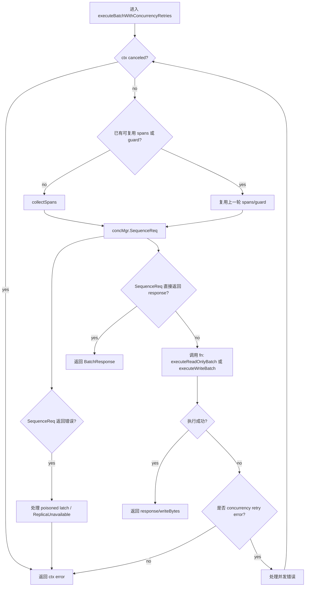

# executeBatchWithConcurrencyRetries 深度剖析——Replica 并发控制与服务端重试主循环

## 一、先给结论

`executeBatchWithConcurrencyRetries` 是 `Replica` 上普通读写请求进入真正执行前的 **并发控制重试外壳**。

它不直接读 Pebble，也不直接 propose Raft。它主要负责：

```text
1. 计算这个 BatchRequest 会访问哪些 key span。
2. 进入 concurrency manager，获取 latches，等待事务锁。
3. 调用真正的读写执行函数：
     executeReadOnlyBatch
     executeWriteBatch
4. 如果执行中遇到可在 server 端处理的并发错误，就处理后重试。
5. 如果成功或遇到不可处理错误，就返回。
```

最小心智模型：

```go
for {
    spans := collectSpans(batch)
    guard := concMgr.SequenceReq(spans)

    response, err := executeReadOrWrite(batch, guard)
    if success {
        return response
    }
    if notConcurrencyRetryError(err) {
        return err
    }

    handleConcurrencyError(err)
    retry
}
```

它在请求路径中的位置：

```text
Node.Batch
  -> Node.batchInternal
     -> Stores.SendWithWriteBytes
        -> Store.SendWithWriteBytes
           -> Replica.SendWithWriteBytes
              -> executeBatchWithConcurrencyRetries
                 -> executeReadOnlyBatch / executeWriteBatch
```

## 二、为什么需要这个函数

### 2.1 KV 请求不能直接执行

在一个 range 上，很多请求可能同时访问重叠 key。

例如：

```text
Txn A:
  Put account:1

Txn B:
  Get account:1

Txn C:
  Scan account:0-account:9
```

这些请求不能随便并发执行，否则会出现：

```text
1. 同一个 key 的读写顺序不稳定。
2. 扫描过程中看到一半新数据、一半旧数据。
3. 事务锁和 intent 的处理顺序混乱。
4. 重试时无法保证公平性。
```

所以 Replica 层有一个 `concurrency manager`。

它负责：

```text
1. latches：本地内存并发互斥。
2. lock table：事务锁 / intent 的等待队列。
3. txn wait queue：事务 push / 等待事务状态变化。
```

`executeBatchWithConcurrencyRetries` 就是把请求送进这个并发控制系统的地方。

### 2.2 它解决的是 server-side retry

有些错误不需要返回给客户端。

例如：

```text
请求执行时发现一个 intent。
这个 intent 原本不在 lock table 里。
```

这时可以：

```text
1. 把这个 intent 加进 lock table。
2. 当前请求进入这个 lock 的 wait queue。
3. 等锁释放后，在 server 端重试。
```

客户端不需要知道中间发生过一次 `LockConflictError`。

这类重试叫：

```text
server-side concurrency retry
```

也就是：

```text
同一个 RPC 内部，Replica 自己处理并重试。
```

## 三、几个必须先懂的概念

### 3.1 latch 是什么

`latch` 是 Replica 本地内存里的并发保护结构。

它保护的是：

```text
正在 evaluation 的请求之间的 key span 冲突。
```

比如：

```text
请求 A: Put k1
请求 B: Scan k0-k9
```

它们 key span 重叠，所以不能同时 evaluation。

注意：

```text
latch 不是 MVCC 锁。
latch 不写入 Pebble。
latch 不复制到 Raft。
latch 只在当前 Replica 内存里存在。
```

### 3.2 lock 是什么

`lock` 指事务锁，通常对应 intent 或 lock table 里的锁。

它是事务语义的一部分：

```text
Txn A 写了 key k1，但还没提交。
这个 key 上会有 Txn A 的 intent。

Txn B 读/写 k1 时，需要处理这个 intent。
```

区别：

| 概念 | 位置 | 生命周期 | 作用 |
|---|---|---|---|
| latch | Replica 内存 | 请求 evaluation 期间 | 防止本地并发 evaluation 冲突 |
| lock / intent | MVCC / lock table | 事务提交/回滚前 | 表示事务持有的逻辑锁 |

### 3.3 Guard 是什么

`concurrency.Guard` 是 concurrency manager 返回给请求的“并发保护凭证”。

它表示：

```text
这个请求已经排好队，并且可能持有：
  - latches
  - lock wait queue 位置
  - span sets
```

只要 `Guard` 还在，请求结束时就必须释放：

```go
r.concMgr.FinishReq(ctx, g)
```

所以函数开头有：

```go
defer func() {
    if g != nil {
        r.concMgr.FinishReq(ctx, g)
    }
}()
```

这是兜底释放，防止错误路径泄露 latches。

### 3.4 batchExecutionFn 是什么

`batchExecutionFn` 是真正执行 batch 的函数类型：

```go
type batchExecutionFn func(
    *Replica,
    context.Context,
    *kvpb.BatchRequest,
    *concurrency.Guard,
) (*kvpb.BatchResponse, *concurrency.Guard, *kvadmission.StoreWriteBytes, *kvpb.Error)
```

它有两个实际实现：

```go
(*Replica).executeReadOnlyBatch
(*Replica).executeWriteBatch
```

也就是说：

```text
executeBatchWithConcurrencyRetries 是外壳。
executeReadOnlyBatch / executeWriteBatch 是真正执行器。
```

## 四、整体流程图



## 五、逐段精讲

### 5.1 初始化状态

函数开头：

```go
var latchSpans *spanset.SpanSet
var lockSpans *lockspanset.LockSpanSet
var requestEvalKind concurrency.RequestEvalKind
var g *concurrency.Guard
```

它们的含义：

```text
latchSpans:
  本请求需要拿 latch 的 key spans。

lockSpans:
  本请求需要检查/等待事务锁的 key spans。

requestEvalKind:
  本轮 evaluation 的模式。

g:
  concurrency manager 返回的 guard。
```

### 5.2 PoisonPolicy：遇到不可用 Replica 时怎么处理

代码：

```go
pp := poison.Policy_Error
if r.signallerForBatch(ba).C() == nil {
    pp = poison.Policy_Wait
}
```

含义：

```text
默认普通请求遇到 poisoned latch 会 fail fast。

如果这个请求 bypass replica circuit breaker，或者 breaker 没有 signal channel，
就改成继续等待。
```

这里的 `poisoned latch` 可以理解成：

```text
某个请求拿着 latch，但它所在的 Replica 已经不可用，
所以等待这个 latch 的请求不应该一直傻等。
```

普通请求：

```text
Policy_Error
  -> 遇到 poisoned latch 直接返回 ReplicaUnavailableError
```

特殊请求：

```text
Policy_Wait
  -> 继续等，不被 breaker fail-fast
```

### 5.3 for 循环：为什么是循环

主体是：

```go
for {
    ...
}
```

因为一次执行可能遇到并发错误。

比如：

```text
第一次执行：
  发现一个 intent，但 lock table 之前不知道它。

处理错误：
  把 intent 加进 lock table。
  当前请求排到 wait queue。

第二次执行：
  这次 SequenceReq 就能看到 lock table 里的锁。
  它会等待锁释放后再执行。
```

所以循环就是：

```text
执行
遇到可修复并发错误
修复/等待
再执行
```

### 5.4 每轮先检查 ctx

```go
if err := ctx.Err(); err != nil {
    return nil, nil, kvpb.NewError(err)
}
```

如果请求已经超时或取消，就不再继续重试。

否则可能出现：

```text
客户端已经放弃了，
Replica 还在内部继续等锁 / 获取 lease / 等 merge。
```

### 5.5 collectSpans：计算访问范围

```go
if latchSpans == nil && g == nil {
    latchSpans, lockSpans, requestEvalKind, err = r.collectSpans(ba)
}
```

它根据 batch 中的请求声明：

```text
我要读哪些 key？
我要写哪些 key？
我要锁哪些 key？
```

例子：

```text
Get(k1):
  latchSpans = k1 read span
  lockSpans  = k1 lock span

Put(k1):
  latchSpans = k1 write span
  lockSpans  = k1 lock span

Scan(k1, k9):
  latchSpans = [k1, k9)
  lockSpans  = [k1, k9)
```

为什么有条件？

```text
某些重试分支会复用上一轮的 span sets 或 guard。
这种情况下不需要重新 collect。
```

### 5.6 SequenceReq：进入 concurrency manager

核心代码：

```go
g, resp, pErr = r.concMgr.SequenceReq(ctx, g, concurrency.Request{
    Txn:             ba.Txn,
    Timestamp:       ba.Timestamp,
    WaitPolicy:      ba.WaitPolicy,
    PoisonPolicy:    pp,
    Requests:        ba.Requests,
    LatchSpans:      latchSpans,
    LockSpans:       lockSpans,
    Batch:           ba,
}, requestEvalKind)
```

`SequenceReq` 做三类事情：

```text
1. 获取 latches。
2. 检查 lock table。
3. 必要时进入 lock wait queue 或 txn wait queue。
```

成功返回后：

```text
请求已经获得足够隔离，可以进行 evaluation。
```

返回值有三种情况：

```text
1. pErr != nil
   并发排序阶段失败，直接返回错误。

2. resp != nil
   concurrency manager 已经能直接给响应，不需要继续执行 fn。

3. g != nil
   拿到 guard，继续调用真正执行函数。
```

### 5.7 为什么 SequenceReq 可能直接返回 resp

注释里说：

```go
else if resp != nil {
    br = new(kvpb.BatchResponse)
    br.Responses = resp
    return br, nil, nil
}
```

可以理解为：

```text
某些 wait policy / lock handling 情况在 concurrency manager 阶段就能构造结果。
这时不需要再进入 executeReadOnlyBatch / executeWriteBatch。
```

你可以先不把它当主路径。

主路径是：

```text
SequenceReq 返回 guard
然后调用 fn 执行
```

### 5.8 调用真正执行器

```go
br, g, writeBytes, pErr = fn(r, ctx, ba, g)
```

这里的 `fn` 是：

```text
读请求：
  executeReadOnlyBatch

写请求：
  executeWriteBatch
```

如果成功：

```go
return br, writeBytes, nil
```

如果失败，先判断是不是当前函数能处理的并发重试错误：

```go
if !isConcurrencyRetryError(pErr) {
    return nil, nil, pErr
}
```

不是并发重试错误就直接返回。

例如：

```text
RangeKeyMismatch
ConditionFailed
普通事务重试错误
权限/校验错误
```

这些不在这里处理。

## 六、什么错误会在这里重试

`isConcurrencyRetryError` 识别这些错误：

```text
LockConflictError
TransactionPushError
IndeterminateCommitError
ReadWithinUncertaintyIntervalError
InvalidLeaseError
MergeInProgressError
OptimisticEvalConflictsError
```

表格：

| 错误 | 典型原因 | 这里做什么 |
|---|---|---|
| `LockConflictError` | evaluation 时发现 intent / lock | 加入 lock table / wait queue 后重试 |
| `TransactionPushError` | PushTxn 没推成功 | 加入 txn wait queue 后重试 |
| `IndeterminateCommitError` | STAGING txn 状态不确定 | 发起事务恢复，恢复后重试 |
| `ReadWithinUncertaintyIntervalError` | 读到 uncertainty interval 内的版本 | 尝试前推时间戳，重新拿 latch 后重试 |
| `InvalidLeaseError` | 当前 replica 没有效 lease | 获取 lease 或重定向后重试 |
| `MergeInProgressError` | range 正在 merge | 等 merge 完成后重试 |
| `OptimisticEvalConflictsError` | 乐观执行发现冲突 | 下一轮转悲观执行 |

## 七、每个错误分支怎么处理

### 7.1 LockConflictError

场景：

```text
Txn A 正在写 key k1，留下 intent。
Txn B 扫描时没在 lock table 看到这个锁。
Txn B 进入 evaluation 后，从 MVCC 数据里真的读到了 intent。
```

这时 `executeReadOnlyBatch` 返回：

```text
LockConflictError
```

当前函数处理：

```go
g.AssertLatches()
g, pErr = r.handleLockConflictError(ctx, ba, g, pErr, t)
```

`handleLockConflictError` 会：

```text
1. 告诉 concurrency manager：这里有个 lock 之前没被 lock table 跟踪。
2. 把当前请求排进这个 lock 的 wait queue。
3. 释放 latches。
4. 返回更新后的 guard。
```

下一轮重试时：

```text
SequenceReq 会看到这个 lock。
请求会在 lock wait queue 中等锁释放。
```

### 7.2 TransactionPushError

场景：

```text
Txn A 想 push Txn B。
但 Txn B 还活着，不能被 push。
```

第一次执行 PushTxn 失败：

```text
TransactionPushError
```

处理：

```go
g, pErr = r.handleTransactionPushError(ctx, ba, g, pErr, t)
```

它会把请求和 pushee txn 关联到 txn wait queue。

下一轮：

```text
请求会等待 Txn B 状态变化、过期或被其它方式推进。
```

### 7.3 IndeterminateCommitError

场景：

```text
PushTxn 遇到一个 STAGING 状态事务。
不知道这个事务最终会 COMMITTED 还是 ABORTED。
```

不能随便当它失败，也不能随便当它成功。

处理：

```go
dropLatchesAndLockWaitQueues(true)
r.handleIndeterminateCommitError(...)
```

它会调用事务恢复逻辑：

```text
ResolveIndeterminateCommit
```

如果恢复成功：

```text
原请求重试。
```

如果恢复失败：

```text
返回错误。
```

### 7.4 ReadWithinUncertaintyIntervalError

场景：

```text
读请求时间戳 = 100
读到了一个版本 timestamp = 105
这个 105 落在当前事务 uncertainty interval 内
```

这个版本可能来自未来时钟节点。

处理：

```go
dropLatchesAndLockWaitQueues(false)
ba, pErr = r.handleReadWithinUncertaintyIntervalError(...)
```

为什么不复用 span sets？

```text
因为请求时间戳可能被前推。
timestamp 变了，latch/lock 隔离语义也可能变。
所以要重新 collectSpans / 重新 sequence。
```

如果能 server-side retry：

```text
更新 batch timestamp
重试
```

如果不能：

```text
把 uncertainty error 返回给客户端
```

### 7.5 InvalidLeaseError

场景：

```text
请求到了这个 replica。
但这个 replica 没有有效 lease。
```

处理：

```go
dropLatchesAndLockWaitQueues(true)
r.handleInvalidLeaseError(ctx, ba)
```

handler 会：

```text
1. 尝试获取 lease。
2. 如果发现 lease 在别处，返回 NotLeaseHolder 让上层重定向。
3. 如果成功拿到 lease，返回 nil，让当前 batch 重试。
```

### 7.6 MergeInProgressError

场景：

```text
当前 range 正在 merge 到左邻 range。
```

请求不能在 merge 中间随便执行。

处理：

```go
dropLatchesAndLockWaitQueues(true)
r.handleMergeInProgressError(...)
```

它会等 `mergeCompleteCh`。

如果 merge 失败：

```text
重试原 range。
```

如果 merge 成功：

```text
下一轮可能发现 range 已经不存在，然后返回给客户端刷新 range cache。
```

### 7.7 OptimisticEvalConflictsError

这是乐观执行相关。

普通悲观执行：

```text
先完整拿 latches / 检查 locks，再 evaluation。
```

乐观执行：

```text
为了性能，先以较轻方式进入 evaluation，
之后再检查有没有冲突。
```

如果乐观执行发现冲突：

```text
OptimisticEvalConflictsError
```

处理：

```go
requestEvalKind = concurrency.PessimisticAfterFailedOptimisticEval
```

特别注意：

```text
这里不释放 latches。
```

下一轮会：

```text
等待这些已经插入的 latches 真正获取成功，
然后用悲观方式检查 locks。
```

## 八、Guard 生命周期

这段函数最容易看晕的地方就是 `g`。

你可以把 `g` 理解为：

```text
当前请求在 concurrency manager 里的座位票。
```

它可能处于几种状态：

### 8.1 正常成功

```text
SequenceReq 返回 g
fn 执行成功
fn 可能释放/接管 g
函数返回
defer 检查 g，如果还在就 FinishReq
```

### 8.2 锁冲突

```text
fn 返回 LockConflictError
g 还在
handleLockConflictError 消费这个错误
释放 latches，但可能保留 wait queue 位置
下一轮把 g 传回 SequenceReq
```

### 8.3 需要完全重新排队

比如 uncertainty retry：

```text
dropLatchesAndLockWaitQueues(false)
g = nil
下一轮重新 collect spans
重新 SequenceReq
```

### 8.4 复用 span sets

比如 lease invalid：

```text
dropLatchesAndLockWaitQueues(true)
latchSpans, lockSpans = g.TakeSpanSets()
FinishReq(g)
g = nil
下一轮复用 spans，重新 SequenceReq
```

## 九、几个具体例子

### 9.1 例子一：读请求遇到 intent

```text
Txn A:
  Put k1
  未提交，留下 intent

Txn B:
  Get k1
```

流程：

```text
1. Txn B 进入 executeBatchWithConcurrencyRetries。
2. collectSpans 得到 k1。
3. SequenceReq 获取 latch。
4. executeReadOnlyBatch 读 MVCC。
5. 发现 Txn A 的 intent。
6. 返回 LockConflictError。
7. handleLockConflictError 把 intent 加入 lock table。
8. Txn B 进入 lock wait queue。
9. 循环重试。
10. 等 Txn A 提交/回滚后，Txn B 继续读。
```

### 9.2 例子二：请求打到没有 lease 的 replica

```text
请求到了 n2/s2 的 r10 replica。
但 r10 leaseholder 实际是 n1/s1。
```

流程：

```text
1. SequenceReq 可能成功。
2. executeReadOnlyBatch / executeWriteBatch 检查 lease。
3. 发现 InvalidLeaseError。
4. dropLatchesAndLockWaitQueues(true)。
5. handleInvalidLeaseError 尝试获取 lease 或发现 leaseholder 在 n1。
6. 如果能拿到 lease，server 端重试。
7. 如果 lease 在 n1，返回 NotLeaseHolder，让 DistSender 重路由。
```

### 9.3 例子三：乐观读失败

```text
Scan k1-k100 使用 optimistic eval。
一开始没有完整等待所有冲突。
evaluation 后发现有冲突。
```

流程：

```text
1. 第一轮 requestEvalKind = OptimisticEval。
2. executeReadOnlyBatch 返回 OptimisticEvalConflictsError。
3. 不释放 latches。
4. requestEvalKind = PessimisticAfterFailedOptimisticEval。
5. 第二轮等待 latches 真正获取成功。
6. 再悲观检查 locks。
7. 重新 evaluation。
```

## 十、和客户端事务重试的区别

不要把这里的 retry 和客户端事务 retry 混在一起。

这里的 retry：

```text
server-side concurrency retry
同一个 RPC 内部完成
客户端通常不知道
```

客户端事务 retry：

```text
返回 TransactionRetryError
TxnCoordSender / SQL 层重新执行用户事务闭包或 SQL statement
```

举例：

```text
LockConflictError:
  Replica 内部可以等锁后重试。

TransactionRetryError:
  事务 epoch/timestamp 需要重启，通常要返回给 txn coordinator。
```

## 十一、最小伪代码

```go
func executeBatchWithConcurrencyRetries(batch, fn) {
    var guard
    var spans

    defer finish guard if still held

    poisonPolicy := failFastUnlessBypassingCircuitBreaker(batch)

    for {
        if ctx canceled {
            return ctx error
        }

        if no reusable spans/guard {
            spans = collectSpans(batch)
        }

        guard, directResponse, err := concMgr.SequenceReq(batch, spans, guard, poisonPolicy)
        if err != nil {
            return err
        }
        if directResponse != nil {
            return directResponse
        }

        response, guard, writeBytes, err := fn(batch, guard)
        if err == nil {
            return response, writeBytes
        }
        if not serverSideConcurrencyRetry(err) {
            return err
        }

        switch err {
        case LockConflict:
            teach lock table, wait, retry
        case TransactionPush:
            wait on txn status, retry
        case IndeterminateCommit:
            recover transaction, retry
        case Uncertainty:
            bump timestamp if allowed, retry
        case InvalidLease:
            acquire/redirect lease, retry
        case MergeInProgress:
            wait merge, retry
        case OptimisticConflict:
            retry pessimistically
        }
    }
}
```

## 十二、最终心智模型

你可以把 `executeBatchWithConcurrencyRetries` 想成一个排队窗口：

```text
进门前：
  先声明我要访问哪些 key。

排队时：
  concurrency manager 给我安排 latches 和 lock wait queues。

执行时：
  read/write executor 真正读写 MVCC / Raft。

遇到冲突：
  不是立刻甩给客户端。
  先看 server 能不能自己解决。

解决后：
  再回到队伍里重新执行。
```

一句话总结：

```text
它不是业务逻辑执行器，而是 Replica 读写请求的并发控制与服务端重试调度器。
```
