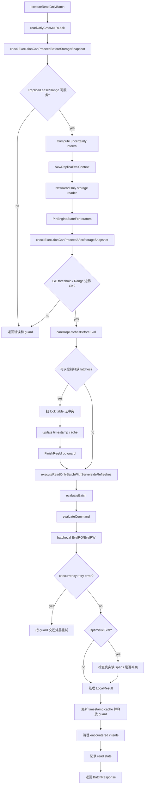

# executeReadOnlyBatch 深度剖析——Replica 读路径、Snapshot、Latch 与 Intent 清理

## 一、先给结论

`executeReadOnlyBatch` 是 CockroachDB 在 `Replica` 上执行 **不修改 range 复制状态的 KV 读请求** 的核心函数。

它不是最外层入口，也不是 SQL 层入口。它位于 KV 请求已经被路由到某个 `Replica`、并且已经经过 `executeBatchWithConcurrencyRetries` 排队之后：

```text
Node.Batch
  -> Node.batchInternal
     -> Stores.SendWithWriteBytes
        -> Store.SendWithWriteBytes
           -> Replica.SendWithWriteBytes
              -> executeBatchWithConcurrencyRetries
                 -> executeReadOnlyBatch
                    -> executeReadOnlyBatchWithServersideRefreshes
                       -> evaluateBatch
                          -> evaluateCommand
                             -> batcheval command
                                -> MVCCGet / MVCCScan / QueryIntent ...
```

最短心智模型：

```go
func executeReadOnlyBatch(batch, guard) {
    // 1. 确认这个 Replica 现在能服务这个读请求。
    leaseStatus := checkBeforeSnapshot(batch)

    // 2. 创建只读 Pebble snapshot/reader。
    reader := NewReadOnly()
    reader.PinEngineStateForIterators()

    // 3. snapshot 创建后再确认 GC threshold / range 边界。
    checkAfterSnapshot(batch)

    // 4. 某些读请求可以先扫 lock table，确认无冲突后提前释放 latches。
    maybeDropLatchesBeforeEval()

    // 5. 真正执行 MVCC read，必要时尝试 server-side timestamp refresh。
    response, result, err := evaluateReadOnlyBatch()

    // 6. 处理并发错误、乐观执行校验、本地副作用、timestamp cache、intent cleanup。
    finishRead()
}
```

一句话：

```text
executeReadOnlyBatch = 在 Replica 本地用稳定 storage snapshot 执行读请求，
同时负责读路径的 lease/GC 检查、latch 释放、timestamp cache 更新、intent 清理和乐观执行校验。
```

## 二、它不做什么

先把边界说清楚，否则容易看混。

`executeReadOnlyBatch` 不负责：

```text
1. SQL 解析、优化、执行计划。
2. DistSender range cache 路由。
3. gRPC 发到目标节点。
4. Store 根据 RangeID 找 Replica。
5. 并发管理器初始排序。
6. Raft propose。
7. Pebble 写入 replicated state。
```

这些分别在别的层做：

```text
DistSender:
  找 range / 找 leaseholder / 拆 batch / 发 RPC。

Node.Batch:
  server 端接收 RPC。

Stores.SendWithWriteBytes:
  根据 RangeID 找 Store / Replica。

executeBatchWithConcurrencyRetries:
  收集 latch spans / lock spans，调用 concurrency manager 排队。

executeReadOnlyBatch:
  读路径本地执行。

executeWriteBatch:
  写路径 evaluation + Raft propose。
```

所以，读请求到了这个函数时，通常已经是在某个具体 `Replica` 上。

它可能是：

```text
1. leaseholder replica。
2. 可以服务 follower read 的 follower replica。
3. 某些允许跳过 lease 检查的特殊请求。
```

## 三、为什么读路径这么复杂

直觉上，读请求似乎应该很简单：

```text
打开 snapshot
从 Pebble 读 key
返回 value
```

但 CockroachDB 的读请求要同时满足这些约束：

```text
1. 不能读错 range。
2. 不能由错误的 replica 服务强一致读。
3. 不能读到已经被 GC 掉的历史版本。
4. 不能和正在 merge/split 的 range 状态打架。
5. 不能绕过事务锁/intent 造成隔离性问题。
6. 不能让读请求长期拿着 latch 阻塞写请求。
7. 不能因为时钟不确定性直接频繁把错误抛给客户端。
8. 不能在乐观执行时漏掉冲突。
9. 不能遇到 intent 后无限制创建异步 goroutine 清理。
```

`executeReadOnlyBatch` 就是在这些目标之间做平衡。

## 四、核心概念

### 4.1 read-only batch 是什么

这里的 read-only 不是说“完全没有副作用”。

它的准确含义是：

```text
不修改 range 的 replicated state。
```

也就是不走 Raft propose，不把数据写入 replicated log。

但它仍然可能有本地副作用：

```text
1. 更新 timestamp cache。
2. 记录 read load stats。
3. 把遇到的 intent 交给 intent resolver 清理。
4. 通知 lock manager 某个 lock missing。
5. 对某些 locking read，记录 unreplicated lock。
```

这些副作用大多是 leaseholder-local 或 best-effort 的。

### 4.2 latch 是什么

`latch` 是 Replica 本地内存里的并发互斥结构。

它不是事务锁，也不是 Raft 状态。

它解决的是：

```text
两个访问重叠 key span 的请求，不能同时进入 evaluation。
```

例如：

```text
Txn A:
  Put account:1

Txn B:
  Get account:1
```

如果它们同时在同一个 Replica 上 evaluation，读写顺序可能变得难以控制。

所以进入 `executeReadOnlyBatch` 前，外层 `executeBatchWithConcurrencyRetries` 已经通过 concurrency manager 给请求排过队，并把结果放在 `Guard` 里。

### 4.3 Guard 是什么

`Guard` 是并发管理器返回给调用方的句柄。

可以理解成：

```text
Guard = 我已经拿到的 latches + 我在 lock wait queue 里的位置 + 本轮 eval 模式
```

`executeReadOnlyBatch` 的重要责任之一是：

```text
该释放 Guard 时释放；
该把 Guard 交还给外层重试时，不要擅自释放。
```

这就是为什么函数签名里返回值有一个 `*concurrency.Guard`：

```go
func (r *Replica) executeReadOnlyBatch(
    ctx context.Context,
    ba *kvpb.BatchRequest,
    g *concurrency.Guard,
) (
    br *kvpb.BatchResponse,
    _ *concurrency.Guard,
    _ *kvadmission.StoreWriteBytes,
    pErr *kvpb.Error,
)
```

成功路径里，它通常会自己释放 guard，然后返回 `nil` guard。

遇到 server-side concurrency retry error 时，它会把 guard 交回外层。

### 4.4 Pebble snapshot 是什么

读请求要看到一个稳定视图。

如果 scan 过程中底层数据一直变化，就可能出现：

```text
scan 前半段看到旧状态
scan 后半段看到新状态
```

所以读路径会创建一个只读 storage reader：

```go
rw := r.store.StateEngine().NewReadOnly(storage.StandardDurability)
```

然后调用：

```go
rw.PinEngineStateForIterators(readCategory)
```

意思是：

```text
从这个 reader 创建出来的 iterator，都基于同一个固定 engine state。
```

这样同一个 batch 里的多个读 command 能看到一致的底层存储视图。

### 4.5 timestamp cache 是什么

timestamp cache 记录：

```text
某些 key span 最近被读过的时间戳。
```

它的作用是保护读写串行化。

例如：

```text
T1 at ts=100:
  Get account:1

T2 想在 ts=90:
  Put account:1
```

如果允许 T2 在更早时间戳写入，就会破坏 T1 的读。

timestamp cache 会告诉写请求：

```text
account:1 已经在 ts=100 被读过，
你不能在 ts<=100 写入；
需要 push 到更高 timestamp。
```

所以读请求释放 latch 前，必须先更新 timestamp cache。

### 4.6 intent 是什么

事务写入不会立刻变成普通 MVCC value。

它会先留下 intent：

```text
key account:1
  intent by txn T1
```

读请求遇到 intent 时，需要根据隔离级别和 wait policy 决定：

```text
1. 等待。
2. push 对方事务。
3. 跳过 locked row。
4. 返回 LockConflictError 给外层处理。
5. 异步清理已经可清理的 intent。
```

所以 read-only batch 并不意味着不会碰到事务冲突。

## 五、整体流程图



## 六、逐段精讲

### 6.1 readOnlyCmdMu：读路径的外层同步

函数开始：

```go
r.readOnlyCmdMu.RLock()
defer r.readOnlyCmdMu.RUnlock()
```

这个锁不是 key 级别的并发控制。

key 级别并发控制由 latch / lock table 处理。

`readOnlyCmdMu` 更像是：

```text
Replica 级别的读命令保护锁。
```

读路径拿 `RLock`，说明多个读可以并发。

某些需要排斥读命令的 Replica 状态转换，会拿写锁。

### 6.2 snapshot 前检查：Replica 现在能不能服务这个请求

代码：

```go
st, err := r.checkExecutionCanProceedBeforeStorageSnapshot(ctx, ba, g)
```

这个检查发生在创建 storage snapshot 之前。

它主要检查：

```text
1. Replica 是否初始化。
2. Replica 是否 destroyed。
3. 请求 key span 是否完全落在当前 range 内。
4. 当前 replica 是否有资格服务这个请求。
5. 是否处于 pending merge，需要等待 merge 完成。
```

返回值 `st` 是 `LeaseStatus`。

它有两种重要含义：

```text
非零 VALID:
  当前 Replica 持有有效 lease，可以服务请求。

零值:
  这个请求允许跳过 lease 检查，或者走 follower read。
```

如果这里失败：

```go
return nil, g, nil, kvpb.NewError(err)
```

注意返回的是 `g`。

因为读还没真正执行，也没有释放 guard，外层 `executeBatchWithConcurrencyRetries` 还要负责清理或重试。

### 6.3 uncertainty interval：为什么读可能要刷新 timestamp

代码：

```go
ui := uncertainty.ComputeInterval(&ba.Header, st, r.Clock().MaxOffset())
```

CockroachDB 是分布式数据库，各节点物理时钟不完全一致。

假设：

```text
n1 时钟 = 100
n2 时钟 = 105
max offset = 10
```

事务在 n1 上以 timestamp 100 读取。

它在 n2 的数据上看到一个版本：

```text
value timestamp = 104
```

这个版本到底是：

```text
1. 真的是事务开始之后才写的未来数据？
2. 还是因为 n2 时钟快，实际逻辑上可以被当前事务看到？
```

这就是 uncertainty interval。

读路径遇到这种情况时，可能返回：

```text
ReadWithinUncertaintyIntervalError
```

`executeReadOnlyBatchWithServersideRefreshes` 会尝试在服务端把读 timestamp 往前推，然后重新读一次。

### 6.4 ReplicaEvalContext：给 batcheval 的执行上下文

代码：

```go
rec := NewReplicaEvalContext(
    ctx,
    r,
    g.LatchSpans(),
    ba.RequiresClosedTSOlderThanStorageSnapshot(),
    ba.AdmissionHeader,
)
defer rec.Release()
```

`batcheval` 里的具体命令不应该直接知道 `Replica` 的所有细节。

所以 CockroachDB 用 `ReplicaEvalContext` 给它提供受控接口。

它包含：

```text
1. 当前 Replica 信息。
2. 当前请求声明的 latch spans。
3. closed timestamp 约束。
4. admission header。
5. 一些读取 store / clock / settings / descriptor 的能力。
```

然后具体命令，比如 `Get`、`Scan`、`QueryIntent`，通过这个 context 访问需要的信息。

### 6.5 创建只读 storage reader

代码：

```go
rw := r.store.StateEngine().NewReadOnly(storage.StandardDurability)
```

这里已经是本地 storage 层。

但它还不是直接“读一个 key”。

它先创建一个只读 reader，后续 `evaluateBatch` 会把它传给具体命令。

对于一个普通 `Get(account:1)`：

```text
executeReadOnlyBatch
  -> NewReadOnly
  -> evaluateBatch
  -> evaluateCommand(Get)
  -> batcheval.Get
  -> storage.MVCCGet
  -> Pebble iterator
```

### 6.6 PinEngineStateForIterators：固定读视图

代码：

```go
rw.PinEngineStateForIterators(readCategory)
```

这一步非常关键。

它保证：

```text
这个 reader 后续创建的 iterator 都看到同一个 engine state。
```

举例：

```text
Scan account:1-account:100
```

如果 scan 过程中底层不断有写入：

```text
account:20 被更新
account:70 被更新
```

没有固定 snapshot 的话，一次 scan 可能看到混杂视图。

固定 snapshot 后，这次 scan 看到的是 pin 住那一刻的稳定状态。

### 6.7 为什么 snapshot 后还要检查一次

代码：

```go
if err := r.checkExecutionCanProceedAfterStorageSnapshot(ctx, ba, st); err != nil {
    return nil, g, nil, kvpb.NewError(err)
}
```

这个检查主要关注：

```text
1. range 边界是否仍然匹配。
2. 读 timestamp 是否高于 GC threshold。
```

为什么 GC threshold 要在 snapshot 之后检查？

因为 GC 请求不会按“它正在 GC 的 timestamp”去拿同样的 latches。

所以读路径需要保证：

```text
我 pin 住的 storage snapshot，
在 GC threshold 语义下仍然能读。
```

否则可能读一个已经被 GC 语义认为不可读的历史版本。

### 6.8 canDropLatchesBeforeEval：读路径的重要优化

代码：

```go
ok, stillNeedsInterleavedIntents, pErr :=
    r.canDropLatchesBeforeEval(ctx, rw, ba, g, st)
```

这个函数回答两个问题：

```text
1. 这个读请求能不能在真正 evaluation 前释放 latches？
2. 如果能释放，后续 evaluation 还需不需要 intent interleaving iterator？
```

为什么想提前释放 latches？

因为读请求可能很慢：

```text
Scan 100 万行
```

如果它一直拿着 latches，重叠 key span 的写请求都会被挡住。

但能不能直接释放？

不能。

因为读请求必须先确认：

```text
没有和它冲突的锁 / intent。
```

所以它会先扫描 lock table keyspace：

```text
没有冲突:
  可以更新 timestamp cache，然后释放 latches，再慢慢读 snapshot。

发现冲突:
  返回 LockConflictError，交给外层并发重试逻辑处理。
```

这个优化只允许部分读请求使用。

`canReadOnlyRequestDropLatchesBeforeEval` 里限制：

```text
1. 必须有 guard，也就是当前真的持有 latches。
2. 目前只允许 CONSISTENT read。
3. 不能是 OptimisticEval。
4. 不能是 locking read。
```

### 6.9 提前释放 latches 前必须先更新 timestamp cache

如果 `ok == true`：

```go
r.updateTimestampCacheAndDropLatches(ctx, g, ba, nil, nil, st)
g = nil
```

顺序不能反。

必须是：

```text
先更新 timestamp cache
再释放 latches
```

原因：

```text
释放 latches 后，写请求就能进来。
如果 timestamp cache 还没记录这次读，
写请求可能用一个过低 timestamp 写入，
破坏刚才这个读的串行化保护。
```

这里 `br == nil` 表示：

```text
还没有真正 evaluation。
timestamp cache 只能根据请求声明的 spans 更新。
```

### 6.10 executeReadOnlyBatchWithServersideRefreshes：真正执行读

代码：

```go
ba, br, result, pErr =
    r.executeReadOnlyBatchWithServersideRefreshes(ctx, rw, rec, ba, g, &st, ui, evalPath)
```

这个函数内部调用：

```go
evaluateBatch(...)
```

并且最多做一次 server-side retry。

它能处理的典型错误：

```text
ReadWithinUncertaintyIntervalError
WriteTooOldError
```

但它有一个重要限制：

```text
如果 latches 已经提前释放了，不能在本函数里把 timestamp 往前推后重试。
```

源码里的判断是：

```go
latchesHeld := g != nil
if latchesHeld {
    ba, ok = canDoServersideRetry(...)
}
```

为什么？

因为你原来拿的 latches 只保护当前 timestamp/当前访问语义下的执行。

如果 timestamp 被前推，隔离关系可能变化。

已经释放 latches 后还想换 timestamp 重读，就不安全。

这种情况会把错误返回给外层，让外层重新收集 spans、重新排队、重新执行。

### 6.11 evaluateBatch：把 batch 拆成具体 command

`executeReadOnlyBatchWithServersideRefreshes` 最终调用：

```go
evaluateBatch(...)
```

`evaluateBatch` 做的是：

```text
1. 创建 BatchResponse。
2. 克隆事务 proto。
3. 对每个 Request 调 evaluateCommand。
4. 合并每个 command 的 Result。
5. 维护 response header / txn 状态 / scan stats。
```

`evaluateCommand` 再调用：

```go
cmd := batcheval.LookupCommand(args.Method())
cmd.EvalRO(...) 或 cmd.EvalRW(...)
```

也就是说：

```text
具体 Get 怎么读 MVCC key，不在 executeReadOnlyBatch 里；
具体 Scan 怎么用 iterator，也不在 executeReadOnlyBatch 里；
它们在 batcheval 命令实现里。
```

### 6.12 遇到 concurrency retry error：交回外层

代码：

```go
if isConcurrencyRetryError(pErr) {
    ...
    return nil, g, nil, pErr
}
```

这类错误包括：

```text
LockConflictError
TransactionPushError
IndeterminateCommitError
ReadWithinUncertaintyIntervalError
InvalidLeaseError
MergeInProgressError
OptimisticEvalConflictsError
```

如果本函数遇到这些错误，通常不在这里完成完整重试。

它会把错误和 guard 交回外层：

```text
executeBatchWithConcurrencyRetries
```

由外层统一处理：

```text
1. 释放/复用 guard。
2. 等待锁。
3. 获取 lease。
4. 等待 merge。
5. 改成悲观执行。
6. 重新进入本函数。
```

### 6.13 OptimisticEval 的特殊处理

乐观执行的特点是：

```text
先不完整等待 latches / locks，尝试快速 evaluation，
最后再检查是否真的没有冲突。
```

所以读成功后还要检查：

```go
latchSpansRead, lockSpansRead, err := r.collectSpansRead(ba, br)
ok := g.CheckOptimisticNoConflicts(latchSpansRead, lockSpansRead)
```

这里不是检查整个请求声明的最大 span。

它会根据 response 的 resume spans 推出：

```text
这次实际读了哪些 spans。
```

例如：

```text
Scan account:1-account:100 LIMIT 10
```

请求声明 span 是：

```text
account:1-account:100
```

但实际可能只读到：

```text
account:1-account:10
```

乐观冲突检查只需要围绕实际读到的范围做，避免过度保守。

如果发现冲突：

```text
返回 OptimisticEvalConflictsError
外层下一轮改成悲观执行
```

### 6.14 LocalResult：读请求也有本地副作用

`evaluateBatch` 返回：

```go
result.Result
```

其中 `result.Local` 是不会写入 Raft 的本地副作用。

读路径关心这些：

```text
1. EncounteredIntents
2. ReportedMissingLocks
3. AcquiredLocks
4. Metrics
```

#### EncounteredIntents

读过程中遇到 intent。

函数后面会提交给：

```go
r.store.intentResolver.CleanupIntentsAsync(...)
```

#### ReportedMissingLocks

某些 `QueryIntent` 会发现：

```text
lock table 以为有锁，
但实际 lock 已经不存在。
```

这时要通知 concurrency manager：

```go
r.concMgr.OnLockMissing(ctx, &missingLocks[i])
```

否则之后的请求可能继续等一个不存在的 lock。

#### AcquiredLocks

`handleReadOnlyLocalEvalResult` 会处理：

```go
r.concMgr.OnLockAcquired(...)
```

源码注释说这些是：

```text
unreplicated locks
```

这类锁只存在本地 lock table，不通过 Raft 复制。

## 七、几个实际例子

### 7.1 例子一：普通 Get 成功

请求：

```text
Get account:1 at ts=100
```

流程：

```text
1. DistSender 把请求发到 account:1 所在 range 的 leaseholder。
2. executeBatchWithConcurrencyRetries 给 account:1 拿 latch。
3. executeReadOnlyBatch 检查 lease 有效。
4. 创建只读 Pebble reader。
5. pin engine snapshot。
6. 检查 GC threshold。
7. 读取 MVCC value。
8. 更新 timestamp cache:
     account:1 read at ts=100
9. 释放 latch。
10. 返回 value。
```

这次不会走 Raft。

因为它不修改 replicated state。

### 7.2 例子二：Scan 很大，提前释放 latches

请求：

```text
Scan account:1-account:1000000 at ts=100
```

如果 scan 一直持有 latches：

```text
Put account:500
Put account:1000
Put account:2000
```

这些写都可能被挡很久。

优化路径：

```text
1. executeReadOnlyBatch 创建稳定 Pebble snapshot。
2. canDropLatchesBeforeEval 扫 lock table。
3. 没有发现冲突 intent。
4. 先更新 timestamp cache。
5. 提前释放 latches。
6. 慢慢 scan snapshot。
```

这样写请求可以继续进入。

但写请求会看到 timestamp cache：

```text
这个 span 在 ts=100 被读过。
```

所以写请求不能在 `<=100` 的时间戳写入破坏读。

### 7.3 例子三：提前释放前发现 intent

请求：

```text
Txn A:
  Scan account:1-account:100
```

同时：

```text
Txn B:
  Put account:50
  还没提交，留下 intent
```

`canDropLatchesBeforeEval` 先扫 lock table / replicated lock table。

发现：

```text
account:50 有冲突 intent
```

于是返回：

```text
LockConflictError
```

`executeReadOnlyBatch` 不自己处理，而是交给外层：

```text
executeBatchWithConcurrencyRetries
```

外层会：

```text
1. 把这个 lock 记录进 lock table。
2. 当前请求进入 lock wait queue。
3. 等 Txn B 结束或 intent 被解析。
4. 重新执行 Scan。
```

### 7.4 例子四：读到 uncertainty interval 内的版本

场景：

```text
当前事务读 timestamp = 100
max clock offset = 10

读到版本:
  key account:1
  timestamp = 105
```

这个 105 位于 uncertainty interval。

第一次 evaluation 可能返回：

```text
ReadWithinUncertaintyIntervalError
```

如果还持有 latches，并且 batch 允许前推读时间戳：

```text
ba.CanForwardReadTimestamp = true
```

`executeReadOnlyBatchWithServersideRefreshes` 可以：

```text
1. 把 batch timestamp 从 100 推到 105 之后。
2. 清理本轮内存账号。
3. 再次 evaluateBatch。
4. 成功则直接返回。
```

如果 latches 已经提前释放：

```text
不能在这里换 timestamp 继续读。
```

因为新 timestamp 下的隔离保护没有被当前 guard 覆盖。

这时错误会返回外层，让外层重新排队。

### 7.5 例子五：OptimisticEval 读成功但最后发现冲突

假设一个 limited scan：

```text
Scan account:1-account:100 LIMIT 10
```

乐观执行时，它先快速读。

实际只读了：

```text
account:1-account:10
```

读完后检查：

```text
这段实际读过的 span 有没有和并发写冲突？
```

如果发现：

```text
Txn B 正好写 account:5
```

就返回：

```text
OptimisticEvalConflictsError
```

外层下一轮会改成：

```text
PessimisticAfterFailedOptimisticEval
```

也就是更保守地拿 latch / 检查 lock 后再读。

### 7.6 例子六：读遇到 intent，最后异步清理

读请求 evaluation 时遇到一个已经可以清理的 intent：

```text
Txn B 已经提交或 abort
但 account:1 上的 intent 还没清掉
```

读请求可以继续完成，但会把 intent 放进：

```text
result.Local.EncounteredIntents
```

最后：

```go
r.store.intentResolver.CleanupIntentsAsync(...)
```

这个清理是半同步的。

意思是：

```text
允许一定数量异步清理任务；
如果堆太多，后续调用会被反压阻塞。
```

这样避免：

```text
读请求很多，每个都遇到 intent，
结果系统无限创建 intent resolution goroutine。
```

## 八、和 executeBatchWithConcurrencyRetries 的关系

两者分工如下：

| 函数 | 职责 |
|---|---|
| `executeBatchWithConcurrencyRetries` | 外层并发重试循环，负责 SequenceReq、处理 LockConflict/InvalidLease/Merge 等并发错误 |
| `executeReadOnlyBatch` | 读请求本地执行，负责 snapshot、读 evaluation、timestamp cache、intent cleanup |
| `executeReadOnlyBatchWithServersideRefreshes` | 调用 evaluateBatch，并在允许时做一次本地 timestamp refresh |
| `evaluateBatch` | 把 batch 拆成单个 KV command 并执行 |
| `evaluateCommand` | 查找 batcheval command，调用具体 EvalRO/EvalRW |

所以可以把它们看成三层：

```text
第一层：外层重试
executeBatchWithConcurrencyRetries

第二层：读路径壳
executeReadOnlyBatch

第三层：具体命令执行
evaluateBatch / evaluateCommand / batcheval
```

## 九、关键设计取舍

### 9.1 为什么不是拿着 latch 一直读完

这样最简单。

但会导致大 scan 长时间阻塞写请求。

CockroachDB 的选择是：

```text
能安全提前释放时，就提前释放。
```

代价是代码复杂：

```text
1. 要先扫描 lock table。
2. 要先更新 timestamp cache。
3. 要区分是否还需要 intent interleaving iterator。
4. 要处理 server-side retry 与 latch 释放之间的关系。
```

### 9.2 为什么提前释放后不能随便 server-side retry

因为 server-side retry 可能改变 timestamp。

timestamp 变了以后：

```text
原来的 latch/lock 保护范围不一定还有效。
```

如果 latches 还在，可以在保护下尝试前推 timestamp。

如果 latches 已经释放，就必须交给外层重新排队。

### 9.3 为什么要先 pin snapshot 再释放 latch

如果先释放 latch，再创建 snapshot：

```text
写请求可能在中间插进来。
```

读请求实际看到的 storage state 就不再是它更新 timestamp cache 时保护的那个状态。

正确顺序是：

```text
1. 持有 latches。
2. pin storage snapshot。
3. 扫 lock table 确认无冲突。
4. 更新 timestamp cache。
5. 释放 latches。
6. 基于已经 pin 住的 snapshot 读。
```

### 9.4 为什么 intent cleanup 放在读完成后

读请求的核心目标是返回用户数据。

intent cleanup 是为了优化后续请求。

如果每次读都同步清理所有 intent：

```text
读延迟会被 intent resolution 放大。
```

如果完全异步不限制：

```text
遇到大量 intent 时可能 goroutine 膨胀。
```

所以这里采用半同步：

```text
有并发上限的 async cleanup。
```

## 十、常见误解

### 10.1 read-only 是不是一定没有锁？

不是。

read-only 只表示不修改 replicated state。

它仍然可能：

```text
1. 检查锁。
2. 等待锁。
3. 遇到 intent。
4. 获取 unreplicated lock。
5. 通知 lock manager。
```

### 10.2 读请求是不是直接读 Pebble？

不是直接从这个函数读。

准确路径是：

```text
executeReadOnlyBatch
  -> executeReadOnlyBatchWithServersideRefreshes
     -> evaluateBatch
        -> evaluateCommand
           -> batcheval command
              -> storage MVCC API
                 -> Pebble iterator
```

这个函数负责准备安全的读环境。

### 10.3 提前释放 latch 后，读到的数据会不会被并发写改掉？

不会。

因为读基于已经 pin 住的 storage snapshot。

释放 latch 后，新的写可以执行，但不会改变当前 reader 已经固定的视图。

timestamp cache 负责保证这些并发写不会用过低 timestamp 破坏串行化。

### 10.4 follower read 也走这里吗？

可能会。

`checkLease` 里如果当前 replica 不是 leaseholder，但请求满足 follower read 条件，就可以继续。

这时 `LeaseStatus` 可能是零值，表示：

```text
不是以 leaseholder 身份服务这个请求。
```

但后续仍然要检查 range 边界、GC threshold，并基于本地 storage snapshot 读。

## 十一、最终心智模型

把 `executeReadOnlyBatch` 想成一个读请求的“安全执行框架”。

它做的不是：

```text
我直接去 Pebble 拿 value。
```

而是：

```text
1. 我现在是不是有资格读？
2. 我要读的 key 还属于这个 range 吗？
3. 我的 timestamp 还没低于 GC threshold 吗？
4. 我能不能创建一个稳定 snapshot？
5. 我能不能提前释放 latches，避免挡住写？
6. 如果读到 uncertainty 错误，能不能在服务端刷新 timestamp？
7. 如果乐观读了，最后有没有冲突？
8. 读过程中遇到的 intent / lock 本地副作用怎么处理？
9. timestamp cache 什么时候更新？
10. guard 什么时候释放，什么时候交还外层？
```

伪代码：

```go
func executeReadOnlyBatch(ba, guard) {
    lockReadOnlyCommandMu()

    leaseStatus := checkBeforeStorageSnapshot(ba, guard)
    uncertainty := computeUncertainty(ba, leaseStatus)

    evalCtx := newReplicaEvalContext(guard.latchSpans)

    reader := newReadOnlyStorageReader()
    reader.pinEngineState()

    checkAfterStorageSnapshot(ba, leaseStatus)

    if canDropLatchesBeforeEval(reader, ba, guard) {
        updateTimestampCache(ba)
        finishReq(guard)
        guard = nil
    }

    ba, br, localResult, err :=
        executeReadOnlyBatchWithServersideRefreshes(reader, evalCtx, ba, guard, uncertainty)

    if isConcurrencyRetryError(err) {
        return nil, guard, err
    }

    if guard.isOptimistic() {
        actualReadSpans := collectSpansRead(ba, br)
        if conflict(actualReadSpans) {
            return nil, guard, OptimisticEvalConflictsError
        }
    }

    processLocalResult(localResult)

    if guard != nil {
        updateTimestampCache(ba, br, err)
        finishReq(guard)
    }

    cleanupEncounteredIntents(localResult)
    recordReadStats(br)
    return br
}
```

最终记住这句话：

```text
executeReadOnlyBatch 的难点不在“怎么读一个 key”，
而在“如何在分布式事务、MVCC、latch、lock、lease、GC、uncertainty、snapshot 同时存在时，安全而高并发地读”。
```
